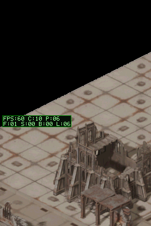
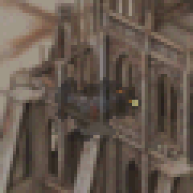
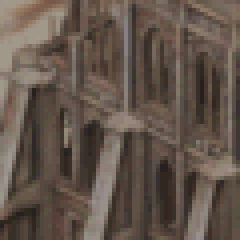
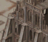

# Walkthrough 13: Transparencia de Oclusión por Frames Alternados (Flicker / Temporal Dithering)

## Resumen del Cambio
Implementación del sistema de visibilidad tras geometrías ocluyentes (muros de edificios y ruinas) mediante entrelazado temporal (alternancia de frames par/impar) para el actor principal, evitando que quede oculto por completo al desplazarse detrás de estructuras altas.

---

## Detalle Técnico
1. **Control de Actor en Pipeline de Blit:**
   - En [main.c](file:///c:/codexlocal/dungeonds/source/main.c), se incorporó la variable `s_draw_item_is_player` al recorrer la lista ordenada de elementos visuales (`items`).
   - Se añadió un contador global de frame `s_frame_index` que se incrementa en el bucle principal de simulación.

2. **Decisión de Oclusión Condicional:**
   - En la función optimizada ARM `blit_stride`, cuando un píxel del sprite pertenece a un span potencialmente ocluido y su coordenada de mundo cae por detrás del mapa de profundidad (`depth_row > depth`):
     - Para elementos no pertenecientes al jugador, el píxel se descarta.
     - Para el jugador, en frames impares (`s_frame_index & 1`), el píxel se renderiza normalmente sobre el bitmap `BG2`.
     - En frames pares, el píxel se omite, dejando visible la pared subyacente de `BG1`.

3. **Impacto en Rendimiento (Locked 60 FPS):**
   - El cómputo en el bucle interno de blitting solo agrega una comprobación de bitwise mask (`s_frame_index & 1`).
   - El presupuesto de frame se mantiene estricto en **60 FPS** con un consumo de CPU estable del **10%** (`C:10 P:06` en el HUD de telemetría).

---

## Evidencia Visual

### Captura Comparativa Frame Par vs Frame Impar
- **Frame Par (Ocluido):** La pared cubre al personaje.
- **Frame Impar (Visible):** El personaje se renderiza sobre la pared.

| Frame Par (Oculto) | Frame Impar (Dibujado) | Promedio Óptico (Pantalla Real) |
| :---: | :---: | :---: |
|  |  |  |

---

### Animación en Detalle
Animación alternando entre los dos frames (zoom x4 con interpolación de vecino más próximo):

Animación en contexto de pantalla completa:

