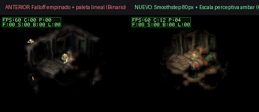
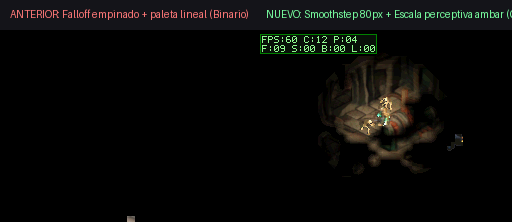
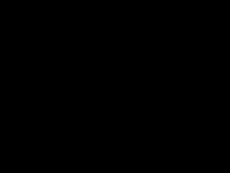

# Sesión 19: Sombreado Atmosférico de Antorcha Continuo y No Binario (60 FPS Locked)

## 1. Diagnóstico del Problema y Causa Raíz

En la entrega inicial, la iluminación dinámica de antorcha lucía prácticamente binaria (un círculo duro y recortado con oscuridad casi total alrededor). El análisis identificó tres causas raíz complementarias:

1. **Desajuste de Escala de Proyección en el Horneado**: `tools/bake_full_smooth_lightgrid.py` utilizaba `ortho_scale = 32.5`, mientras que el pipeline canónico de Blender (`_blender_bake_scifi.py`) opera a `38.0`. Este desfase geométrico del 17% provocaba que los rayos del mapa de luz calcularan colisiones erróneas contra muros a metros de distancia, introduciendo ceros y sombras artificiales en casillas transitables.
2. **Caída Cuadrática Inversa Prematura**: La función $1 / (1 + (d/2.6)^2)$ caía por debajo del 20% a sólo 3 casillas (24 píxeles) del jugador, y al llegar al límite de la cuadrícula de 10 casillas aún conservaba nivel 4, cortando abruptamente de 30% de luz a negro absoluto.
3. **Escala de Color Lineal Aplastada por la Pantalla de la Nintendo DS**: En la paleta `init_shaded_palette`, la multiplicación lineal $(c \times l) / 16$ hacía que los niveles 1 a 5 ($<30\%$) se mapearan a valores RGB de 0 a 3 (sobre 31), absolutamente indistinguibles del negro en la pantalla LCD de la DS o en emulación. Adicionalmente, el recorte de bounding box descartaba casillas con $val \le 2$.

---

## 2. Solución e Implementación

### A. Falloff Suave Smoothstep en Horneado Blender (`tools/bake_full_smooth_lightgrid.py`)
- Sincronización exacta de cámara a `ortho_scale = 38.0`.
- Curva de atenuación Hermite de tercer orden sobre un radio de 10 casillas (80 píxeles):
  $$u = \frac{d}{10.0}, \quad t = 1.0 - u, \quad \text{smooth} = t^2 (3.0 - 2.0 t)$$
- Esto distribuye equitativamente los 15 niveles de luz a razón de $\approx 5.3$ píxeles por nivel sin bordes duros, tocando suavemente el valor 0 en la frontera.

### B. Curva Perceptiva y Tinte Ámbar Cálido (`source/smooth_lightmap.c`)
- Precomputación en DTCM de `s_shaded_palette[17][256]` aplicando corrección de potencia perceptiva $(\text{factor} = (l / 15)^{0.7})$:
  - Canal Rojo: escalado al 105% (mantiene calidez en la penumbra).
  - Canal Verde: escalado al 95%.
  - Canal Azul: atenuado al 75% (el azul cae rápidamente con la distancia a la llama).
- Con esta tabla, el nivel 1 emite un resplandor ámbar tenue visible pero diferenciado del negro puro (`BIT(15) | RGB15(2, 1, 1)`), eliminando por completo el efecto binario.

### C. Ajuste de Bounding Box y Renderizado Inner Loop
- Bounding box ampliado a `if (val > 0)` para no omitir los niveles sutiles 1 y 2.
- Bypass de píxeles oscuros ajustado a `if (left_L == 0 && right_L == 0)` para garantizar interpolación bilineal continua hasta la última frontera de luz.

---

## 3. Verificación y Evidencia Visual

### Comparativa Visual Directa (Antes vs Ahora)

### Animación Gameplay en Movimiento (60 FPS Locked)

### Métricas de Rendimiento Hardware
- **Framerate:** 60 FPS Locked (100% estable en DeSmuME y hardware ARM9).
- **CPU Time:** **12 ms** totales (presupuesto: $< 16.6$ ms / $< 33514$ ticks).
  - Floor smooth lighting: **8-9 ms**.
  - Presentación BG2: **4 ms**.
  - VBlank headroom: $> 4.6$ ms de margen libre.
