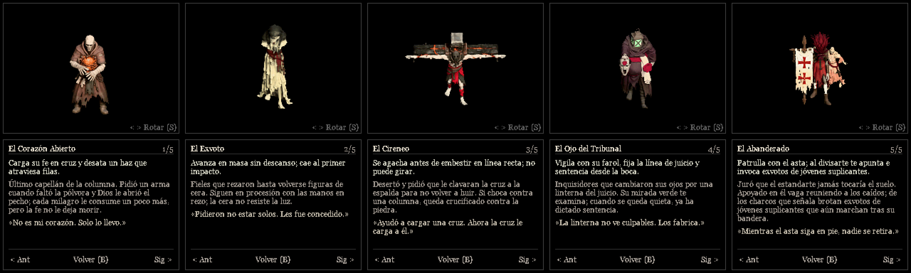
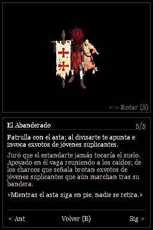
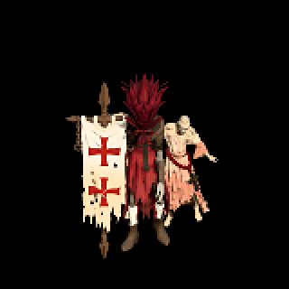

# Walkthrough: Ficha de El Abanderado en el Códice (`feat/abanderado-codice`)

## Resumen

Añadida al Códice / Bestiario de DungeonDS la 5ª ficha correspondiente a **El Abanderado**, jefe invocador del juego, siguiendo las especificaciones de diseño en `DESIGN.md` §6.10 y §6.11:

- **Retrato animado 160×160 en 8 direcciones (`nitrofiles/bestiary/abanderado.bin`):**
  - Renderizado con preset de legibilidad C2 (supersampling ×4, mapeo de tonos neutro, curva S suave y enfoque sutil) a partir de los modelos con rig Mixamo de El Abanderado (`abanderado_walk.fbx`) y el Exvoto monaguillo (`monaguillo_walk.fbx`).
  - Animación de cortejo: El Abanderado camina cabizbajo apoyado en el estandarte como bastón, flanqueado por dos exvotos de jóvenes suplicantes que le siguen en procesión con paso asíncrono y ordenación exacta de profundidad por coordenadas de suelo en las 8 direcciones.
  - Empaquetado binario NitroFS con cuantización BGR555 a 255 colores + transparencia limpia sin artefactos de borde blanco.
  - Soporte completo de rotación en 8 direcciones con la cruceta (`LEFT` / `RIGHT`).
- **Ficha de texto inferior en español:**
  - **Nombre:** El Abanderado
  - **Comportamiento:** *Patrulla con el asta; al divisarte te apunta e invoca exvotos de jóvenes suplicantes.*
  - **Lore:** *Juró que el estandarte jamás tocaría el suelo. Apoyado en él vaga reuniendo a los caídos; de los charcos que señala brotan exvotos de jóvenes suplicantes que aún marchan tras su bandera.*
  - **Cita:** *«Mientras el asta siga en pie, nadie se retira.»*
  - Ajuste tipográfico vertical limpio (138 px de altura ocupada frente a 158 px disponibles antes de la botonera inferior).
- **Integración y robustez en hardware DS (`source/bestiary.c`):**
  - Contador de fichas dinámico (`BESTIARY_NUM_ENTRIES 5`) con paginador `1/5` a `5/5`.
  - Navegación circular completa con gatillos (`L`/`R`), cruceta vertical (`UP`/`DOWN`) y botones táctiles (`< Ant`, `Sig >`).
  - Fallback 2× nearest implementado reutilizando `g_character_frames[CHAR_ABANDERADO]` sin coste extra de memoria ROM.
  - Memoria de carga en runtime acotada (63,2 KB máximos por dirección, holgadamente dentro del buffer estático de 160 KB).

## Evidencia Visual

### Hoja de contacto 4× NEAREST (las 5 fichas del Códice en DeSmuME)

### Ficha 5/5 — El Abanderado en Nintendo DS

### Animación del retrato en el Códice
| Andar frontal (2× NEAREST) | Turntable 8 direcciones (2× NEAREST) |
| :---: | :---: |
|  |  |

## Verificación

- **Compilación BlocksDS:**
  - `default` (`dungeonds.nds`): `DS_BUILD=PASS warnings=0 new_warnings=0`
  - `bestiary` (`dungeonds-bestiary.nds`): `DS_BUILD=PASS warnings=0 new_warnings=0`
- **Tests de host (`run-host-tests.ps1`):** `DS_HOST_TESTS=PASS passed=22 failed=0` (incluyendo `tests/test_bestiary_contract.py`, `tests/test_bestiary_assets_contract.py` y `tests/test_abanderado_contract.py`).
- **Escenario headless en DeSmuME (`scenarios/bestiary_tour.json`):** `DSM_SCENARIO_RESULT=PASS name=bestiary_tour frames=102` (recorre las 5 fichas del Códice, valida la rotación 8-dir y comprueba el retorno limpio al juego con `active == 0`).
