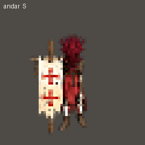
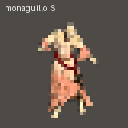
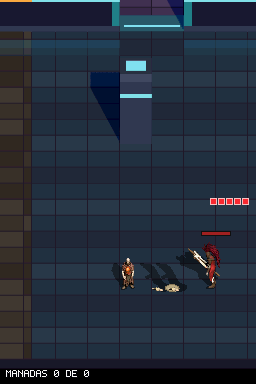
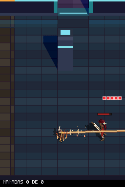

# El Abanderado (jefe, versión mínima)

**Rama:** `feat/abanderado-jefe` (worktree `.worktrees/abanderado-jefe`)  
**Fecha:** 2026-11-14  
**Diseño:** `DESIGN.md` §6 («El Abanderado (jefe, versión mínima)»)

## Qué se ha entregado

1. **Arte y sprites C2:**
   - **Abanderado** (`60×60`, preset C2): andar cabizbajo apoyado en el estandarte como bastón (`abanderado`) y gesto de apuntar levantando la cabeza e inclinando el asta (`abanderado_point`), generados con `tools/characters/build_abanderado.py`.
   - **Exvoto monaguillo** (`40×40`, preset C2): animación de andar lento rezando transferida al modelo monje zombi (`tools/characters/build_monaguillo.py`).
   - Empaquetados en `source/player_sprite.c` / `include/player_sprite.h` mediante `tools/generate_player_sprites_c.py`.
2. **Comportamiento en la ROM (`dungeonds.nds`):**
   - **Aparición cada 2:00:** el primer Abanderado aparece a los 2:00 de partida (`7200` frames); el siguiente reloj de 2:00 arranca al morir el anterior.
   - **Patrulla siguiendo la cámara:** camina despacio por puntos caminables dentro de la banda visible actual de la cámara (y acelera para reentrar si se queda atrás).
   - **Detección y gesto:** al ver al jugador a ~1 pantalla con línea de visión, se detiene, levanta la cabeza e inclina el estandarte hacia él; si lo pierde de vista ~2 s, vuelve a patrullar.
   - **Invocación de charcos y monaguillos:** mientras apunta, crea un charco color crema desaturado a medio camino cada ~3 s del que emergen poco a poco hasta 2 Exvotos monaguillo (~0,5 s, invulnerables e inmóviles mientras emergen; tope de 8 vivos).
   - **Vida y recompensa:** aguanta 8 disparos cargados (`1200` de vida), muestra barra flotante rojo/negro sobre la cabeza y al morir suelta siempre una cruz de curación.

## Verificación

- **Compilación:** `dungeonds.nds` (`default`) y `dungeonds-sandbox.nds` (`sandbox`) compilados con 0 warnings.
- **Tests de host:** `tests/test_abanderado_contract.py`, `test_character_muzzle.py`, `test_sprite_ground_anchor.py`, `test_shooter_contract.py`, `test_ai_perf_contract.py`, `test_blit_runs_contract.py` — todos en verde (`OK`).
- **Escenario headless en DeSmuME:** `scenarios/abanderado_jefe_ciclo.json` (`PASS`, 129 frames).

## Evidencia

| Arte Abanderado | Arte Monaguillo |
| :---: | :---: |
|  |  |

| Charco crema y monaguillos emergiendo | Disparo al jefe y barra de vida |
| :---: | :---: |
|  |  |
