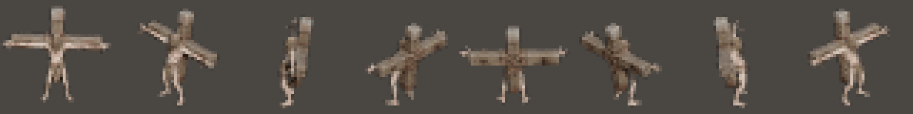
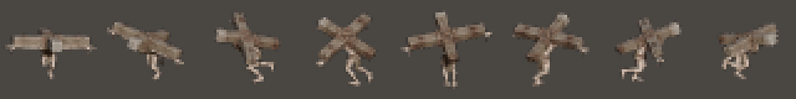
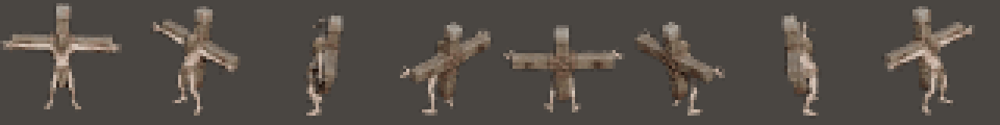
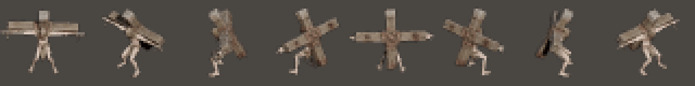

# Animaciones del Cireneo con la cruz (2026-11-12, rama `feat/anim-cireneo`)

Primer enemigo de la demo de la catedral (`DESIGN.md` §6.10): gigante crucificado que camina, con los brazos clavados al travesaño y la cruz atornillada a la espalda. Tripo rigea y anima el cuerpo, pero no la cruz, así que la cruz se monta en Blender por script.

## Resultado a escala de juego

Sprites del lab (celda de 40 px, luz `neutral`, sin contorno) en las 8 direcciones, ampliados 4x:

**Andar** (Tripo, brazos fijados en cruz)

**Carga** (Tripo, con +10° de cadera y +11° por vértebra de inclinación)

**Telegrafía** (keyframes a mano; el último frame se mantiene congelado)

**Atascado** (keyframes a mano, bucle)

Hojas de contacto en Blender (vistas frontal, de perfil y cenital): `assets/sheet_walk.png`, `sheet_charge.png`, `sheet_telegraph.png` y `sheet_stuck.png`. Del lab se guardan `spritesheet.png`, `settings.json` y `collage.gif` en `assets/lab_<clip>/`.

## Cómo se hace

- **Fuentes:** `assets/models/characters/cireneo/source/` (personaje de Tripo con andar y carga; cruz en `cruz/`).
- **Script:** `tools/characters/build_cireneo.py`. Pega la cruz al hueso `mixamorig:Spine2` como malla con skin (peso 1,0), fija `Shoulder/Arm/ForeArm/Hand` rectos y horizontales en todos los frames, quita el desplazamiento horizontal de `Hips` y crea a mano la telegrafía y el atascado. Los parámetros de la cruz (`CRUZ_*`, `CRUZ_ARM_EMBED`, `PALM_TWIST`) están al principio.
- **Comando:** `"C:/Program Files/Blender Foundation/Blender 5.2/blender.exe" -b -P tools/characters/build_cireneo.py -- <ruta del worktree>`; en Git Bash hay que pasar la ruta en formato Windows (`$(pwd -W)`).
- **Salida:** `assets/models/characters/cireneo/cireneo_{walk,charge,telegraph,stuck}.fbx`, una acción por archivo. No se versionan (`.gitignore`): se regeneran con el script.
- **Lab:** `node tools/lab/export_character_headless.cjs <fbx> <out> --template assets/sprites/characters/marine/settings.json --outline none`. El preset de luz se llama `neutral`; con `--light Neutra` sale sin luz.
- **Hojas de contacto:** `blender -b -P tools/characters/verify_sheet.py -- <fbx> <png> [nframes] [res]`.

## Correcciones durante la sesión

1. En la primera versión los brazos no tocaban el travesaño: se notaba al inclinarse (carga y telegrafía), porque la cruz estaba detrás de la espalda y los brazos salían del hombro. Ahora el script mide la cara trasera de los brazos y la cara delantera del travesaño, y adelanta la cruz para que se solapen 2,5 cm.
2. El primer export del lab salió quemado porque el preset de luz no existía.

## Pendiente

- **Tamaño:** sale del mismo tamaño que los demás (celda de 40 px). El diseño pide unos 46 px; se decide al meterlo en el juego (celda mayor o escala en el lab) y cuesta el doble de memoria.
- **Integración:** exportar a `assets/sprites/characters/cireneo/` y conectarlo a la FSM del cargador (andar → telegrafía → carga → atascado). Según el presupuesto de `walkthroughs/concepto-demo-personajes/prompts-animaciones-enemigos.md`, entran andar y carga completos, 1 frame de la telegrafía y 2 del atascado.
- Los clavos de las manos cuelgan bajo el travesaño; a 40 px no se ven.
- No hay medición en DS: este trabajo solo genera assets.
