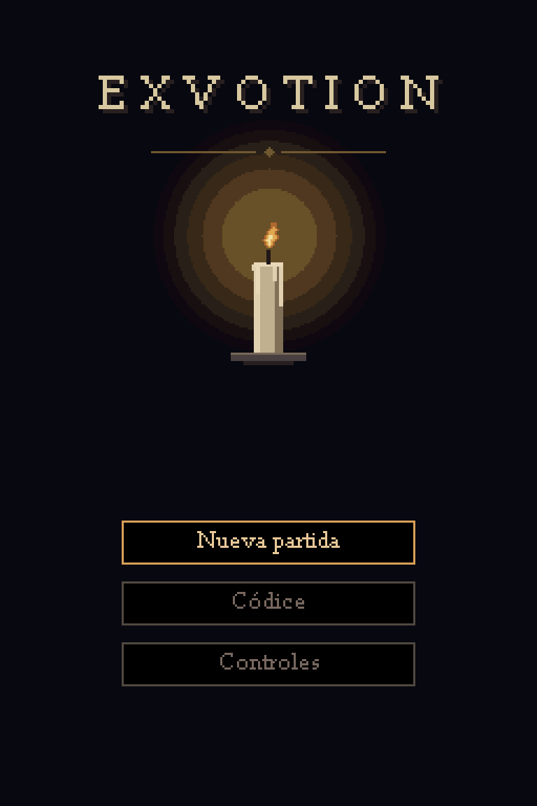
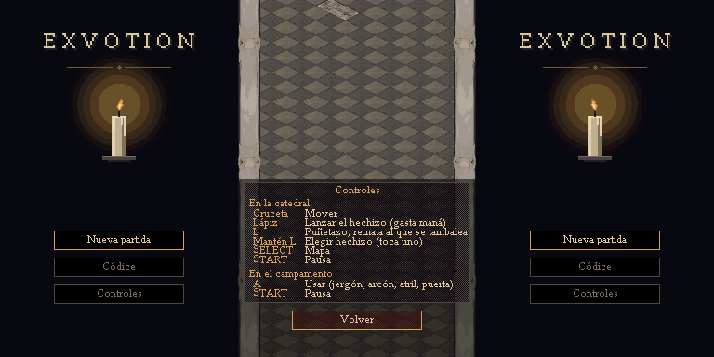
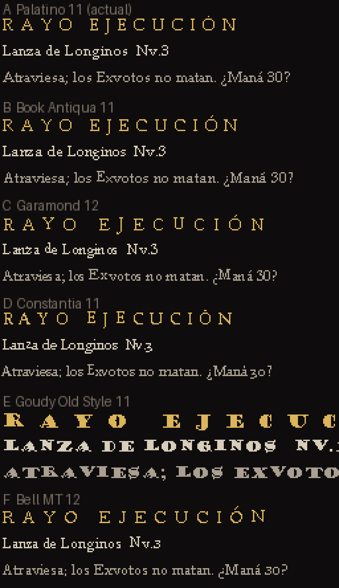
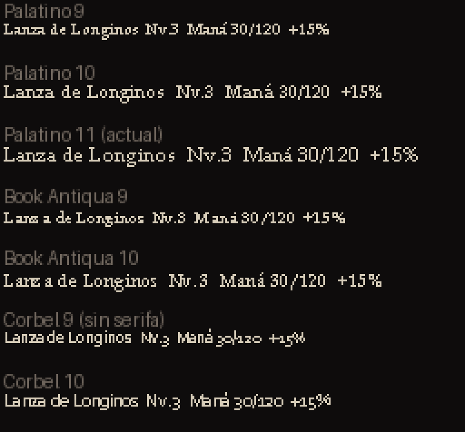
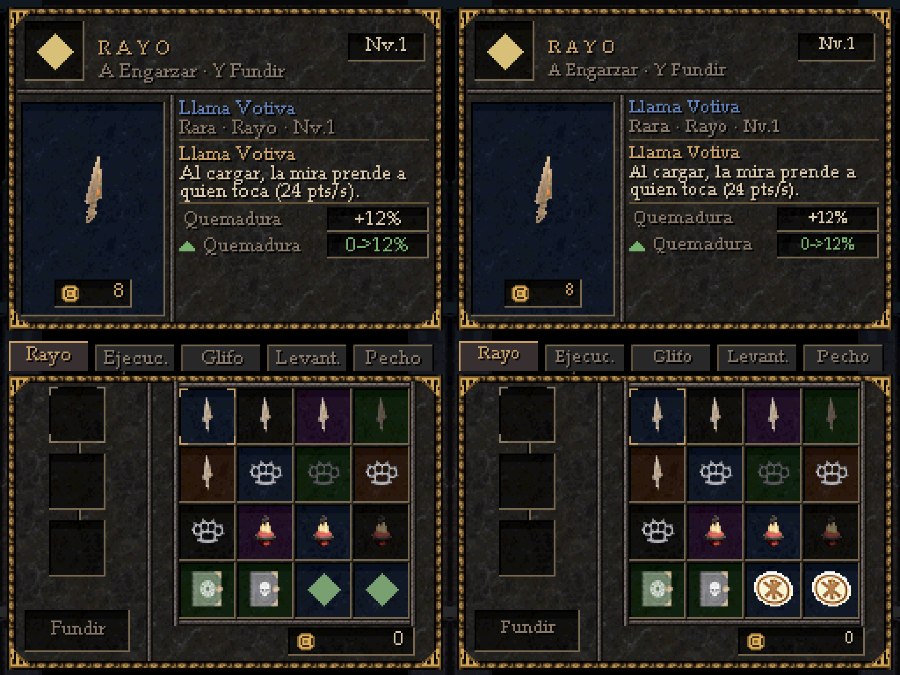

# ARPG: acabado de título e inventario

Rama `claude/arpg-acabado-0baf54` (desde `proto/arpg`), 2026-11-23.

## 1. Pantalla de título

Decisiones del usuario: nombre provisional **EXVOTION** (el definitivo, por decidir) e imagen «solo nombre y vela» (frente a un exvoto de cera o la nave con altar). Tras verla, pidió que la pantalla de abajo no enseñe el suelo de la catedral: las dos pantallas comparten el mismo fondo casi negro.

- Arriba: nombre en versalitas espaciadas a doble tamaño, filete con rombo, vela de cera con halo tenue y llama que parpadea (se repinta solo la llama, cada 4 fotogramas).
- Abajo: los botones sobre el mismo fondo. Controles sigue sobre el suelo oscurecido.

Código: `source/title_screen.c` (nuevo), `source/main.c` (la pantalla de arriba del título se pinta como la del inventario), `source/menu.c` (fondo de abajo). Escenario de evidencia `scenarios/arpg_titulo.json`.

## 2. Tipografía del inventario

Pruebas a resolución real (3×) de Palatino, Book Antiqua, Garamond, Constantia, Goudy, Bell y Corbel. Elegida **Palatino 10** (antes 11) solo para el inventario: fuente propia `inv_font` generada con `tools/gen_bestiary_font.py --prefix inv --size 10 --line-height 12`. Códice, menús y cartas siguen con Palatino 11.

Antes (izquierda) y después (derecha), de la ROM:

## 3. Sonidos

Aplazado: al usuario le gustan más los sonidos gratuitos (`lab_*`) que muchos de ElevenLabs (p. ej. el de ejecución). Se monta una ROM de prueba de sonidos en sesión aparte (`arpg-prueba-sonidos`) para apuntar cuáles chirrían.

## Verificación

Builds sin avisos; `arpg_titulo` y `arpg_menus_inicio_final` PASS (solo evidencia). Sin medir en la DS (el título y el inventario no tocan el combate). Documentos: `DESIGN-ARPG.md` §3 y §8, `STATUS-ARPG.md`.
