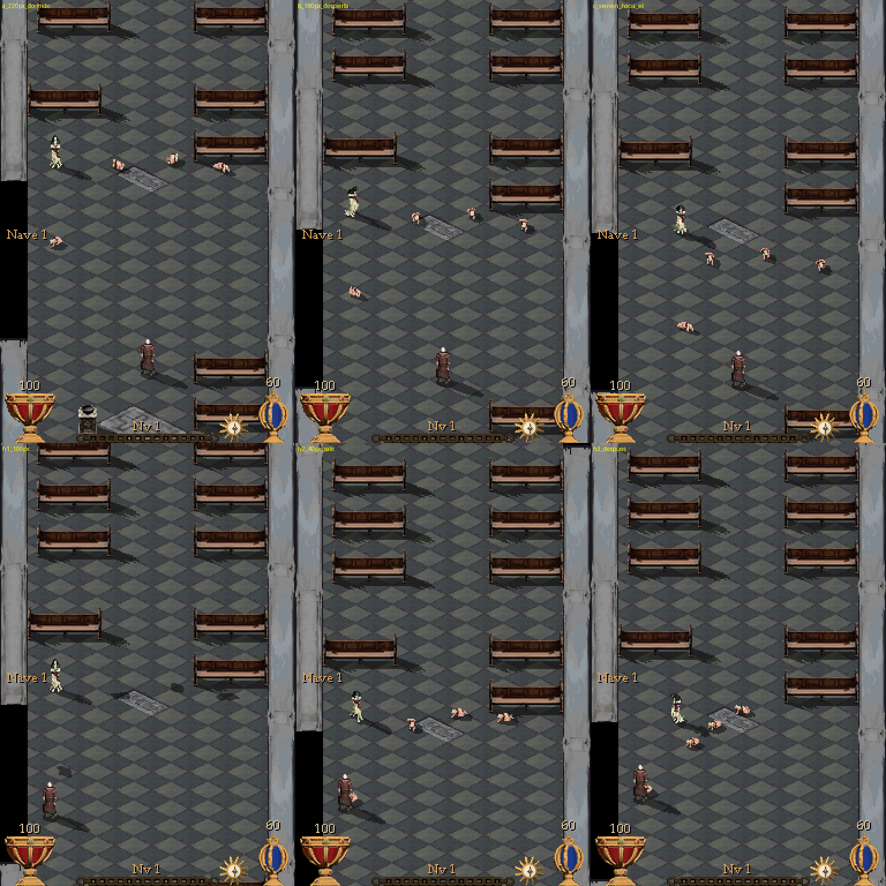

# ARPG: aviso de grupos a 200 px

## Problema
Los grupos de enemigos despertaban cuando el héroe estaba a 96 px, casi encima, sin margen para reaccionar.

## Decisión
El usuario fijó 200 px: todos los grupos despiertan cuando el héroe está a ≤200 px de suelo de cualquier miembro. Las emboscadas siguen a 48 px y el Campanero conserva su activación (margen de 36 px dentro de su bloque). Detalle en `DESIGN-ARPG.md` §12 «Activación».

## Verificación
Verificador aparte, escenario `scenarios/arpg_aviso_grupos.json`: criterios 1, 2, 3 y 5 PASS. El jefe NO queda cubierto en el emulador porque `arpg_campanero_toques` ya fallaba en la base. Pendiente: comprobar en la DS que el Campanero no arranca antes de entrar en su sala.

## MDs
Solo `DESIGN-ARPG.md` (§12) y `STATUS-ARPG.md`; el resto sin cambios.
