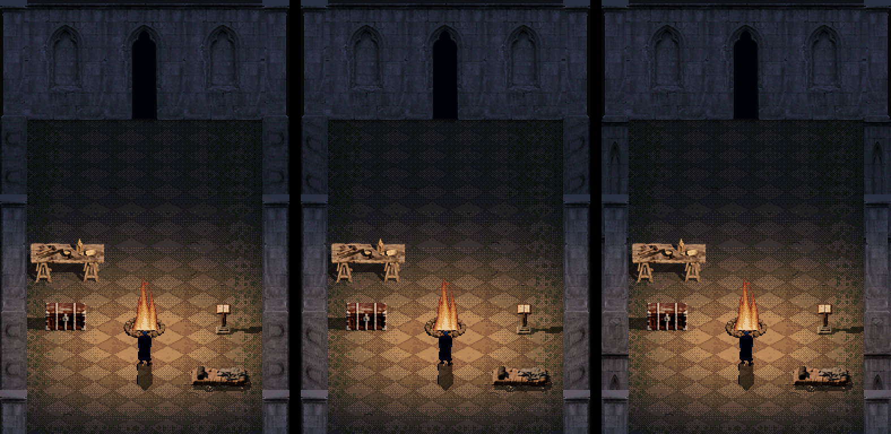
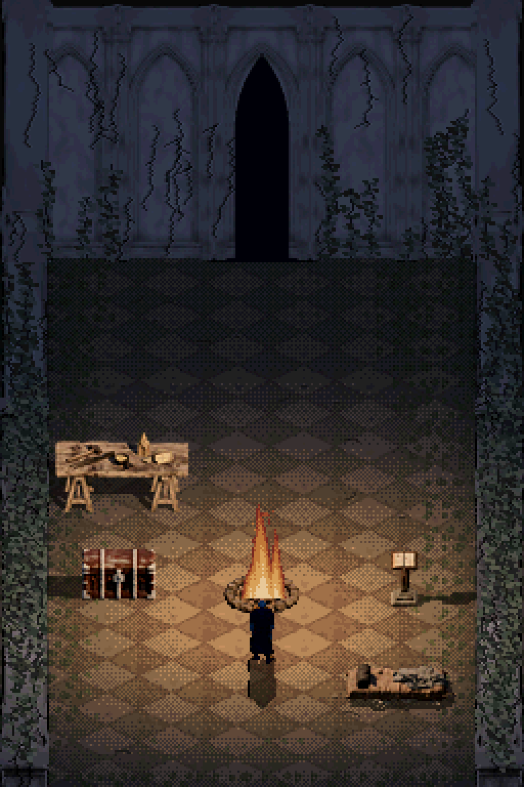
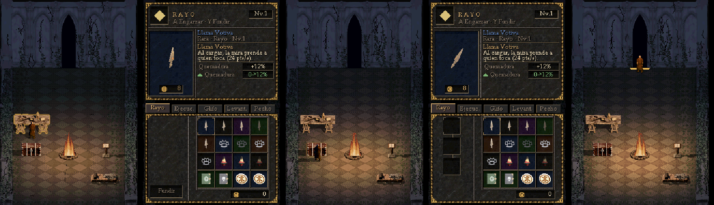
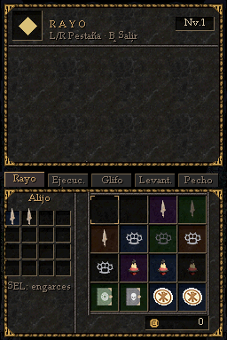
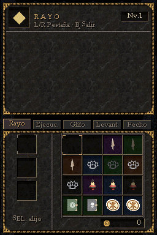

# ARPG: campamento nocturno cerrado

Rama `claude/arpg-campamento-19aed8` (sobre `proto/arpg`), 2026-11-23. Sin mergear.

## Qué cambia para el jugador
- **Muros:** el campamento usa los muros de la catedral (frontal con el portón en arco y laterales), con grietas y hiedra trepando para que se lea como patio exterior. Sustituye al kit de 3 piezas y a sus laterales de piedra girada.
- **Mesa = Crisol de desguace:** `A` junto a la mesa abre la bolsa sin engarces; `A`/`Y` marca la reliquia y pide confirmar; funde por cera. El arcón queda solo con engarces. La pausa de la catedral conserva ambos.
- **Foco sin rótulos:** el objeto utilizable más cercano respira un halo cálido; el portón brilla en el umbral.
- **Cera y pociones:** decidido «solo desguace»; la cera solo se acumula, no hay pociones.

## Decisiones del usuario (registradas en `DESIGN-ARPG.md` §4)
Uso de cera → solo desguace; foco → brillo en el contorno; muros → muro de la catedral con más grietas e hiedra, también el frontal.

## Evidencia (capturas de la ROM)
- Ronda de laterales A | B | C (descartada): 
- Muros de la catedral con hiedra, vista y portón: 
- Foco en la mesa, Crisol, arcón (con engarces, sin Crisol) y portón: 

## Verificación
Build `default` 0 avisos. Escenario `camp_foco_crisol` (evidencia, `suite: false`) PASS. Sin tests ni escenarios de cierre (la versión no está aprobada para mergear) y sin `perf` en la DS: el halo recorre un contorno precalculado de ≤1500 px por frame.

## Documentos
`DESIGN-ARPG.md` §4, `STATUS-ARPG.md`, `TECHNICAL.md` (campamento) y `assets/MANIFEST.md` actualizados; falta sincronizarlos con `main` al cerrar.
- **Alijo del arcón (16 huecos):** columna izquierda del arcón; A guarda/saca, toque o arrastre con el lápiz, `SELECT` alterna con los engarces:  
