# Campaña B «Tres penitencias» (ARPG, 2026-11-27)

Rama `feat/campana`, mergeada en `arpg` (el trabajo continúa con feedback del usuario).

## Qué cambia para el jugador
- Campaña de la demo: **Don Tomás** (lista del coro) → **Sor Leonor** (denuncia) y **la Misa** (llave de la capilla, opcional) → **Abanderado**. Rejas con objeto en la Nave 1, la Capilla con llave y la Nave 4. Diseño vigente en `DESIGN-ARPG.md` §7, «Campaña de la demo».
- Se puede bajar andando entre naves; pasillo libre al pie de las naves 1-4.
- La hoguera da la misión clara (ruta en texto) y el mapa de SELECT marca la sala objetivo.
- Reja con luz de sala, sombra y oclusión por profundidad.
- Bebés que gatean, población inicial de Bebés (sin Monaguillos en la Nave 1) y monja de cera con 60 de vida que se tambalea al primer golpe (ver también `../bebe-gatea/walkthrough.md`).
- Registro `/dungeonds_campana.log` en la SD (eventos con segundos y sala).

## Guías publicadas
- Guía de la campaña: https://claude.ai/artifact/LB5PmZoqzUR6hU7ruoTJD5
- Mapa: https://claude.ai/artifact/Q1Lc6FUyQPXaE5gNjRQGXJ

## Evidencia (capturas de la ROM)
Guía paso a paso:

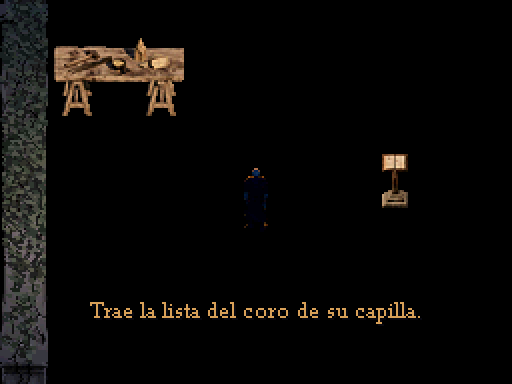 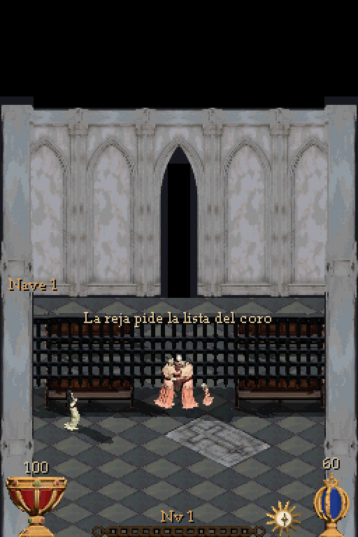 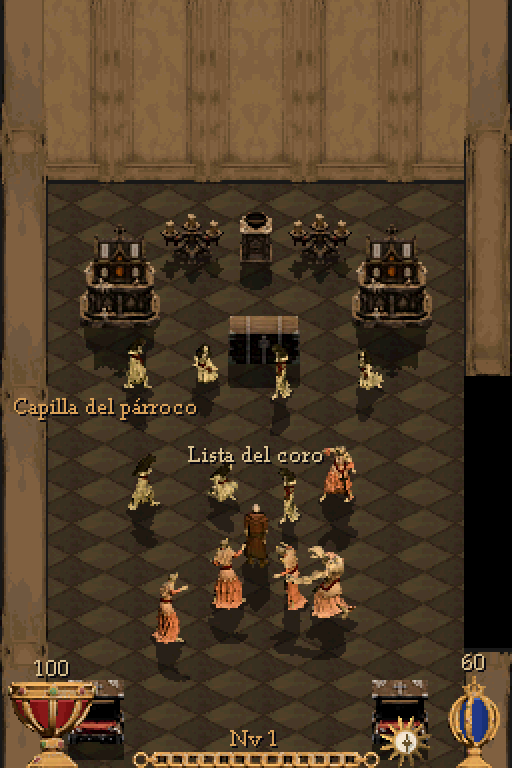

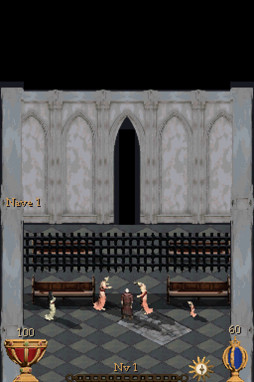 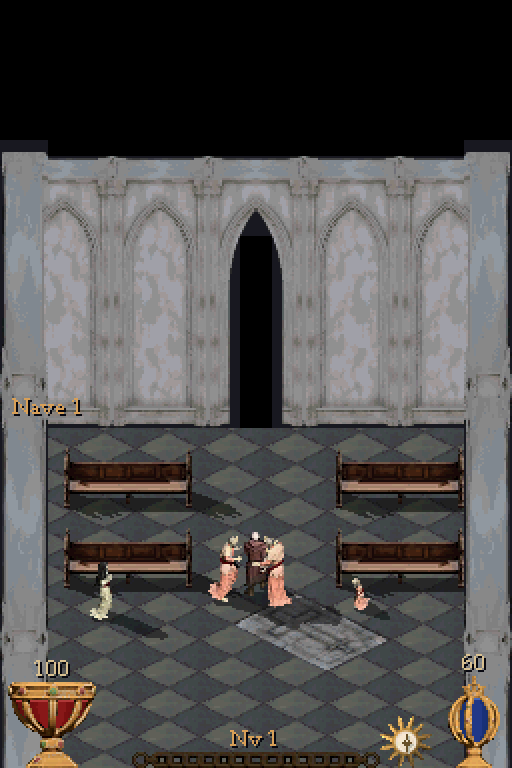 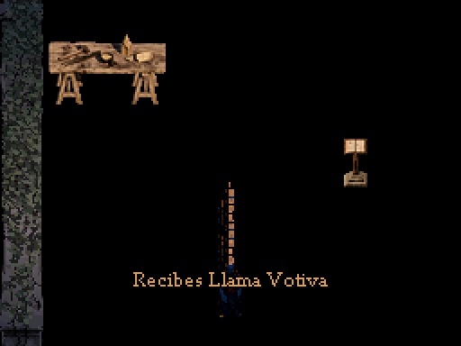

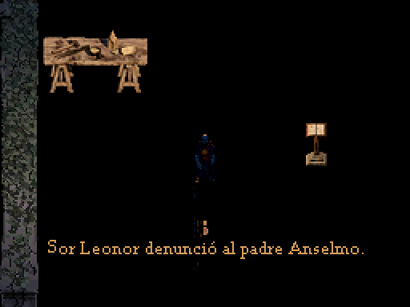 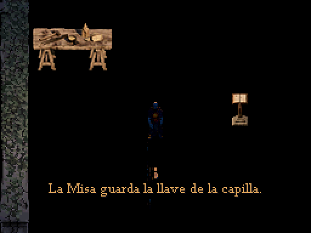

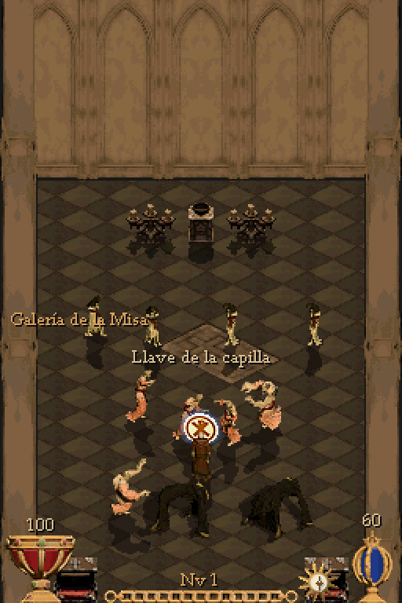 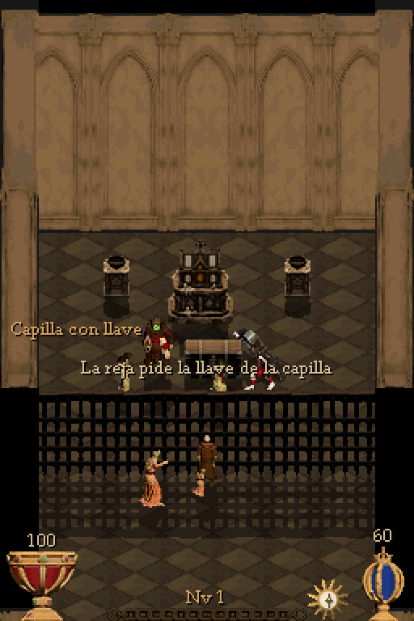 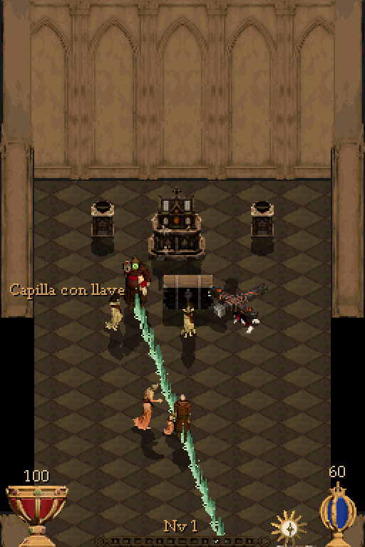 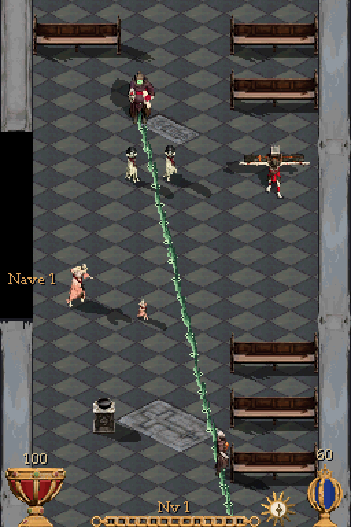

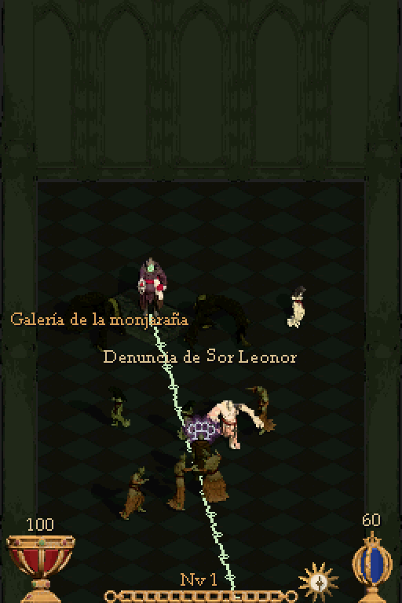 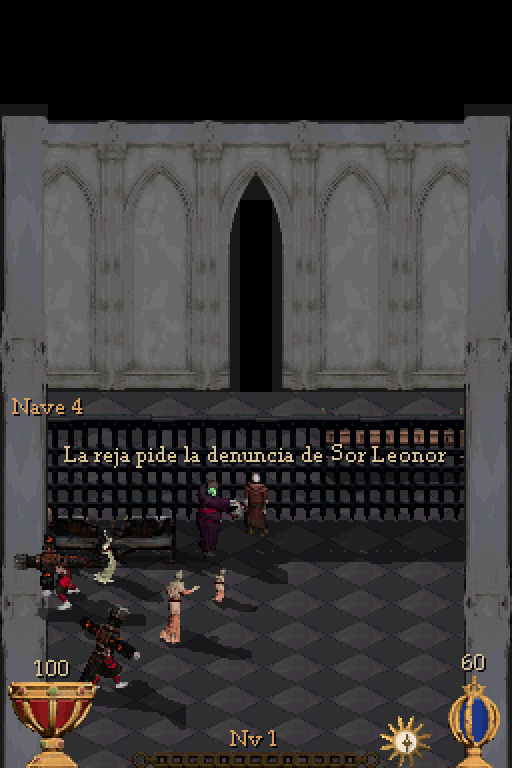 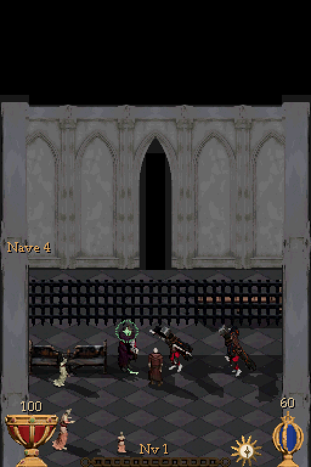 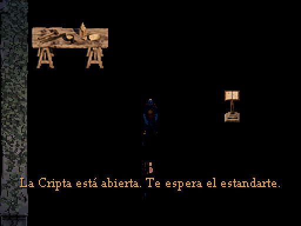 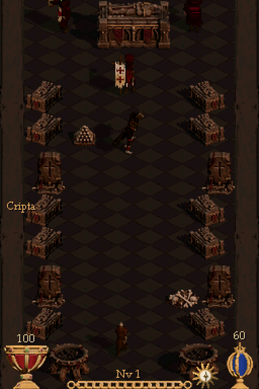

Reja con luz y sombra de sala:

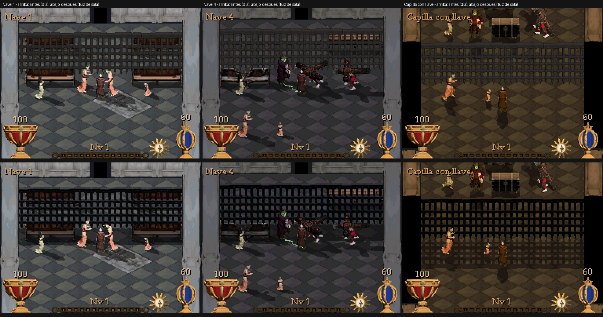

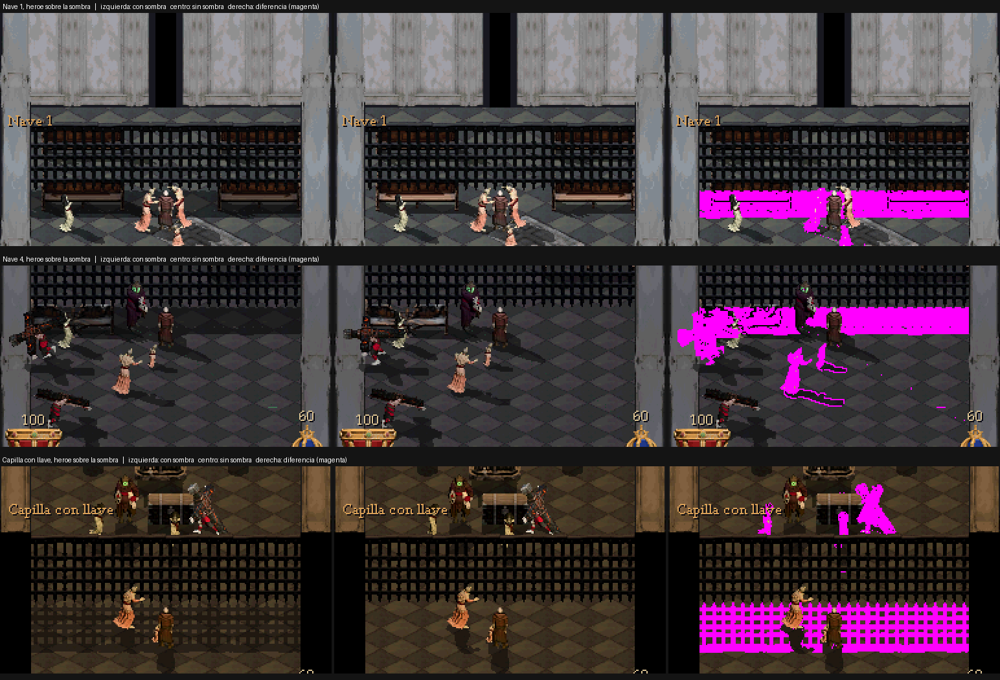

Misión clara y marca en el mapa de SELECT (Nave 1):

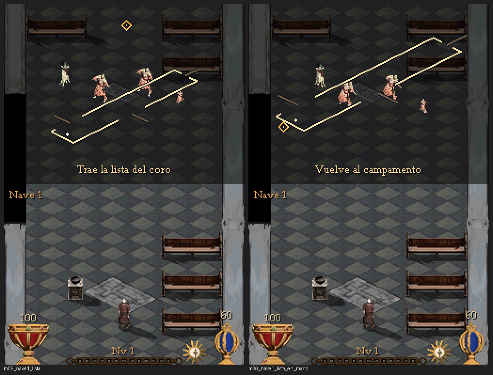

## Verificación
- Compilación sin avisos nuevos; escenarios `arpg_campana_*` PASS en el merge; verificador aparte en la rama.
- Fallos previos conocidos (ya fallaban antes): `arpg_sala_limite_sur`, `arpg_reposos`.
- No medido en la DS: falta `perf` con gente a ambos lados de la reja.

## MDs
`DESIGN-ARPG.md` (campaña de la demo, sala 12 renombrada «Galería de bajada»), `STATUS-ARPG.md` y `STATUS-ARCHIVE.md`. Sincronizados con `roguelike`.
