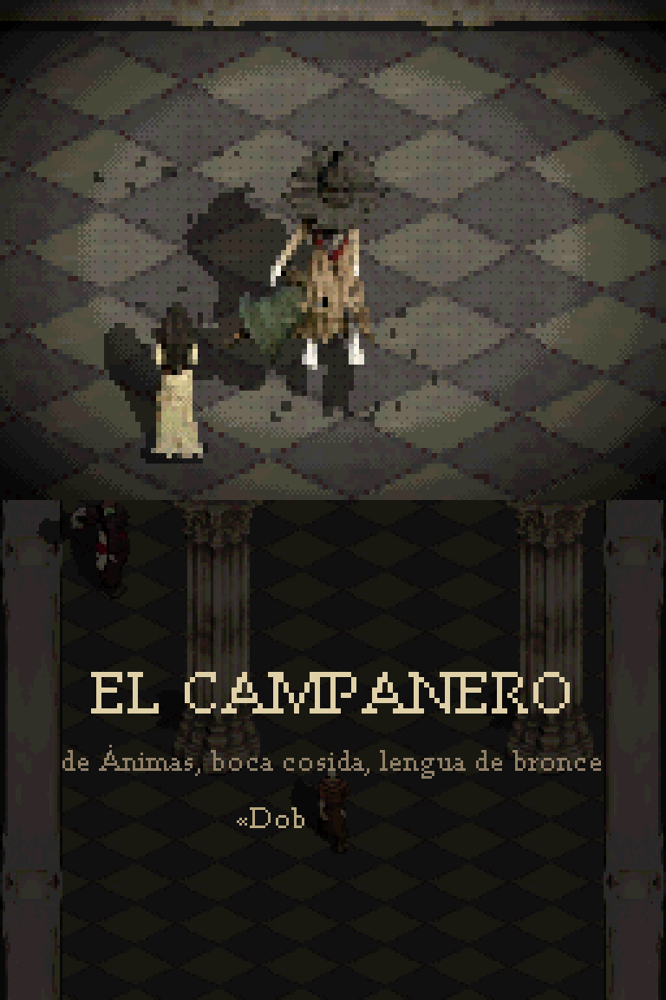
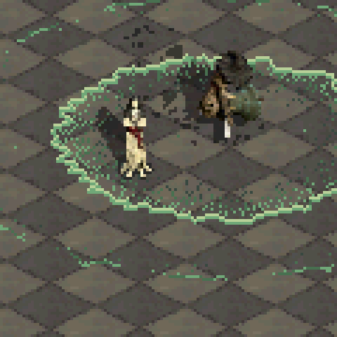
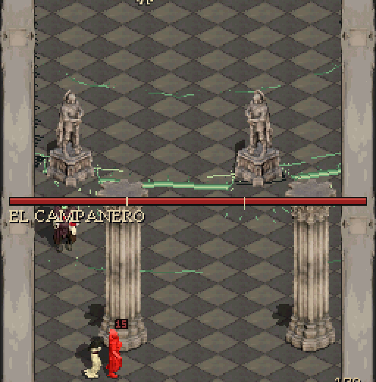
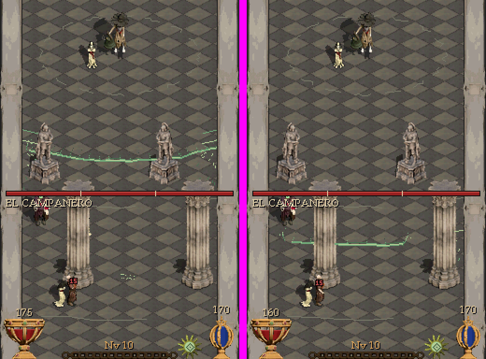

# ARPG: El Campanero de Ánimas, arte, ondas y rendimiento en la DS

Rama `feat/arpg-campanero`, sobre `proto/arpg`, 2026-11-23. Diseño en `DESIGN-ARPG.md` §9; técnica en `TECHNICAL.md` §5.5.

## Qué cambia para el jugador

- **Arte del jefe (5 clips: quieto, andar, toque, tañido, muerte):**
  - Los brazos van abiertos para que la campana no se meta en el cuerpo.
  - Agarra la campana por el centro del yugo y la campana cuelga recta.
  - El tañido es un péndulo del brazo y la campana.
  - Se han quitado las motas sueltas que había en la sombra proyectada.
- **Intro propia del Campanero** (antes salía la del Abanderado).
- **Toque mayor (verde, hace daño):** las columnas y estatuas lo cortan en seco. La zona segura de detrás no se pinta. El corte se marca con un rebote de chispas y un arco, y los extremos del anillo se rizan.
- **Tañido menor (anula glifos, no hace daño):** ahora es solo una línea fina gris discontinua, para no confundirlo con la onda que hace daño.
- **Rendimiento en la DS:** en combate llegan a tiempo ~96 % de los fotogramas (antes, 30-45 FPS). Hubo tres causas:
  - El dibujo de las ondas es por píxel, así que solo se abarata dibujando menos píxeles.
  - El toque arrancaba cuatro sonidos en el mismo fotograma. Ahora van escalonados.
  - La animación se leía del cartucho en cada cambio. Ahora, en la variante `perf`, está entera en memoria.

  Los pocos retrasos que quedan coinciden con picos del héroe, que también salen en la intro. Los está tratando la sesión de carga en memoria.

## Evidencia (ROM real)

Esta captura es anterior a quitar la zona segura pintada: el corte y el rebote siguen igual, pero ya no se oscurece el suelo de detrás.

## Verificación

- Builds `arpg-campanero` y `arpg-campanero-perf` sin avisos nuevos.
- Escenario `arpg_campanero_sombra_columna` PASS: detrás de la columna, ningún toque hace daño.
- `test_guardrails` PASS.
- Cinco mediciones `perf` en la DS, jugando el combate.
- Escenarios nuevos: `arpg_campanero_intro_capturas` (capturas) y `arpg_campanero_prof` (perfil, variante `arpg-campanero-prof`). Ninguno entra en la batería.

## Pendiente

- **Equilibrar el encuentro** (`DESIGN-ARPG.md` §9). Las coberturas quedan fuera del alcance del Rayo, así que hay que rediseñar la sala y fijar el nivel de referencia. Queda para una sesión de balance.
- Sala y zona definitivas (zona 2).
- El clip de muerte no se reproduce.
- Momento de entrada del Cireneo.
- La carga de las animaciones del jefe en memoria fuera de la variante `perf`, que depende de la sesión de memoria.

## Documentos

Actualizados:
- `DESIGN-ARPG.md` §9: aspecto de las ondas, el tañido gris y el encuentro sin equilibrar.
- `TECHNICAL.md` §5.5.
- `assets/MANIFEST.md`: tamaño del `campanero.bin`.
- `STATUS-ARPG.md`.
