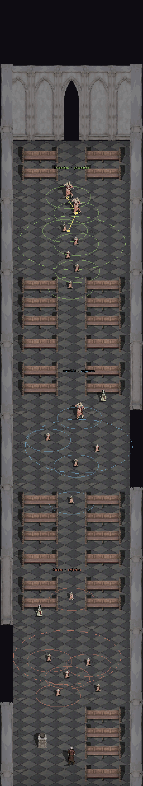
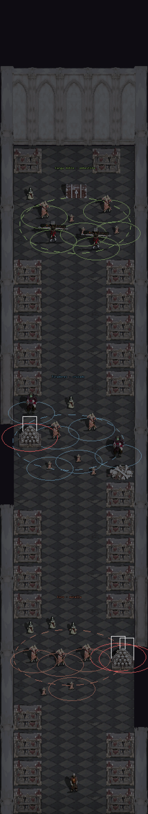
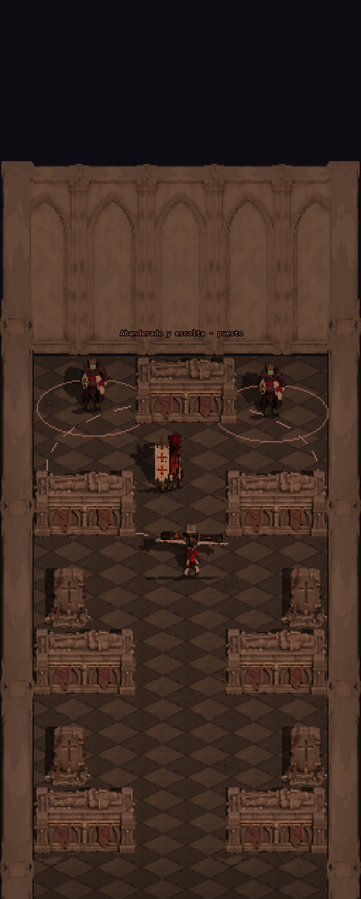

# ARPG: encuentros de la zona 1 (diseño)

Rama `feat/arpg-encuentros`, 2026-11-25. Entrega de diseño y herramienta: la ROM no cambia.

## Qué es

Las 16 salas de la zona 1 tienen sus grupos de enemigos colocados a mano: formaciones, reposo de cada grupo, emboscadas y progresión por naves. La decisión está en `DESIGN-ARPG.md` §12; las posiciones, en `tools/poster/salas/sala_00.py` a `sala_15.py`, que el póster (`tools/poster/poster_arpg.py` y `poster_arpg_juego.py`, con `--sala`, `--revision` y `--out-sala`) dibuja sobre cada sala. El encargo por sala está en [`brief_salas.md`](brief_salas.md).

Revisión interactiva (artifact): https://claude.ai/artifact/9sREeS9i36REYZW61dWUxg (copia local: [`assets/encuentros.html`](assets/encuentros.html)).

## Imágenes de revisión

Las salas sin grupos están en `assets/limpia/`.

## Pendientes

- Llevar posiciones y comportamientos de reposo a la ROM: vaivén, monja rezando, barrido del Ojo, Cireneo paseando, escondidos con pista, patrulla, despertar del grupo entero.
- Regenerar los props `osario_lado` y `sarcofago_lado`; la Cripta es provisional (el póster de la sala 9 usa un placeholder sin versionar de `osario_lado`).
- Emboscadas del Osario a ~80 px del camino.
- Radio de aviso en galerías de un solo tramo.
- El Párroco tapa un poco el altar.

## MDs

`DESIGN-ARPG.md` (§12 nueva), `STATUS-ARPG.md` y `STATUS-ARCHIVE.md`. Sin cambios en el resto.
