# Familias y roles de los Exvotos del ARPG (rama `claude/arpg-exvoto-ramas-a622a1`, 2026-11-22)

Sesión de diseño, sin código. Define las familias de enemigos con sus escalones y el rol del Exvoto chico frente a la Exvoto chica.

## Qué se decide
- **Cuatro familias con escalones:** Exvoto chico (Bebé → Monaguillo → Párroco), Exvoto chica (Bebé → Monja → Súper Monja), Ojo y Cireneo (escalón 2 = el mismo con aura o más grande). El Abanderado es el jefe.
- **Amenaza a igualdad de escalón:** Bebé < chico ≈ chica < Ojo ≈ Cireneo.
- **Roles:** el Monaguillo va a por el héroe y, si el héroe carga el Rayo, se pone entre él y la Monja para comerse el disparo. La Monja reza detrás y cura lo bastante para que compense matarla primero. El Párroco hace lo mismo que el Monaguillo, pero más rápido y con animación de carga (de Mixamo, pendiente). La Súper Monja cura y hace más rápidos a los suyos (su sprite se va a sustituir). Se retira el empuje del primer Párroco.
- **Muñecos:** se corrige el aviso falso de que faltaban los modelos del escalón 3. `exvoto_parroco` es el Párroco y `exvoto_monja` la Súper Monja; están en el repo, pero aún no caben en la memoria de la ROM.

## Propuestas revisadas
- Página para el móvil (dos vueltas: la primera trataba el giro del escalón élite y quedó aparcada; la segunda, los roles): `propuesta.html` (publicada como Artifact de claude.ai).

## Documentos
`DESIGN-ARPG.md` §5 (familias, roles, muñecos), `diseno_juego_final.md` §10, `assets/MANIFEST.md` (qué modelo es cada escalón), `STATUS-ARPG.md`.

## Lo implementado en la rama (2026-11-22 a 2026-11-23)

**Súper Monja emboscada.** Ya no cura ni reza: ronda al héroe a media distancia a trompicones y, si él se acerca a pegarle, retrocede sin darle la espalda. De vez en cuando se para, tiembla como aviso y embiste siguiendo al héroe hasta tenerlo casi encima; entonces fija el rumbo (solo se esquiva apartándose a tiempo), da el cabezazo, no lo atraviesa y rebota. Es la única que esquiva el Glifo. Se mueve en forma de araña (tumbada en puente, arrancadas cortas, quiebros) y es un 50 % mayor que el resto.

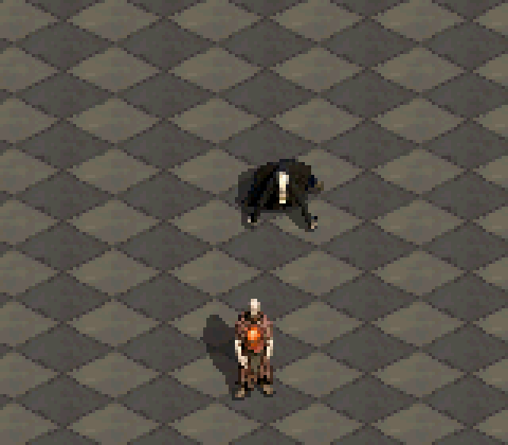
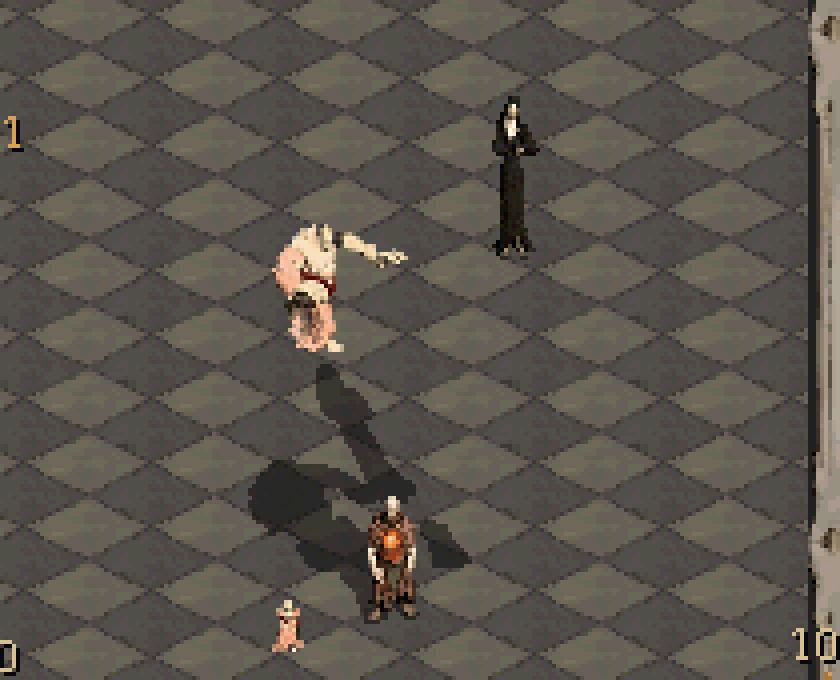
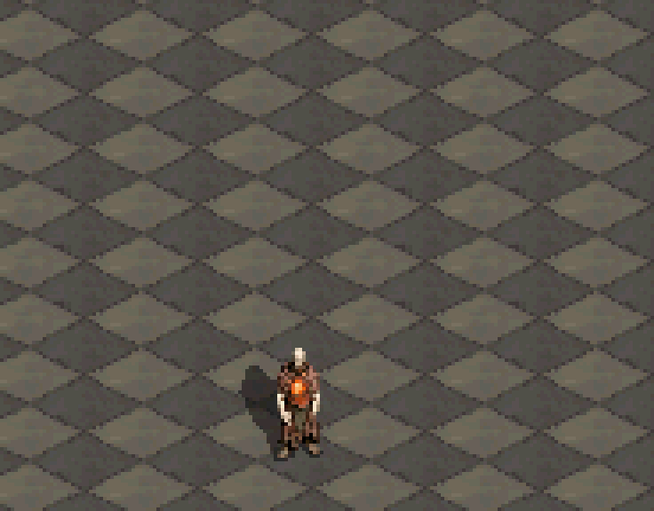

**Aura de posesión.** Alrededor de la Súper Monja, la Monja de cera y el Monaguillo se tumban en araña con una transición en puente (media vuelta y se echan hacia atrás), van más rápidos y la Monja deja de curar para ir a por el héroe. Al salir del aura hacen la transición al revés. Si un poseído queda tambaleante se levanta al instante y su remate es el normal de su tipo; no vuelve a araña mientras tambalea.

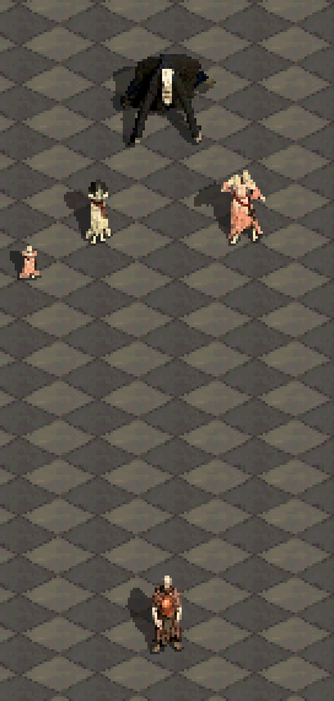
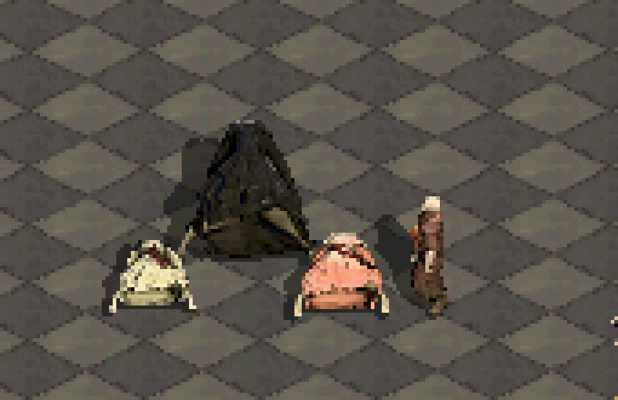

**Párroco, escudo contra el Rayo.** Inmune al Rayo: se rompe contra él en chispas, el cuerpo destella en blanco cera y sale un «0». Corre a ponerse en la línea de tiro; a puñetazos y con el Glifo cae normal. Más grande y con más vida (4x).

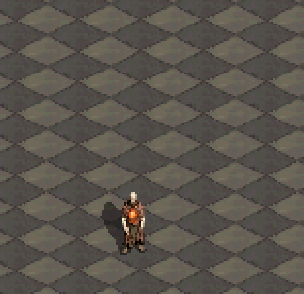
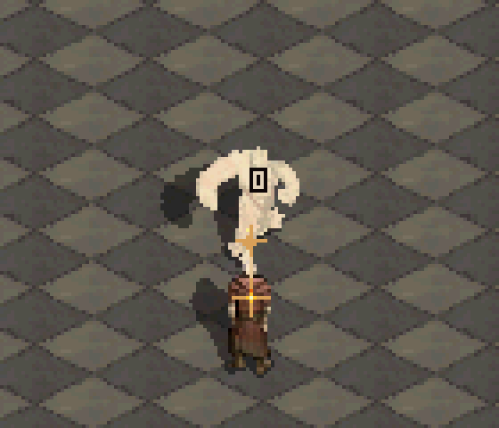

**Guardaespaldas.** No protegen al Bebé (relleno) ni entre sí; corren a 6 veces su paso en cuanto el héroe carga el Rayo y tapar va antes que pegar.

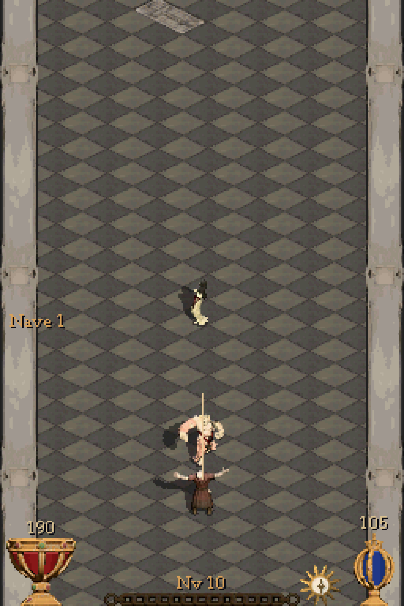

**Remates nuevos.** Súper Monja: arranque de cabeza amplio, recortado a 18 fotogramas (herramienta `tools/trim_remate_smonja.py`). Párroco: «derretirlo». Detalle en `walkthroughs/remate-smonja/` y `walkthroughs/remate-parroco/`.

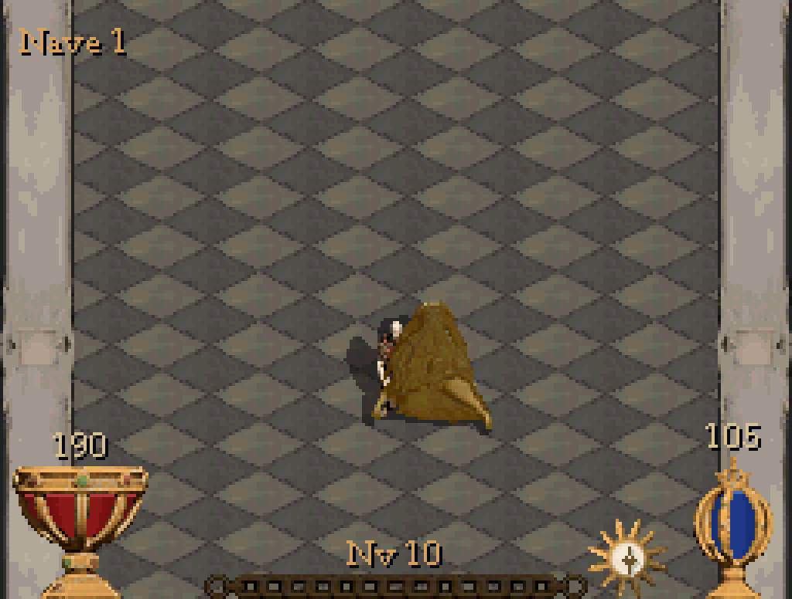

**Variantes de prueba.** `arpg-exvotos` (sala de prueba con los Exvotos de escalón 3) y `arpg-remates` (sala de remates, ver abajo). **Arreglo:** las sombras ya no se pierden al desalojar la caché de sprites.

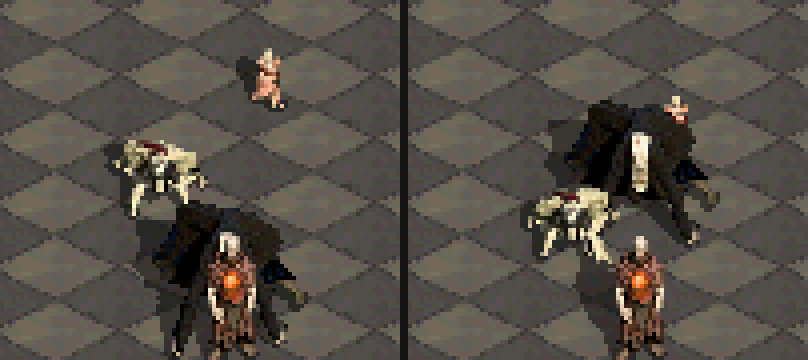
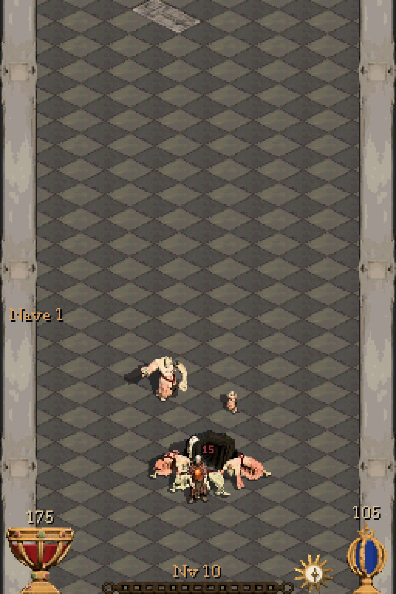

## Sala de remates (variante `arpg-remates`)

Fila al norte del héroe (de oeste a este: Monja de cera, Monaguillo, Bebé, Párroco, Súper Monja, a 40 px; la Súper Monja queda a 120 px de la Monja y el Monaguillo para que no los posea) y, más al norte, un grupo aparte con otra Súper Monja y una Monja de cera y un Monaguillo poseídos. Todos quietos; un puñetazo los deja tambaleantes sin matarlos; al caer por el remate reaparecen en su sitio a los ~2 s. Escenario `scenarios/remates_sala.json` (PASS, `suite: false`).

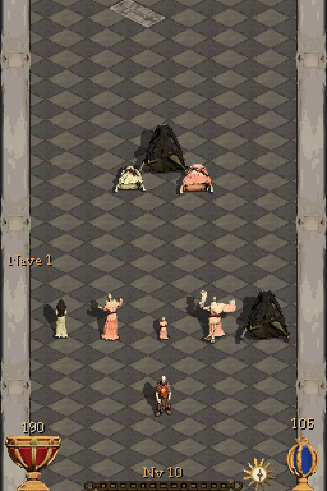

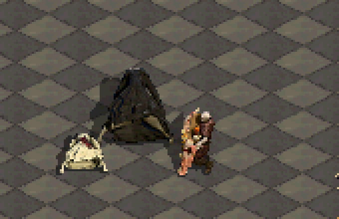

## Verificación
Escenarios PASS en el emulador; jugado en la DS por el usuario, sin log de rendimiento.

## Pendiente
- **Rendimiento en la DS:** variante `perf` en la catedral normal con muchos poseídos a la vez.
- **Balance:** vida del Párroco (4x) y tamaño; cifras de la Súper Monja a ajustar jugando.
- **Dónde salen en el acto I:** tabla de salas de `source/encounters_act1.c` (sus comentarios de `RK_PARROCO` y `RK_MONJA` están desfasados); la curva de `diseno_juego_final.md` §10 sigue con los nombres viejos.
- La Súper Monja vuelve a entrar en el Glifo tras salir de él.
- Los poseídos tambaleantes se levantan de golpe.
- Las chispas del Rayo contra el Párroco se ven poco.
- Lanza de Longinos contra el Párroco: sin probar.
- Merge a `proto/arpg` y sincronía de MDs con `main`.
- Abanderado invocando Exvotos de cualquier familia y escalón (otra sesión).
