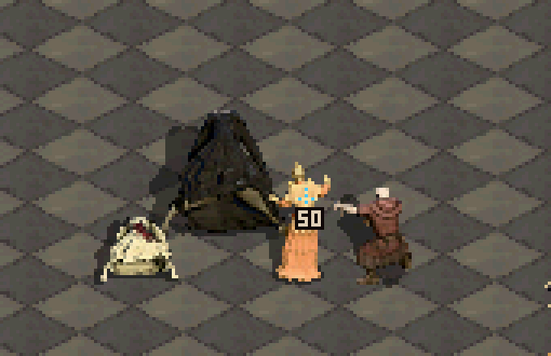

# Familias y roles de los Exvotos del ARPG (rama `claude/arpg-exvoto-ramas-a622a1`, 2026-11-22)

Sesión de diseño, sin código. Define las familias de enemigos con sus escalones y el rol del Exvoto chico frente a la Exvoto chica.

## Qué se decide
- **Cuatro familias con escalones:** Exvoto chico (Bebé → Monaguillo → Párroco), Exvoto chica (Bebé → Monja → Súper Monja), Ojo y Cireneo (escalón 2 = el mismo con aura o más grande). El Abanderado es el jefe.
- **Amenaza a igualdad de escalón:** Bebé < chico ≈ chica < Ojo ≈ Cireneo.
- **Roles:** el Monaguillo va a por el héroe y, si el héroe carga el Rayo, se pone entre él y la Monja para comerse el disparo. La Monja reza detrás y cura lo bastante para que compense matarla primero. El Párroco hace lo mismo que el Monaguillo, pero más rápido y con animación de carga (de Mixamo, pendiente). La Súper Monja cura y hace más rápidos a los suyos (su sprite se va a sustituir). Se retira el empuje del primer Párroco.
- **Muñecos:** se corrige el aviso falso de que faltaban los modelos del escalón 3. `exvoto_parroco` es el Párroco y `exvoto_monja` la Súper Monja; están en el repo, pero aún no caben en la memoria de la ROM.

## Propuestas revisadas
- Página para el móvil (dos vueltas: la primera trataba el giro del escalón élite y quedó aparcada; la segunda, los roles): `propuesta.html` (publicada como Artifact de claude.ai).

## Documentos
`DESIGN-ARPG.md` §5 (familias, roles, muñecos y desfase con el código), `diseno_juego_final.md` §10, `assets/MANIFEST.md` (qué modelo es cada escalón), `STATUS-ARPG.md`. `DESIGN.md`, `TECHNICAL.md` y `LORE.md` no cambian.

## Pendiente
- Reordenar el código según la tabla: hoy «Párroco» y «Monja» son un tanque que empuja y una curandera del escalón 2.
- Curva de inicio de `diseno_juego_final.md` §10 («Párroco y Monja desde la sala 5»): falta decidir qué escalones salen en cada sala con los nombres nuevos.
- Abanderado invocando Exvotos de cualquier familia y escalón (otra sesión).
- Animación de carga del Párroco (Mixamo) y sprite nuevo de la Súper Monja.

## Sala de remates (variante `arpg-remates`, 2026-11-23)

Fila al norte del héroe (de oeste a este: Monja de cera, Monaguillo, Bebé, Párroco, Súper Monja, a 40 px; la Súper Monja queda a 120 px de la Monja y el Monaguillo para que no los posea) y, más al norte, un grupo aparte con otra Súper Monja y una Monja de cera y un Monaguillo poseídos. Todos quietos; un puñetazo los deja tambaleantes sin matarlos; al caer por el remate reaparecen en su sitio a los ~2 s. Escenario `scenarios/remates_sala.json` (PASS, `suite: false`).

**Tambaleo de los poseídos:** un poseído que queda tambaleante recupera al instante su forma de pie (no se reproduce la transición al revés: el golpe ya lo interrumpe) y no vuelve a araña hasta que se le pasa el tambaleo, así el remate es el normal de su tipo y nunca se lanza sobre un sprite a medias.

