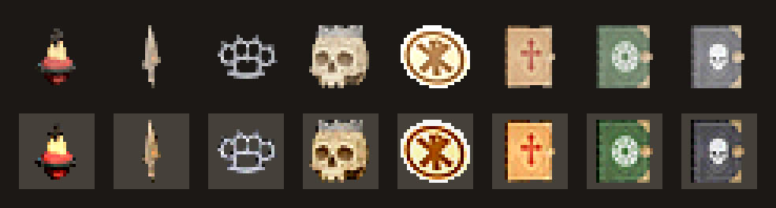
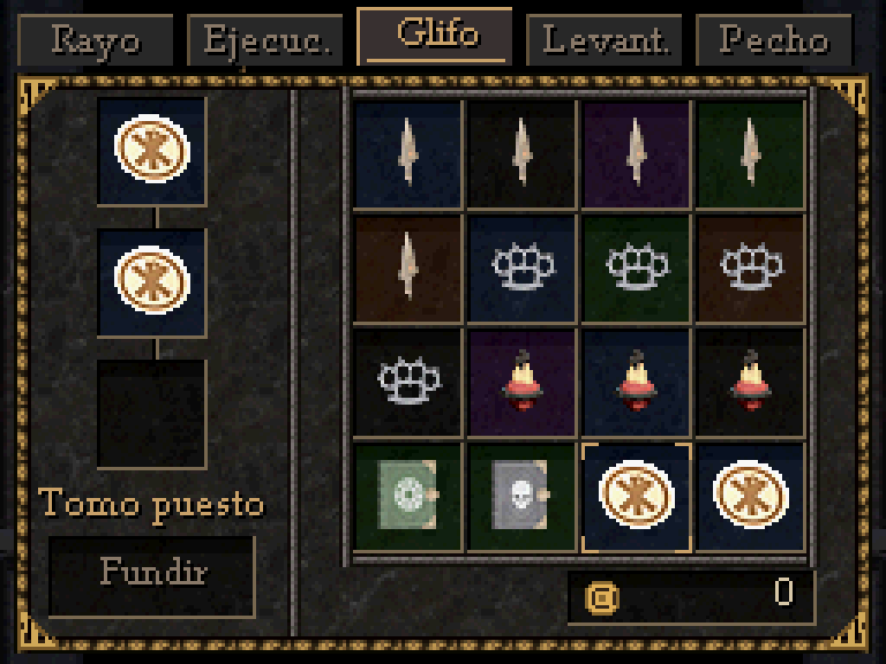
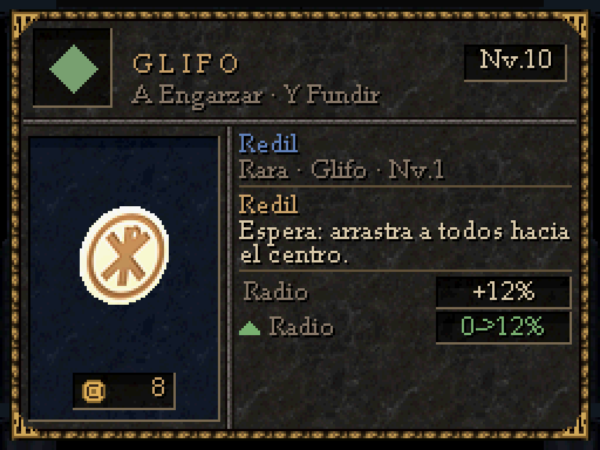
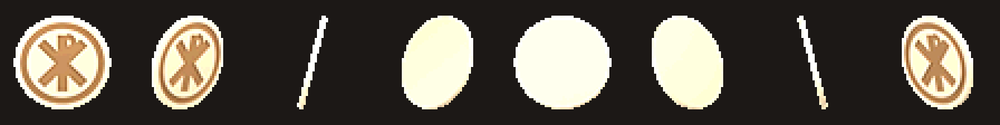
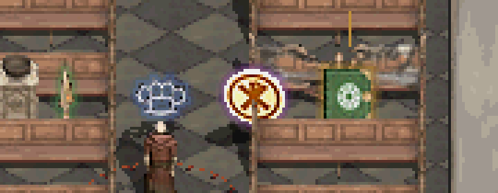

# ARPG: icono de la reliquia del Glifo (hostia consagrada)

Rama `feat/arpg-icono-hostia` (desde `proto/arpg`). Sin mergear.

## Qué cambia para el jugador

Las reliquias del Glifo dejan de verse como un rombo de color: son una **hostia consagrada** con la runa del Glifo reducida a lo mínimo y hendida en la cara (un anillo cerca del borde y el crismón grueso: la X, el trazo vertical y el bucle de la P). Se ve igual que las otras reliquias: en la bolsa y en los engastes (24 px), girando en la ficha de la pantalla superior y en el suelo con el halo de su rareza y su sombra. Su nombre genérico pasa de «Vial de Glifo» a «Hostia de Glifo».

## Cómo se hizo

- **Modelo por geometría, no con Tripo:** `tools/make_relic_hostia.py` crea en Blender un disco de pan ácimo con el canto algo grueso y redondeado y le resta los surcos (anillo, X, trazo y P) con cotas sacadas del dibujo de referencia del usuario (`assets/inbox/hostia_24px_8x_ref1.png`). Surcos hondos (más de la mitad del grosor) y con material propio, marrón cálido, para que hagan sombra.
- **Mismo render que el resto:** `tools/render_item_spin.py` (misma cámara, luz de tres puntos y exposición que la Lanza, la Nudillera, el Cráneo, el Corazón y los tomos) genera el giro de 24 fotogramas de 56 px. Con `--icon24` saca un fotograma más inclinado para el icono de 24 px, que `tools/bake_item_icon24.py` reduce con el mismo tratamiento de nitidez y contraste. El suelo se regenera con `tools/bake_inv_floor_art.py` (los iconos que ya había no cambian).
- El primer render quedó casi blanco y destacaba más que el resto; se bajó el marfil a un tono hueso como el del cráneo. El crismón se leyó a 24 px a la primera.
- La prueba de reliquias en el suelo suelta ahora una reliquia del Glifo en vez del tomo del Rayo.

## Evidencia (ROM real, DeSmuME, 4x NEAREST)

Icono a 24 px junto a los demás (arriba, inventario; abajo, versión de suelo):

Inventario en la pestaña Glifo: dos hostias en los engastes y dos en la bolsa:

Ficha de la pantalla superior con la hostia girando:

Giro (8 de los 24 fotogramas):

En el suelo, la hostia (épica, halo morado) entre la nudillera y el tomo del Glifo ([pantalla completa](assets/reliquias_suelo_pantalla.png)):

Escenario de capturas: `scenarios/arpg_icono_hostia.json` (solo evidencia, fuera de la batería).

## Verificación

- ROM `arpg-todo` y `reliquias-suelo` compiladas sin avisos.
- Escenario `arpg_icono_hostia` PASS (capturas).
- Sin medir en la DS: no cambia nada que se dibuje por fotograma (mismo coste que las otras reliquias).

## Documentos

`DESIGN-ARPG.md` (Vial → hostia consagrada) y `assets/MANIFEST.md` (pipeline y fila de la pieza). Pendiente al cerrar: entrada en `STATUS-ARPG.md` y sincronizar los MDs con `main`.
