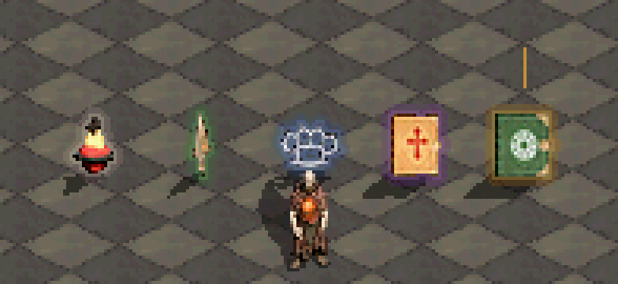

# ARPG: reliquias en el suelo con su icono

Rama `fix/arpg-icono-suelo` sobre `proto/arpg` (2026-11-22).

## Qué cambia para el jugador

Las reliquias y tomos que sueltan cofres y enemigos ya no se ven como un rombo de color: aparece su icono de arquetipo (Corazón, Lanza, Nudillera, Calavera, tomos) a 24 px, el mismo dibujo que en el inventario pero con más contraste y color, porque es un objeto mágico. La rareza se lee por un halo semitransparente de su color que se desvanece hacia fuera y palpita despacio; la legendaria mantiene su haz vertical. Debajo hay una sombra de verdad: la silueta del objeto proyectada sobre el suelo con el tono y la dirección de las sombras de los personajes. La reliquia del Glifo (Vial) aún no tiene modelo y sigue saliendo como rombo.

Pantalla completa: [`reliquias_suelo_pantalla.png`](assets/reliquias_suelo_pantalla.png). Iteraciones descartadas por el usuario: contorno sólido de 1 px ([`reliquias_suelo_4x.png`](assets/reliquias_suelo_4x.png), «feísimo») y aura tramada a 16 px con poco contraste ([`reliquias_suelo_aura_4x.png`](assets/reliquias_suelo_aura_4x.png)).

## Cómo está hecho

- `tools/bake_inv_floor_art.py` lee los iconos de 24 px de `include/inv_item_art.h` y genera `include/inv_item_floor_art.h`: icono con más contraste (niveles por icono, ganancia 1,35–1,5 y +18 % de saturación), mapa de distancias del halo (30×30) y máscara de sombra proyectada (36×10). El inventario conserva su arte.
- `source/pickups.c` dibuja sombra (suelo al 50 %), haz legendario, halo (mezcla del color de rareza al 50/25/12,5 % sobre lo que haya debajo) e icono, respetando la oclusión.
- Ganchos de evidencia: `g_relic_drop_debug` suelta 5 reliquias (común → legendaria) junto al héroe (escenario `scenarios/arpg_reliquia_suelo.json`, solo capturas) y la variante `reliquias-suelo` lo hace al entrar en la catedral y con SELECT, para verlo en la DS.

## Verificación

- Build `default`, `encuentros` y `reliquias-suelo` sin avisos.
- Capturas de la ROM real en DeSmuME (escenario de arriba).
- Visto en la DS con la variante `reliquias-suelo`: aprobado por el usuario. Sin log `perf` (el coste es un bucle de 30×30 por reliquia visible).

## Documentos

`DESIGN-ARPG.md` §5 («Reliquia en el suelo»), `STATUS-ARPG.md`, `assets/MANIFEST.md` (fila de iconos de suelo).
