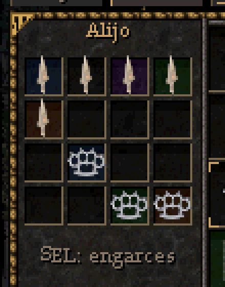
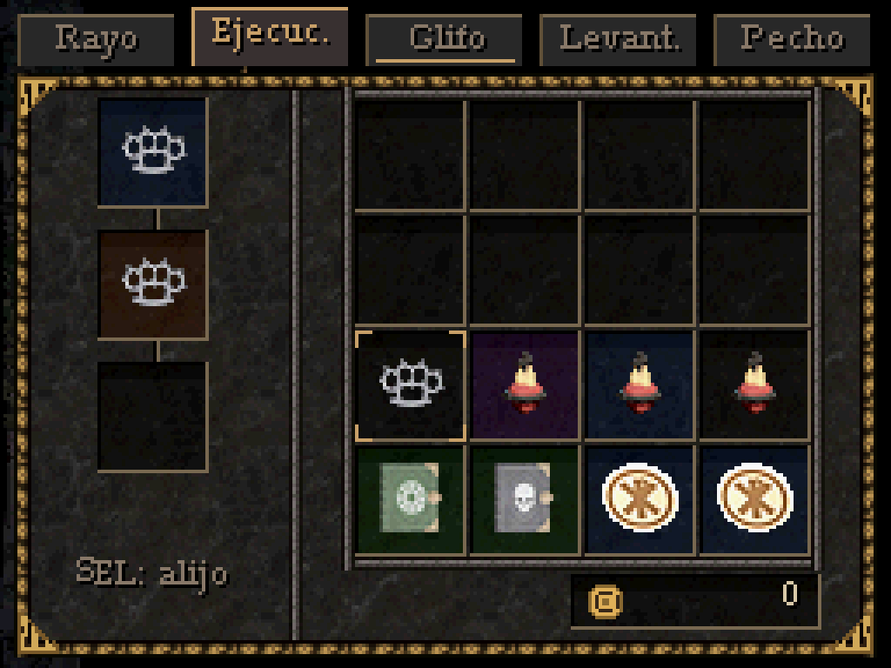
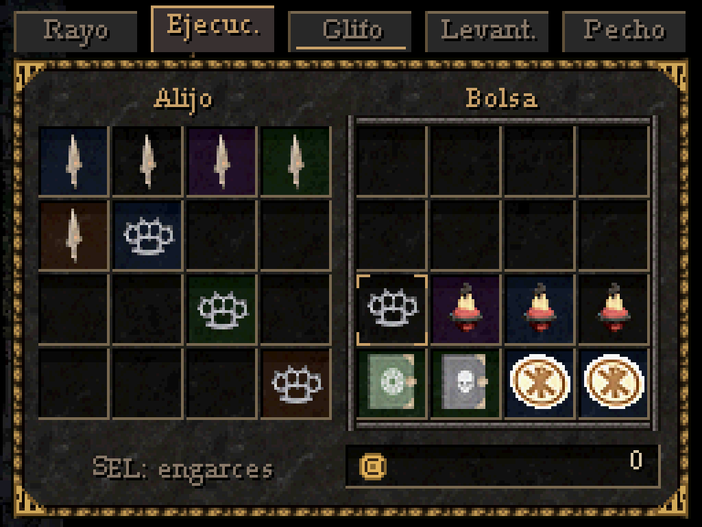
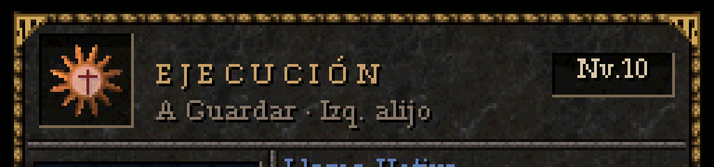
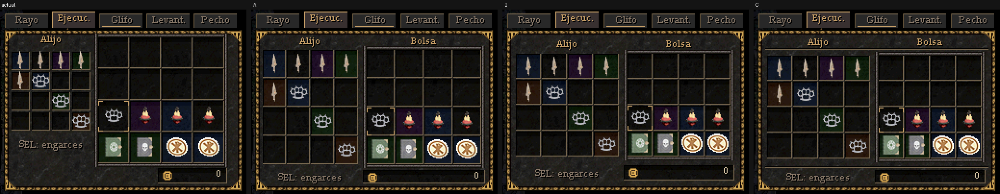

# ARPG: arcón con alijo sin pisar la filigrana

Rama `fix/arpg-inv-alijo`, integrada en `proto/arpg` (2026-11-24).

## Qué cambia para el jugador
- Arcón: el alijo ya no pisa la filigrana izquierda. Maquetación elegida en ronda A/B/C (B «Respiro»): alijo y bolsa 4x4 con casillas de 26 px alineadas arriba y abajo, margen uniforme de 5 px, títulos «Alijo» y «Bolsa», fila inferior con ayuda y cera; las espadas caben en sus casillas.
- Las pestañas quedan repartidas con hueco igual y centradas en todos los modos del inventario.
- Pantalla superior: la cabecera muestra el icono del viril de la escuela en vez de un rombo de color (Pecho sigue con rombo; no tiene icono).

## Evidencia
Antes y después del alijo:

Arcón con engarces y vista táctil completa:

Cabecera de la pantalla superior:

Ronda A/B/C (A «Alineado» y C «Bandas» descartadas, elegida B):

Builds por defecto y `arpg-todo` sin avisos; escenario `arpg_inv_alijo` (mover objetos al alijo, alternar alijo/engarces; `suite: false`, solo evidencia).

## Pendiente
- No probado en la DS (pantalla de menú, sin impacto en combate).
- No revisado a ojo: pestañas en pausa y Crisol.

## MDs
`DESIGN-ARPG.md` §3 (una línea sobre el alijo) y `STATUS-ARPG.md` (la entrega más vieja pasa a `STATUS-ARCHIVE.md`).
