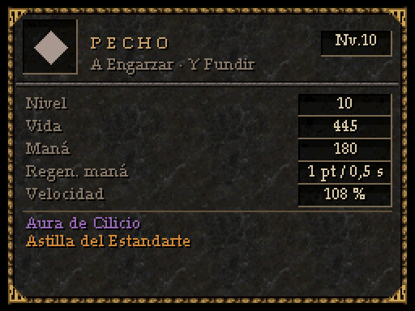
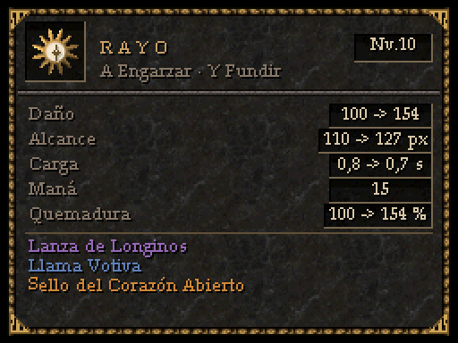
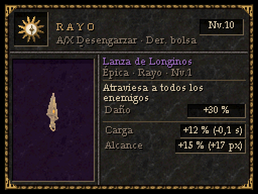
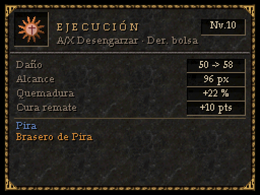
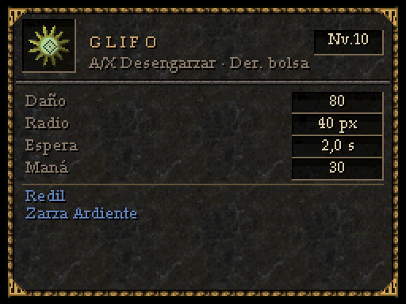
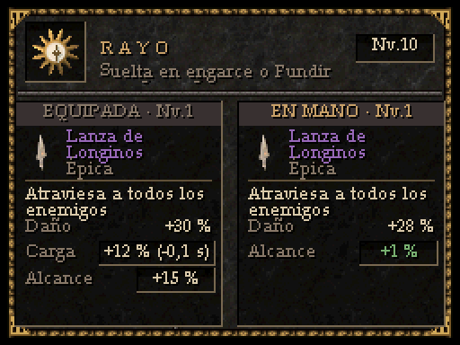

# ARPG: ficha de escuela en la pantalla superior del inventario

Rama `feat/inventario-ficha`, base `arpg`, 2026-11-26.

## Qué cambia

La pantalla superior del inventario tiene 3 estados:

- **Ficha de la escuela** (al abrir, al cambiar o tocar una pestaña y sobre huecos vacíos): estadísticas totales «base -> total» y debajo solo los nombres de las auras engarzadas, en el color de su rareza. Pecho es una pestaña más (nivel, vida, maná, regen., velocidad y sus auras).
- **Ficha de reliquia** y **comparación**, como antes.
- Los textos de aura van sin cifra y su cifra en línea propia con unidad («Atraviesa a todos los enemigos» / «Daño +30 %»); las líneas en % añaden el valor real («Alcance +15 % (+17 px)»).
- Arreglo: el inventario aplica las reliquias al abrirse aunque no se haya jugado aún (antes, en el arcón recién arrancado, las cifras no cuadraban).

## Capturas (ROM, 2x)

Las capturas 03 y 05 son de una ronda anterior (el nombre del aura ya no se repite).

## Verificación

Compila sin warnings nuevos (default y arpg-todo); escenario `scenarios/arpg_inv_ficha.json` (evidence_only) PASS; probado por el usuario en la DS con su partida. No toca render en combate: sin medición de rendimiento.

## MDs

`DESIGN-ARPG.md` §3 y §5 actualizados en el commit de la entrega; `TECHNICAL.md` no describe el inventario, sin cambios.
