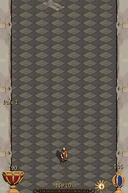
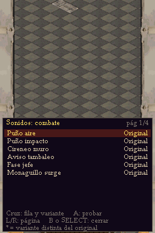
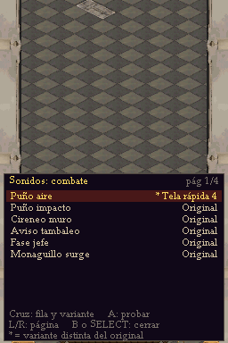
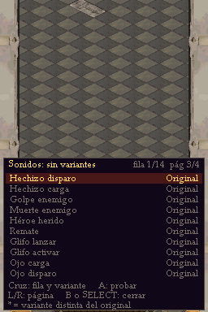

# Laboratorio de combate ARPG (`arpg-lab`)

ROM de pruebas para afinar el combate sin pasar por título, vídeo ni campamento. Se compila con la variante `arpg-lab` y no cambia en nada las demás versiones del juego.

## Qué hace

- **Arranque directo:** al encender, el héroe ya está en la catedral con todo desbloqueado.
- **Menú de ajuste (SELECT):** abre un panel en la pantalla inferior y detiene el juego mientras está abierto. Cruz arriba/abajo elige fila, izquierda/derecha cambia el valor, **A** prueba (suena el sonido elegido), **L/R** cambian de página, **B** o **SELECT** cierran.
- **Variantes de sonido por evento:** cada evento (puño al aire, puño que impacta, muro del Cireneo, campana de jefe, aviso de tambaleo, Monaguillo, orbes, cofre, puerta, clics, engarce, subir nivel) tiene su fila. Izquierda/derecha recorre **solo las variantes de ese evento**: «Original» (el sonido actual) y los candidatos Kenney (CC0) ya preparados. Un `*` marca una variante distinta del original. Páginas: «combate», «mundo y menús», «sin variantes» (el resto de eventos, en gris, solo con «Original») y «Pruebas» (invulnerable).
- **Cuántas variantes hay (además del original):** Puño aire 3, Puño impacto 4, Cireneo muro 3, Aviso tambaleo 3 y Fase jefe 3 (las mismas tres campanas), Monaguillo surge 2, Orbe recogido 3, Abrir cofre 3, Abrir puerta 2, Clic menú 3, Engarce reliquia 3, Subir nivel 2. Son 31 archivos en `assets/sfx/baked/lab_*.wav`.
- **Preparado para crecer:** el menú se alimenta de una tabla. Añadir un ajuste (distancia de remate, tiempos...) es registrar una línea; no hay que tocar el menú. Pasos en `include/lab_tuning.h` y `TECHNICAL.md`.

## Evidencia

Arranque directo en el combate:

Menú abierto (el juego queda parado debajo):

«Puño aire» cambiado a la variante «Tela rápida 4» (marcada con `*`):

Página de eventos sin variantes (con indicador de fila porque hay más de las que caben):

## Dónde viven los sonidos candidatos

`assets/sfx/baked/lab_*.wav` (16 bits, mono, 16.384 Hz, igual que los demás). **Entran en todas las compilaciones**, no solo en el laboratorio: la herramienta de compilación mezcla una única carpeta de audio y no admite archivos por variante. Cuestan unos 0,4 MB en la ROM y no consumen memoria en el juego normal, porque solo se cargan al elegirlos en el menú del laboratorio.

## Tamaño de ROM (investigado, no implementado)

La ROM pesa ~15,5 MB y casi todo es `nitrofiles/` (12 MB). El combate ARPG solo necesita en ejecución: `remate/` (2,8 MB), `punch/` (0,3 MB) y la música `bgm.raw` (0,24 MB). Se podrían quitar unos **8,7 MB**: `bestiary/` (3,4, solo códice), `levelup/` (1,6, solo cartas de mejora), `intro/` (1,4, solo título/introducción), `items/` (1,0, solo arte del inventario), `camp/` (1,0, solo el campamento: al morir el juego vuelve a él) y `boss.raw` (0,3, solo modo jefe). Todos los cargadores comprueban el fallo de apertura y devuelven sin arte (sin cierre del juego), salvo el campamento, que no está verificado sin sus archivos. La herramienta de compilación solo admite definiciones por variante, no copias por variante, así que habría que ampliarla (en el repositorio de la skill) para sacar esa ROM reducida.

## Documentos

`TECHNICAL.md` (nueva sección de la variante) actualizado; `DESIGN.md`, `LORE.md`, `assets/MANIFEST.md` y `STATUS.md` sin cambios (herramienta de desarrollo, sin impacto en el juego).
