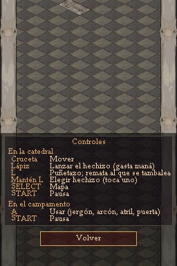
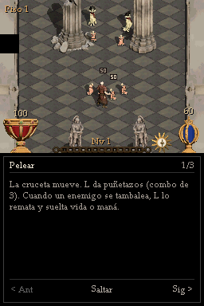
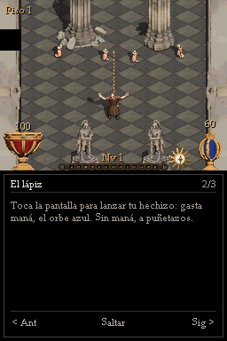
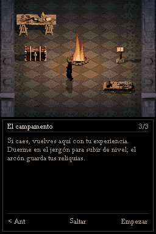
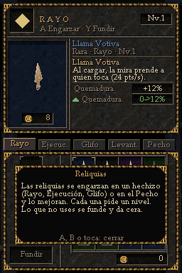
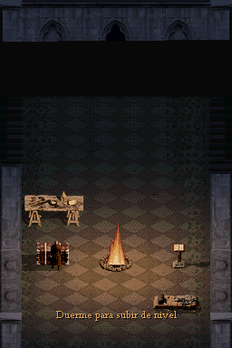
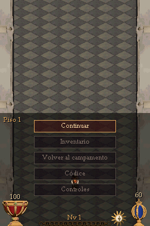
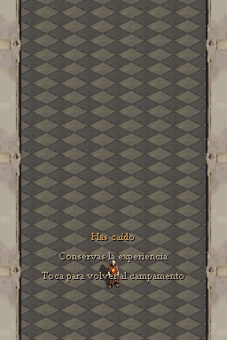

# ARPG: menús y arranque (2026-11-22)

Rama `claude/arpg-menus-inicio-f647ad`, sobre `proto/arpg` (a87601d7); integrada en `proto/arpg` junto al mapa de la zona 1.

## Qué cambia para el jugador
- **Intro:** las 6 tarjetas del roguelike (rejas, coberturas, relicarios, corazones) pasan a 3 tarjetas del ARPG con vídeo de la ROM: **Pelear**, **El lápiz** y **El campamento** (textos en `DESIGN-ARPG.md` §8).
- **Avisos de primera vez**, apuntados en la partida guardada y sin repetirse: «L: rematar» (primer tambaleante), «Engárzala en el arcón o desde la pausa» (primera reliquia), «Mantén L y toca el Glifo» (primer tomo de Glifo) y «Duerme para subir de nivel» (vuelta al campamento con experiencia para subir).
- **Tarjeta «Reliquias»** la primera vez que se abre el inventario; se cierra con A, B o un toque.
- **Controles** en dos bloques («En la catedral», con SELECT Mapa, y «En el campamento»).
- **Pausa de la catedral** por encima de los orbes y el «Nv».
- **Franja negra** en la pantalla de arriba del campamento: arreglada. No la causaban los menús: el muro se repintaba entero en cada fotograma y no daba tiempo. Ahora se pinta una vez por página.

## Evidencia (ROM, DeSmuME)
Propuesta e inventario previo con capturas: [`propuesta.html`](propuesta.html) (las capturas de antes están en `assets/antes/`).

| Título y Controles | Tarjeta 1 | Tarjeta 2 | Tarjeta 3 |
|---|---|---|---|
|  |  |  |  |

| Tarjeta del inventario | Aviso de dormir | Pausa de la catedral | Muerte |
|---|---|---|---|
|  |  |  |  |

Vídeos de las tarjetas (4x, 15 fps): [pelear](assets/despues/clip_pelear.gif) · [lápiz](assets/despues/clip_lapiz.gif) · [campamento](assets/despues/clip_campamento.gif).
Pulido de menús y franja negra: `assets/pulido/`.

## Verificación
- Build por defecto con 0 avisos nuevos.
- Escenarios (solo evidencia) PASS: `arpg_menus_inicio_final` (recorrido completo), `arpg_avisos`, `arpg_menus_pulido` y `intro_3_tarjetas`. Los clips se regeneran con `tools/gen_intro_clips.py` (escenarios `intro_clip_*`).
- En DeSmuME el inventario va a ~12 fps, así que en los escenarios A y B se mantienen 12 frames. Ya iba así antes de este cambio.

## Pendiente
- Probado en la DS por el usuario (se ve bien); no se leyó el log `perf`.
- Los avisos de rematar, primera reliquia y Glifo están programados, pero no se han visto en el emulador.
- Imagen y nombre del juego en la pantalla de título (decisión de arte).
- El remate no sale en el vídeo de «Pelear» (solo el combo).

## Documentos
`DESIGN-ARPG.md` §8 (nueva) y pendientes de §3 y §5; `STATUS-ARPG.md` (la entrega más vieja pasa a `STATUS-ARCHIVE.md`); `TECHNICAL.md` §5 (marco del campamento); `assets/MANIFEST.md` (clips de la intro por rama). La sincronización de los MDs con `main` queda para el cierre.
