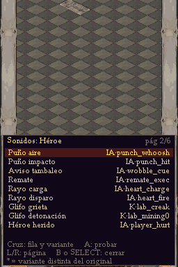
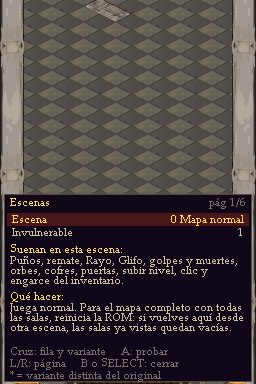
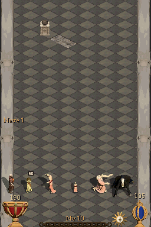
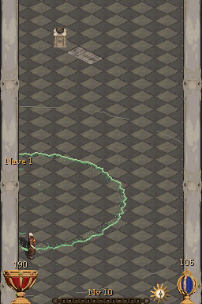

# ARPG: ROM de prueba de sonidos

Variante `prueba-sonidos` (`ARPG_LAB`, `SOUND_TEST`, `SKIP_TITLE`, `ARPG_ALL_UNLOCKED`): sala de pruebas para escuchar cada sonido del ARPG en su contexto y apuntar cuáles chirrían. No cambia ningún sonido del juego.

- **Menú (SELECT):** página «Escenas» (escena + invulnerable + ayuda), cuatro páginas de catálogo con todos los `SND_*` (archivo y origen: `K·` banco gratuito Kenney, `IA·` ElevenLabs; A repite) y «Banco gratuito» con los 31 `lab_*`.
- **Escenas:** 0 mapa normal · 1 Remates · 2 Hechizos (Rayo, Glifo) · 3 Ojos · 4 Cireneos · 5 Monja cura (curación simulada: la oración está desconectada en el ARPG) · 6 Monaguillos · 7 Campanero (tañido, toque, cristal del Glifo).
- Arreglo del lab, válido fuera de la variante: escuchar una voz de jefe desde el menú ya suena (antes se pedía un efecto no cargado).
- Con `SOUND_TEST` el héroe invulnerable sigue sonando al recibir daño, para poder oír «Héroe herido».

Verificado: compila limpia sin avisos (`prueba-sonidos`, por defecto y `arpg-lab`); escenario de evidencia `scenarios/prueba_sonidos.json` (`suite:false`). El audio no se ha oído en el emulador: la escucha es en la DS.

Hoja para marcar (móvil): https://claude.ai/artifact/BCUZrgcGjshczPMPAn7WLK

| | |
|---|---|
|  |  |
|  |  |

Resultado: el usuario la escuchó en la DS y marcó en la hoja lo que chirría; la lista está en `STATUS-ARPG.md` («Pendiente», punto 5). MDs: `STATUS-ARPG.md`, `STATUS-ARCHIVE.md`, `TECHNICAL.md` §5.3c y `walkthroughs/README.md`.
