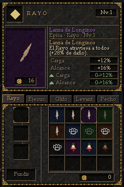
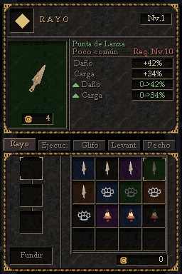
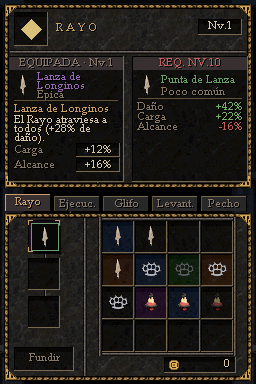
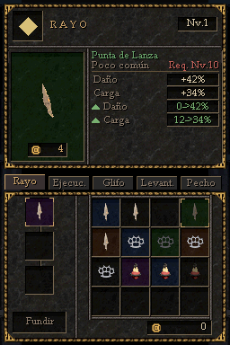
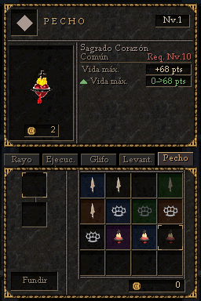

# Walkthrough: Pulido de Reliquias, Combate Real, Escalado Nv/Rareza y Dirección de Escalones (`fix/arpg-relic-stats`)

## Resumen

Entrega en `proto/arpg` dedicada al pulido integral del sistema de reliquias, estadísticas, combate, progresión Nivel vs. Rareza y documentación del diseño de la protodemo:

1. **Alcance de escuelas y auras de la protodemo (`DESIGN.md` §7.6, `source/arpg_inv.c`):**
   - **Rayo:** 2 auras (*Lanza de Longinos* y *Llama Votiva*) + Legendaria *Sello del Corazón Abierto* (*Auto de Fe*).
   - **Ejecución (`L`):** 1 aura (*Pira*, explosión ígnea al rematar) + Legendaria *Brasero de Pira*, reservando la 2.ª aura para *Levantar*.
   - **Pecho:** 2 auras pasivas (*Aura de Cilicio* y *Llaga Abierta*) + Legendaria *Astilla del Estandarte*.
   - Retiradas las reliquias/tomos de **Glifo** y **Levantar** de la bolsa inicial y los drops (`arpg_relic_roll_school`); las pestañas selladas muestran *«Letanía sellada»* (sin corte del sprite giratorio en VBlank).

2. **Unidades explícitas, textos diegéticos y conexión real a combate (`include/arpg_inv.h`, `include/upgrades.h`, `source/arpg_inv.c`, `source/upgrades.c`, `source/gameplay.c`, `source/weapons.c`, `source/punch.c`, `source/remate.c`):**
   - Unidades explícitas en todas las líneas (`%`, `pts`, `pts/s`); `Carga` y `Alcance` convertidos de frames/px a `%` sobre base (`48` frames / `110` px).
   - `Alcance` de Ejecución conectado al alcance real del puñetazo (`punch.c`) y del remate (`remate.c`).
   - Cada aura aplica en combate su cifra real `mech_val` (en lugar de constantes fijas); `Vida máx.`, `Maná máx.` y la mitad de vida de *Llaga Abierta* se actualizan y revierten en vivo al engarzar o desengarzar.
   - Nombres unificados entre el aviso al recoger del suelo y la ficha del inventario; ajuste automático en 2 líneas o alternativa compacta en tarjetas estrechas.

3. **Escalado Nivel vs. Rareza, bloqueo `Req. Nv. X` y drops fijos por ala (`include/arpg_inv.h`, `source/arpg_inv.c`, `source/pickups.c`, `source/encounters_act1.c`, `source/inventory.c`):**
   - Escalado reajustado: `+35 %` por nivel / `+8 %` por rareza en líneas (`Carga` hasta `60 %`) y `+25 %` por nivel / `+10 %` por rareza en auras, de modo que una pieza común o poco común de nivel alto supera en stats brutos a una rara/épica de nivel bajo.
   - **Opción A (bloqueo por nivel al equipar):** recoger y desguazar piezas de cualquier nivel es libre, pero equipar o engarzar exige `g_arpg.level >= item_level` (`arpg_inv_can_equip`). La bolsa atenúa el icono y la ficha / tarjeta comparativa muestran `Req. Nv.X` / `REQ. NV.X` en rojo sin ocultar la vista previa de deltas.
   - Drops de nivel fijo según sala/ala y escalón del enemigo (`+1` en intermedios/especialistas, `+2` en jefes), sin auto-escalar al nivel del héroe.
   - Optimizaciones de comparativa en `source/inventory.c`: hasta 4 filas compactas de delta, descarte de ticks de giro cuando hay comparativa y limpieza selectiva en VBlank (solo franja superior y calle central de piedra al comparar, ahorrando 28.728 escrituras VRAM para evitar cortes en la tarjeta izquierda).

4. **Documentación de diseño (`DESIGN.md` §7.6, `walkthroughs/arpg-predemo/diseno_juego_final.md` §8 y §10):**
   - Registrada la dirección artística de los 3 escalones del Exvoto y futuros escalones del Cireneo y el Ojo como **etapas progresivas de corrupción biológica/sobrenatural del mismo cuerpo** (*La Monja / Valak*, *The Ritual*, *Pennywise*, *Skinwalker*) en lugar de especies distintas o versiones «Hulk».
   - Añadida explícitamente a la lista pendiente de la protodemo la **elección de los sonidos definitivos** para sustituir a los SFX provisionales actuales.
   - Nota de revisión documental (`AGENTS.md`): `TECHNICAL.md`, `LORE.md`, `assets/MANIFEST.md` y `AGENTS.md` no han necesitado cambios en esta sesión.

## Evidencia en la ROM (`check_relics`)

- 
- 
- 
- 
- 

## Verificación

- Builds `default` y `arpg-todo`: **0 warnings**.
- `tests/test_guardrails.py`: **PASS**.
- Escenario `scenarios/arpg_inv_ui_check.json`: **PASS** (además del escenario de verificación `check_relics` inspeccionado en capturas).
