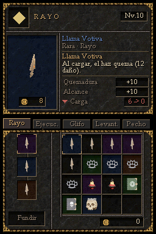
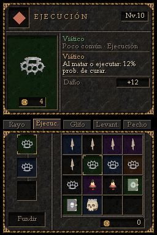
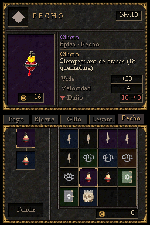
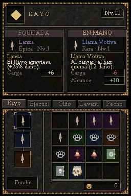

# Walkthrough: Pulido de Reliquias, Ventana 3D Giratoria y Auras ARPG (`fix/arpg-relic-ui`)

## Resumen

Correcciones y mejoras sobre el inventario y sistema de auras en `proto/arpg`:

1. **Brillo uniforme en la bolsa (`source/inventory.c`):** eliminada la atenuación del 50 % que oscurecía en la bolsa a la Nudillera y al Sagrado Corazón cuando estaba activa la pestaña de Rayo.
2. **Pantalla superior dividida con objeto 3D flotante girando (`tools/render_item_spin.py`, `nitrofiles/items/*.bin`, `source/inventory.c`):**
   - Pre-renderizados en Blender 5.2 los 7 modelos (`relic_lanza`, `relic_nudillera`, `relic_calavera`, `relic_corazon`, `tome_glifo`, `tome_levantar`, `tome_rayo`) a 56×56 RGB15 en 24 fotogramas de giro 360°.
   - Streaming desde NitroFS mediante descriptor sin búfer (`open`/`read`/`lseek`, 0 bytes de heap) y refresco parcial en VBlank.
   - Cambio automático de pestaña y engarces al seleccionar cualquier reliquia en la bolsa.
3. **Descripciones y cifras de auras adaptadas al modo ARPG (`include/arpg_inv.h`, `source/arpg_inv.c`):**
   - Añadido `mech_val` a `ArpgInvItem` para poder comparar dos reliquias con la misma aura.
   - Rayo queda limitado a sus 2 auras reales (**Lanza** y **Llama Votiva**, más **Auto de Fe** legendaria); retiradas *Prisa* y *Sed de Ceniza* de la bolsa inicial y `arpg-todo`.
   - Descripciones adaptadas al modo ARPG (sin referencias a corazones) y mostradas tanto en la ficha principal como en las tarjetas de comparación lado a lado.
4. **Cilicio activo todo el rato (`source/weapons.c`):** el aro de brasas del Sagrado Corazón quema alrededor del héroe de forma continua mientras camina, no solo al cargar el rayo.

## Evidencia en la ROM (`arpg-todo`, escenario `arpg_inv_ui_check`)

- 
- 
- 
- 

## Verificación

- Builds `default` y `arpg-todo`: **0 warnings**.
- `tests/test_guardrails.py`: **PASS** (2/2).
- Escenario `arpg_inv_ui_check`: **PASS**.
