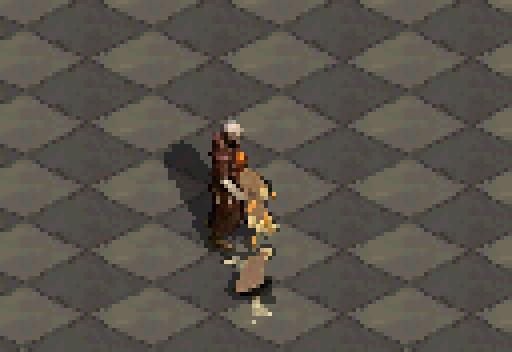

# ARPG: el remate cura, balance y bot

Rama `claude/awesome-bohr-b761e7`, integrada en `proto/arpg` (2026-11-24).

## Qué cambia para el jugador
- Al rematar un enemigo tambaleante hay un 60 % de recuperar +20 de vida y un 75 % de +25 de maná, al instante: un destello apagado viaja del enemigo al héroe con un `+N` (verde vida, azul maná). Sin orbes en el suelo.
- El remate suena solo con su propio sonido: ya no se suma el de muerte genérica ni hay sonido de cura.
- Atasco del Cireneo contra muros y columnas traído de `main` (carga del Cireneo fuera de la ITCM para que el binario quepa).
- Herramienta de balance `tools/arpg_balance.py` con perillas `BAL` (`DESIGN-ARPG.md` §10) y bot con guion (variante `arpg-bot`).

## Evidencia

Escenarios `arpg_remate_cura` y `cireneo_atasco_gif` PASS; builds sin avisos; ROM probada en la DS por el usuario.

## Pendiente
- Subir la cura (+20 es poco frente a 420 de vida a nivel 5).
- Medir `perf` en la DS.
- Sonido tipo «ruleta» al rematar un Exvoto (sospecha: reliquia recogida donde termina el remate; sin confirmar).
- Escenario `enemy_ojo_sentencia_alcanza_al_heroe_quieto`: espera corazones del roguelike (5→4) y en el ARPG la vida va 100→70; hay que reescribirlo.
- Bot: Capilla con llave y táctica de jefe.

## MDs
`DESIGN-ARPG.md` ya estaba al día (remate que cura sin sonido, balance §10); se actualiza `STATUS-ARPG.md` (y `STATUS-ARCHIVE.md` recibe la entrega más vieja).
