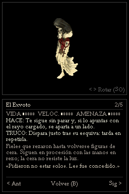

# ARPG: cartas y Códice comprimidos (`perf/arpg-rom-compresion`, 2026-11-23)

Port a `proto/arpg` de la entrega de `main` (`walkthroughs/rom-compresion/` en `main`): el arte de las 17 cartas de mejora y los retratos del Códice van comprimidos (LZ10 de la BIOS) y se descomprimen al cargarlos; mismos píxeles. Los bins y herramientas del ARPG eran idénticos a los de `main`; en `source/bestiary.c` se conserva el buffer del retrato reservado con `malloc` propio del ARPG.

- ROM `dungeonds.nds`: **15.073.280 → 12.742.656 B** (−2,3 MB).
- Build `default` 0 avisos; `bestiary_tour` PASS (retratos y giro correctos); round-trip de los 22 bins OK. Las cartas usan el mismo cargador ya verificado en `main`.
- MDs: entrada en `STATUS-ARPG.md`, sincronizada con `main`.

