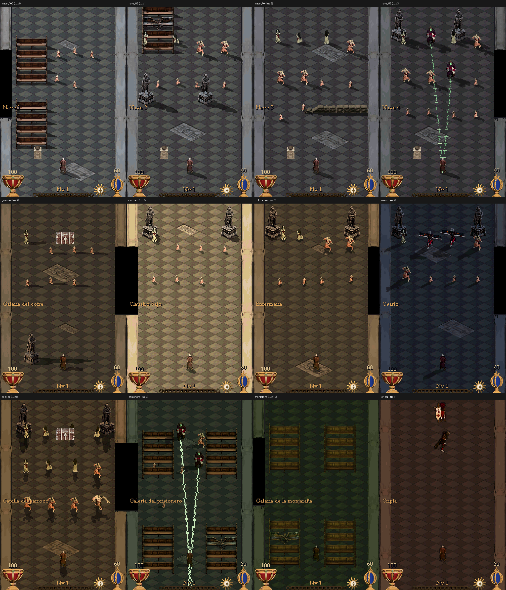
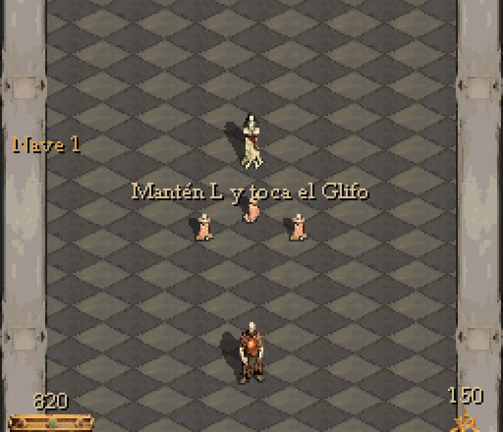

# ARPG: salas, luz por sala, reposos y Monja curandera en la ROM

Integración (`feat/arpg-integra` en `proto/arpg`, 2026-11-26): las 16 salas de la zona 1 salen en la ROM con sus piezas y su luz, los grupos aparecen por proximidad y reposan por papel, la Monja de cera cura en combate y la primera partida arranca en el campamento con tutorial.

## Salas y luz

- Piezas de cada sala en `nitrofiles/rooms/sala_NN.rmk`, horneadas con la luz de su sala; se cargan en la pantalla de carga (`TECHNICAL.md` §3.3.1).
- Una luz principal por sala (12 luces, `nitrofiles/arpg_luz/<luz>.bin`); decisión en `DESIGN-ARPG.md` §11, formato y cargador en `TECHNICAL.md` §5.7. Walkthrough propio de la luz: [`../arpg-luz-sala/walkthrough.md`](../arpg-luz-sala/walkthrough.md).

Hojas de barrido por sala (2x): `assets/sala_00_barrido_2x.png` ... `assets/sala_15_barrido_2x.png`.

## Reposos y encuentros

Reposo por papel y aparición por proximidad (`DESIGN-ARPG.md` §12). Evidencia de los reposos (GIF de la ROM): [bebé](../arpg-reposos/assets/crawl_bebe/anim.gif), [monaguillo](../arpg-reposos/assets/sway_monaguillo/anim.gif), [patrulla de monaguillos](../arpg-reposos/assets/patrol_monaguillos/anim.gif), [Cireneo](../arpg-reposos/assets/stroll_cireneo/anim.gif), [Ojo](../arpg-reposos/assets/sweep_ojo/anim.gif), [emboscada](../arpg-reposos/assets/hidden_emboscada/anim.gif).

## Monja curandera

## Verificación

- Compila sin avisos nuevos (ROM por defecto y `arpg-monja`).
- Escenarios PASS: salas, luz por sala, proximidad, reposos (umbral del monaguillo bajado a 2048 de recorrido: demuestra que pasea; su paseo queda algo corto por las huellas de pieza de la sala).
- `monja_curandera_gif` (sin suite, evidencia) arranca ya en sala con `dbg_start_room` + `dbg_restart`, pero la Monja no cura en esa partida (e0 queda en reposo sin huir ni curar); en la rama `feat/monja-curandera` pasa. Sin diagnosticar.
- **Falta medir en la DS:** FPS y tiempo de carga de sala. Margen de montón con la luz cargada ~12-16 KB (riesgo anotado en `TECHNICAL.md`).

MDs revisados: `DESIGN-ARPG.md` (aparición por proximidad en §12), `STATUS-ARPG.md`, `STATUS-ARCHIVE.md`; `TECHNICAL.md` §3.3.1 y §5.7 ya recogían lo vigente. Sincronizados con `main`.
