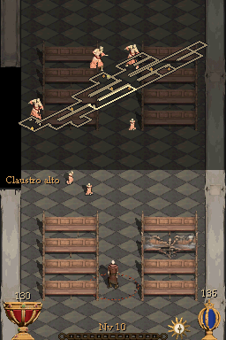
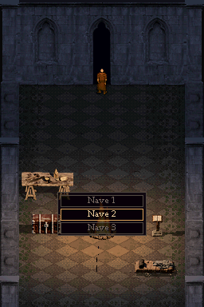
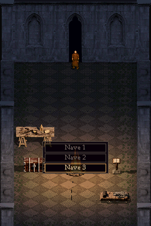
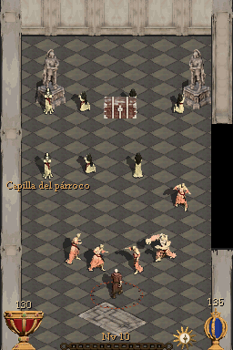
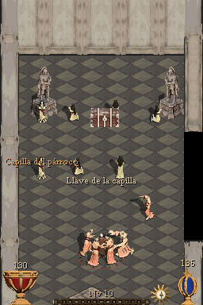
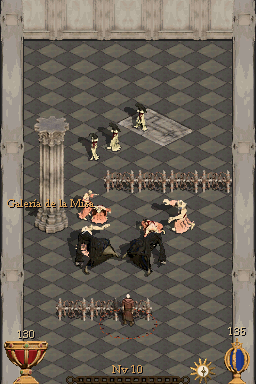
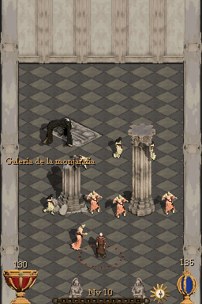
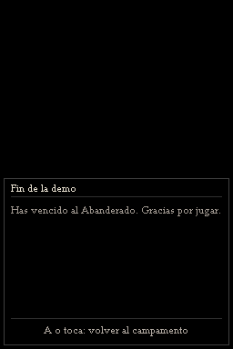
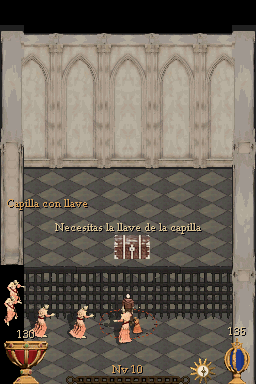
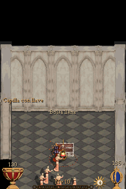

# Zona 1 jugable de principio a fin (ARPG)

Rama `claude/arpg-zona1-jugable-d58ff4` → `proto/arpg`, 2026-11-23. Diseño en `DESIGN-ARPG.md` §7; tabla de salas en `walkthroughs/arpg-predemo/diseno_juego_final.md` §11. Propuesta con mapa a escala: [`propuesta_zona1.html`](propuesta_zona1.html).

## Qué cambia para el jugador

- **Mapa de 16 salas (~70 pantallas)** con dos ramas nuevas (Claustro y Hospital); la demo apunta a ~1 h.
- **Plantel de la parte 1:** Bebé, Monaguillo, Monja de cera, Ojo y Cireneo de escalón 1; el Abanderado solo de jefe. Sin élites.
- **Encuentros especiales:** la Capilla del párroco (monjas rezando que curan, protegidas por el Párroco y los Monaguillos; suelta la llave), la Misa (de todo, sin élites) y la galería de la monjaraña.
- **Llave y reja:** la Capilla con llave cierra el cofre legendario tras el rastrillo, de pared a pared; sin llave se lucha delante y sale «Necesitas la llave de la capilla»; con ella la reja sube al acercarse.
- **Premios garantizados:** rara en la Capilla del párroco, épica al limpiar la Misa y la monjaraña, legendaria del jefe de la Cripta la primera vez y la fija de la Capilla con llave.
- **Viaje entre altares:** en la puerta del campamento, lista de altares tocados (el último preseleccionado, B cancela).
- **Experiencia por amenaza** con curva más larga (nivel 2 cuesta 110); simulada: se llega a la Cripta a nivel 6.
- **Fin de la demo:** tarjeta tras el jefe de la Cripta y vuelta al campamento.
- Guardado v6 (los v3–v5 conservan al héroe y reinician el mapa).

## Evidencia (capturas de la ROM)

| | |
|---|---|
|  Mapa de 16 salas |  Lista de altares |
|  Nave 3 elegida |  Capilla del párroco |
|  Llave conseguida |  La Misa |
|  Galería de la monjaraña |  Fin de la demo |
|  Reja cerrada sin llave |  Con llave, en el cofre |

Dónde iba la reja (opciones que se enseñaron): [`reja_opciones.png`](assets/reja_opciones.png).

## Verificación

- Builds por defecto, `arpg-todo` y `perf` con 0 avisos nuevos.
- Escenarios de evidencia (`"suite": false`): `camp_altares_lista`, `camp_altares_elegir`, `zona1_mapa_16`, `zona1_llave`, `zona1_fin_demo`, `zona1_capilla_parroco`, `zona1_misa`, `zona1_monjarana`, `zona1_nave4_hueco`, `zona1_capilla_llave`, `zona1_capilla_reja_abierta`.

## Pendiente

- **Partida completa del usuario** con feedback concreto (sesión aparte): duración real, curva de nivel (se va algo adelantada desde la Nave 3), dureza de los especiales.
- Medición `perf` en la DS (reja = 4 OAM más; salas especiales con muchos enemigos).
- En la Capilla con llave algunas monjas aparecen detrás de la reja; se quitó la decoración del bloque del cofre.
- Fuera de la demo: Pesadilla/Infierno, atajos y santuarios.
