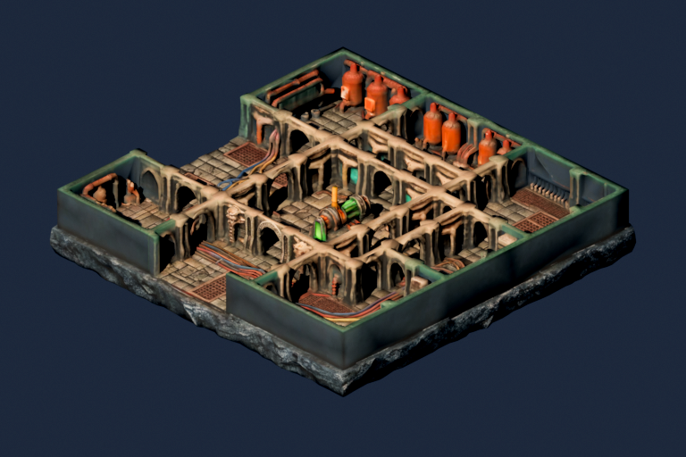
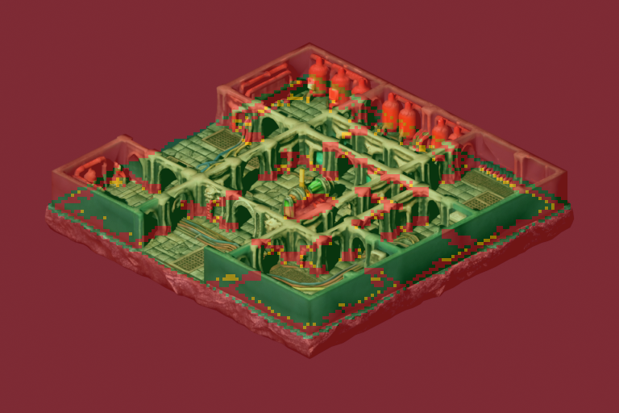

# Sesión: Reorganización Integral de Assets 3D, Spritesheets y Renderizado Consistente de Mazmorra

## Resumen Ejecutivo

En esta sesión se ha transformado y saneado por completo la estructura del catálogo de assets de DungeonDS:
1. **Modelos 3D Organizados (`assets/models/`):** Todos los archivos `.fbx` y `.glb` fuente clasificados limpiamente por categoría (`characters/`, `environment/`, `weapons/`, `animations/`).
2. **Directorio Canónico de Sprites (`assets/sprites/`):** Estructura preparada para la recepción directa de exportaciones del Shader Lab HTML (`assets/sprites/characters/`) con instrucciones claras en su `README.md`.
3. **Almacén Histórico (`archive/`):** Se conservan todos los renders previos, experimentos, corridas temporales de laboratorio (`lab_runs`) y versiones anteriores sin ensuciar el catálogo de producción.
4. **Renderizado de Mazmorra Consistente con Three.js:** Se ha pre-renderizado la mazmorra 3D de test con el preset idéntico al visor Web Three.js (antorcha cálida ámbar `(1.0, 0.76, 0.46)`, relleno frío azul `(0.45, 0.55, 0.75)` y contraste `1.50`), garantizando consistencia cromática y lumínica con los futuros sprites de personajes.

---

## Estructura Canónica Final

```
assets/
  ├── models/
  │    ├── characters/
  │    │    ├── monster/          # Walking.fbx
  │    │    ├── charger/          # Run.fbx
  │    │    ├── skeleton/         # skeleton.fbx, skeleton_death.fbx
  │    │    ├── spacemarine/      # spacemarine.fbx
  │    │    ├── necron/           # necron fbx
  │    │    └── custom/           # mario, henar, wizard
  │    ├── environment/
  │    │    ├── scifi_dungeon/    # tripo FBX + FBM
  │    │    └── dreadhollow/      # Pack modular GLB + Texturas
  │    ├── weapons/
  │    │    ├── shotgun_marine/   # FBX + texturas
  │    │    ├── sniper_necron/    # FBX + texturas
  │    │    └── sword/            # sword.glb
  │    └── animations/
  │         ├── combat/           # Crouchslash.fbx, JumpHit.fbx, Slash.fbx
  │         └── rifle/            # aim, rifle_aiming_idle, run_forward, etc.
  │
  ├── sprites/
  │    ├── characters/            # Directorio limpio para dropear exportaciones del lab
  │    │    └── README.md         # Guía de importación directa
  │    └── dungeon/               # Bakes de fondo, mallas de colisión y tiles
  │         ├── test_dungeon_warm_torch_c15.png
  │         ├── scifi_collision_overlay.png
  │         └── scifi_world_bgr555.raw
  │
  └── icon.png                    # Icono oficial del banner de la ROM NDS
```

---

## Evidencia Visual de la Mazmorra de Test

### 1. Render con Antorcha Cálida y Contraste 1.50
Renderizado ortográfico dimétrico con los mismos parámetros lumínicos y de contraste que el Shader Lab Three.js:


### 2. Malla de Colisión y Despeje de Puertas
Visualización de las celdas de colisión generadas (verde: transitable; amarillo: cobertura baja; rojo: muro sólido):


---

## Verificación de Compilación y Suite de Tests
- **Compilación BlocksDS:** ROM `dungeonds.nds` generada limpiamente mediante Docker (`DS_BUILD=PASS`).
- **Tests Unitarios de Host:** 16 pruebas de contratos (`test_fbx_bg_generator.py`, `test_fog_of_war.py`, `test_diablo_navigation.py`) ejecutadas y aprobadas al 100%.
