# Catálogo de modelos 3D: qué conservar

Todos los modelos 3D del repo con su render, para decidir antes de subir nada a GitHub. Lo que se borre ahora no ocupará nunca cupo de LFS.

- ✅ **Conservar:** lo usa el juego (o está decidido que lo usará). Se versiona en LFS.
- 🗑️ **Borrar:** no se usa. Lo que ya estaba en git sigue recuperable desde el historial, así que borrarlo no pierde nada.
- ❓ **Decides tú.**

Responde con los números que quieras cambiar respecto a la propuesta (por ejemplo «conservar 41 y 46»). Si no dices nada, se aplica la propuesta.

## Personajes del juego

| # | Render | Modelo | Uso | Propuesta |
| :-- | :-- | :-- | :-- | :-- |
| 1 | 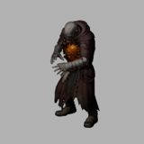 | **Corazón Abierto (disparo)** (7 MB) | héroe, clip de disparo | ✅ Conservar: en uso |
| 2 | 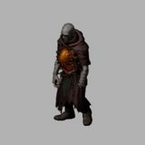 | **Corazón Abierto (andar)** (6 MB) | héroe, andar | ✅ Conservar: en uso |
| 3 | 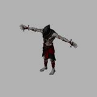 | **Cireneo v2 (cuerpo)** (16 MB) | cargador | ✅ Conservar: en uso |
| 4 | 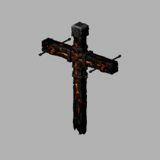 | **Cruz del Cireneo** (20 MB) | cargador | ✅ Conservar: en uso |
| 5 | (solo animación, sin malla) | **Cireneo: clips de andar y cargar + Walking** (1 MB) | animaciones del Cireneo (sin malla) | ✅ Conservar: en uso; sustituyen al Cireneo v1 |
| 6 | 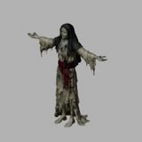 | **Exvoto** (15 MB) | la horda | ✅ Conservar: en uso |
| 7 | 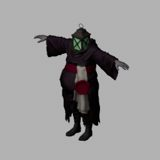 | **Ojo del Tribunal (cuerpo)** (14 MB) | francotirador | ✅ Conservar: en uso |
| 8 | 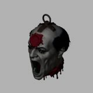 | **Ojo del Tribunal (cabeza)** (14 MB) | francotirador | ✅ Conservar: en uso |
| 9 | 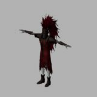 | **Abanderado (cuerpo)** (18 MB) | enemigo | ✅ Conservar: en uso |
| 10 | 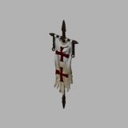 | **Estandarte del Abanderado** (12 MB) | enemigo | ✅ Conservar: en uso |
| 11 | 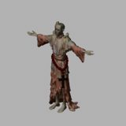 | **Monaguillo** (13 MB) | enemigo | ✅ Conservar: en uso |
| 12 | 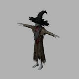 | **Campanero (con barba)** (15 MB) | aún sin integrar, solo en el lore | ✅ Conservar: elegido el 16-nov |
| 13 | 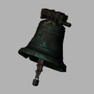 | **Campana del Campanero** (13 MB) | aún sin integrar | ✅ Conservar: va con el Campanero |

## Animaciones compartidas

| # | Render | Modelo | Uso | Propuesta |
| :-- | :-- | :-- | :-- | :-- |
| 14 | 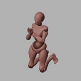 | **Rezar de rodillas** (2 MB) | Exvoto | ✅ Conservar: en uso |
| 15 | 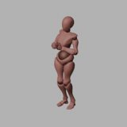 | **Rezar de pie** (2 MB) | Exvoto | ✅ Conservar: en uso |
| 16 | 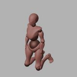 | **Levantarse** (2 MB) | Exvoto | ✅ Conservar: en uso |
| 17 | 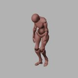 | **Andar triste** (2 MB) | Abanderado | ✅ Conservar: en uso |
| 18 | (solo animación, sin malla) | **Andar normal** (0,4 MB) | Ojo, Abanderado, Corazón | ✅ Conservar: en uso |

## Catedral: props

| # | Render | Modelo | Uso | Propuesta |
| :-- | :-- | :-- | :-- | :-- |
| 19 | 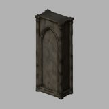 | **Arco gótico** (16 MB) | muro izquierdo | ✅ Conservar: en uso |
| 20 | 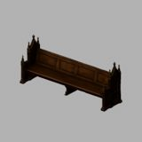 | **Banco gótico** (13 MB) | banco entero | ✅ Conservar: en uso |
| 21 | 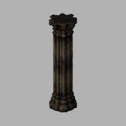 | **Columna** (16 MB) | columna entera | ✅ Conservar: en uso |
| 22 | 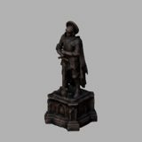 | **Estatua del caballero** (16 MB) | santo | ✅ Conservar: en uso |
| 23 | 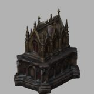 | **Relicario** (0,5 MB) | relicario | ✅ Conservar: en uso |
| 24 | 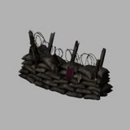 | **Sacos** (17 MB) | sacos | ✅ Conservar: en uso |
| 25 | 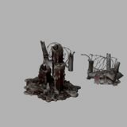 | **Vela derretida** (17 MB) | vela | ✅ Conservar: en uso |
| 26 | 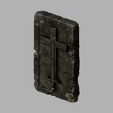 | **Lápida con cruz** (16 MB) | lápidas del suelo | ✅ Conservar: en uso |
| 27 | 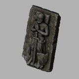 | **Lápida del caballero** (19 MB) | lápidas del suelo | ✅ Conservar: en uso |

## Catedral: suelo

| # | Render | Modelo | Uso | Propuesta |
| :-- | :-- | :-- | :-- | :-- |
| 28 | 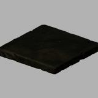 | **Losa lisa** (10 MB + texturas) | suelo | ✅ Conservar: en uso |
| 29 | 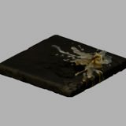 | **Losa con cera** (14 MB) | suelo | ✅ Conservar: en uso |
| 30 | 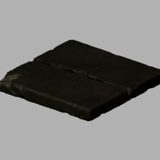 | **Losa con grieta** (13 MB) | suelo | ✅ Conservar: en uso |
| 31 | 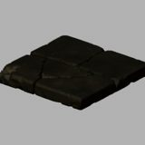 | **Losa rota** (10 MB) | suelo | ✅ Conservar: en uso |
| 32 | 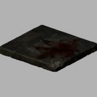 | **Losa con sangre** (16 MB) | suelo | ✅ Conservar: en uso |

## HUD

| # | Render | Modelo | Uso | Propuesta |
| :-- | :-- | :-- | :-- | :-- |
| 33 | 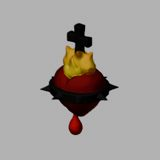 | **Corazón sagrado** (10 MB) | icono de vida | ✅ Conservar: en uso |

## Geometría generada o de prototipo

| # | Render | Modelo | Uso | Propuesta |
| :-- | :-- | :-- | :-- | :-- |
| 34 | 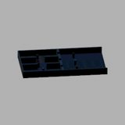 | **Mazmorra 01** (0,3 MB) | la genera un script desde arenas.json | 🗑️ Borrar: es un derivado: se regenera, no hace falta guardarlo |
| 35 | 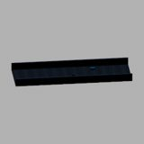 | **Franja de la catedral** (0,2 MB) | la genera un script | 🗑️ Borrar: es un derivado |
| 36 | 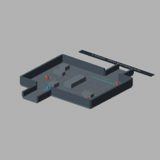 | **Blockout del shooter isométrico (blend, fbx y glb)** (0,9 MB) | prototipo del principio | 🗑️ Borrar: nadie lo usa; queda en el historial de git |
| 37 | 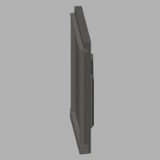 | **Par de ventanas ojivales (blend y glb)** (0,1 MB) | ningún script la usa | 🗑️ Borrar: prueba de vitrales; queda en el historial |

## Legado archivado (ya en el historial de git)

| # | Render | Modelo | Uso | Propuesta |
| :-- | :-- | :-- | :-- | :-- |
| 38 | 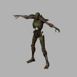 | **Necrón** (53 MB (2 archivos)) | enemigo de la primera época | 🗑️ Borrar: ya está en el historial: archivarlo en LFS gasta cupo para nada |
| 39 | 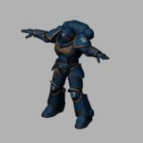 | **Marine espacial** (49 MB (2 archivos)) | héroe de la primera época | 🗑️ Borrar: ídem |
| 40 | 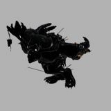 | **Cargador antiguo** (13 MB) | antes del Cireneo | 🗑️ Borrar: ídem |
| 41 | 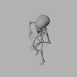 | **Esqueleto sin textura** (2 MB) | antes del Exvoto | 🗑️ Borrar: ídem |
| 42 | 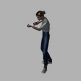 | **Animaciones de rifle y combate del lab** (61 MB (8 archivos)) | catálogo de ejemplo del lab | 🗑️ Borrar: ídem; solo el apuntado pesa 60 MB |
| 43 | 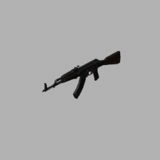 | **Rifles del lab (AK, carabina, rifle, subfusil)** (13 MB) | catálogo del lab | 🗑️ Borrar: ídem |
| 44 | 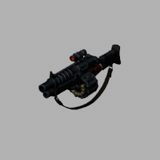 | **Escopeta del marine y francotirador necrón** (25 MB con texturas) | armas Tripo del lab | 🗑️ Borrar: ídem |

## Solo en este disco (nunca versionado)

| # | Render | Modelo | Uso | Propuesta |
| :-- | :-- | :-- | :-- | :-- |
| 45 | 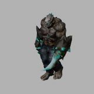 | **Monstruo** (19 MB) | héroe del pipeline Blender antiguo | 🗑️ Borrar: no se usa; al no estar en git, borrarlo es definitivo |
| 46 | 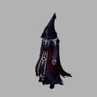 | **Mago** (16 MB) | modelo de prueba tuyo | ❓ Decides tú: no es del juego |
| 47 | 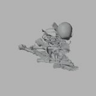 | **Esqueleto muriendo** (3 MB) | modelo de prueba tuyo | ❓ Decides tú: no es del juego |
| 48 | (render no versionado: modelo personal) | **Personaje de prueba (henar)** (10 MB) | modelo de prueba tuyo | ❓ Decides tú: personal; propongo dejarlo fuera del repo |
| 49 | (render no versionado: modelo personal) | **Personaje de prueba (mario)** (14 MB) | modelo de prueba tuyo | ❓ Decides tú: personal; propongo dejarlo fuera del repo |
