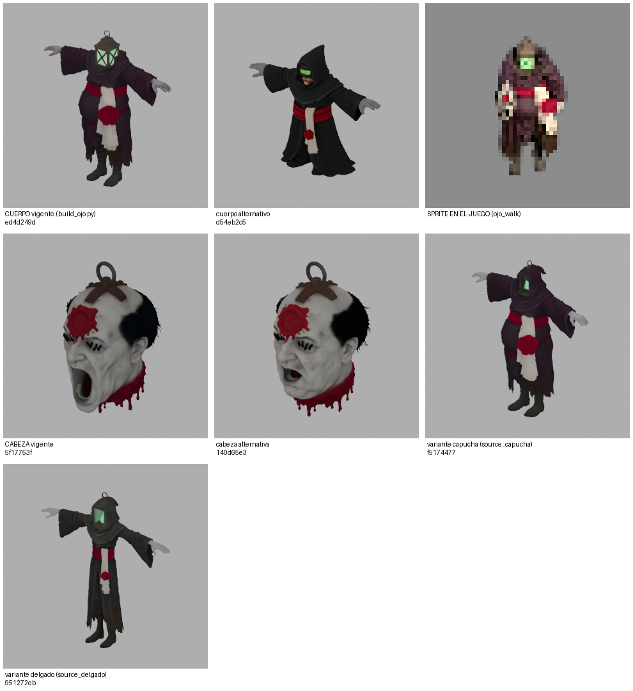
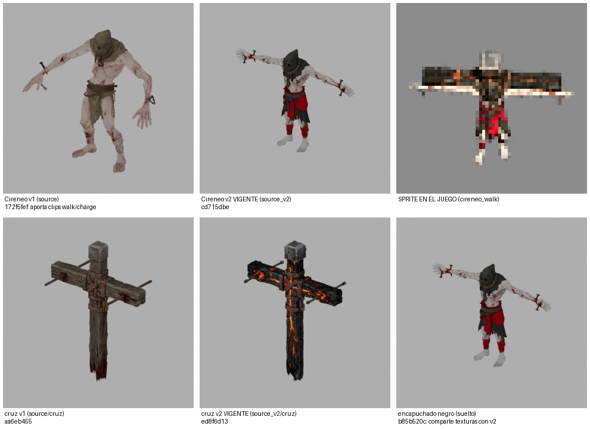
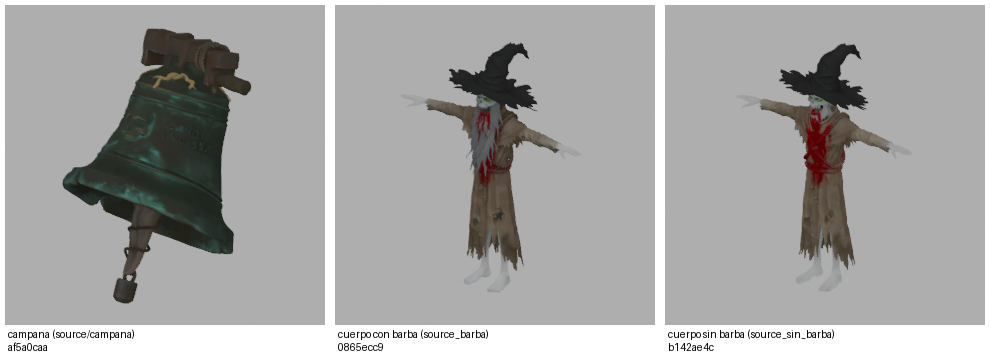
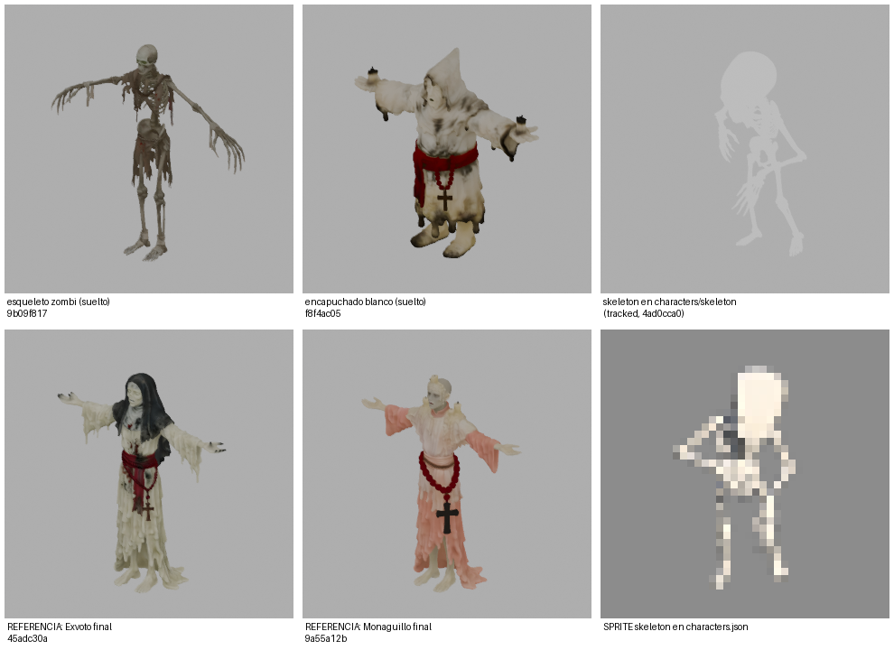
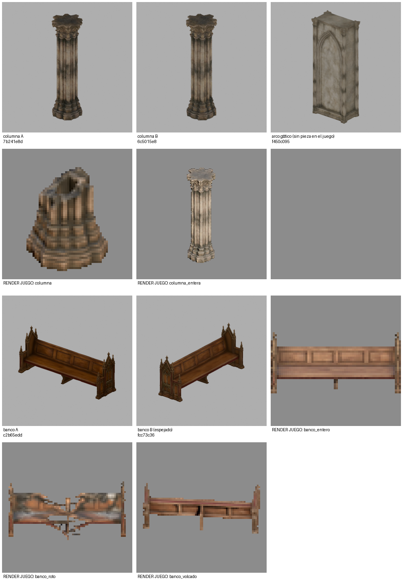
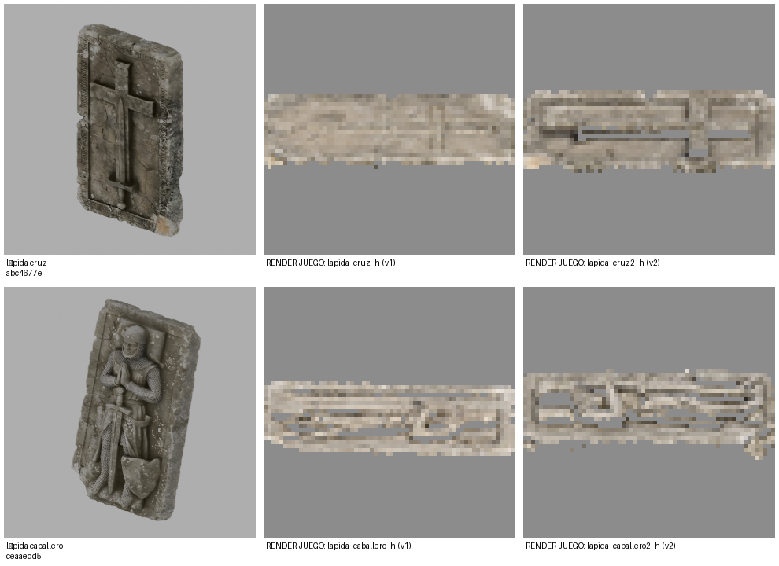
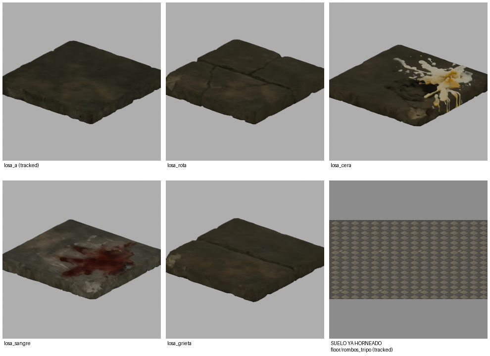

# Inventario de dudas: ¿qué se versiona?

Criterio acordado: solo se guardan y se versionan las versiones **finales y usadas**. Aquí está todo lo que genera duda, con su imagen. Las miniaturas 3D son renders de la malla con textura; donde existe, se muestra también el sprite o render **real del juego** para comparar.

Para cada bloque hay una **propuesta** (qué haría yo) y un hueco **Tu decisión**. Las etiquetas: **Conservar** (se versiona), **Archivar** (se guarda aparte, fuera de lo activo) y **Borrar** (se puede recuperar solo del historial o del zip).

Lo que no genera duda y **se conserva**: Corazón Abierto, Exvoto (45adc30a), Monaguillo (9a55a12b), Abanderado y su estandarte, corazón sagrado del HUD, relicario, santo, vela y sacos.

---

## 1. El Ojo del Tribunal

| Pieza | Qué es | Propuesta |
| :--- | :--- | :--- |
| Cuerpo `ed4d249d` | Túnica oscura con linterna verde como cabeza. **Es el del juego** (el sprite de la derecha sale de él). | Conservar |
| Cabeza `5f17753f` | Cabeza gritando con sello de lacre. **Es la del juego.** | Conservar |
| Cuerpo `d54eb2c5` | Mismo personaje con capucha negra, sin linterna. | Archivar o borrar |
| Cabeza `140d65e3` | Casi idéntica a la vigente; solo cambia el gesto de la boca. | Borrar |
| Capucha `f5174477` | Variante morada con capucha y linterna pequeña. | Borrar |
| Delgado `951272eb` | Variante más esbelta y gris. | Borrar |

Tu decisión: ______

---

## 2. Cireneo

| Pieza | Qué es | Propuesta |
| :--- | :--- | :--- |
| v2 `cd715dbe` | Verdugo encapuchado con faja roja. **El del juego.** | Conservar |
| cruz v2 `ed8f6d13` | Cruz con vetas de lava. **La del juego.** | Conservar |
| v1 `172f5fef` | Cuerpo antiguo, sin capucha negra. **Sigue haciendo falta**: aporta las animaciones de andar y cargar a la v2. | Conservar |
| cruz v1 `aa6eb455` | Cruz de madera antigua. Solo la usa el script de la v1. | Archivar o borrar |
| Encapuchado `b85b520c` | Prácticamente idéntico a la v2 (mismas texturas). Parece una exportación repetida. | Borrar |

Tu decisión: ______

---

## 3. Campanero (aún sin integrar en el juego)

Solo se usa en `LORE.md`. Hay que elegir con barba o sin ella; la campana es única.

| Pieza | Propuesta |
| :--- | :--- |
| Campana `af5a0caa` | Conservar |
| Cuerpo con barba `0865ecc9` | Conservar **una** de las dos |
| Cuerpo sin barba `b142ae4c` | (la otra se archiva o se borra) |

Tu decisión (¿con o sin barba?): ______

---

## 4. Personajes sueltos que no están en el juego

| Pieza | Qué es | Propuesta |
| :--- | :--- | :--- |
| Esqueleto zombi `9b09f817` | Esqueleto con textura. Anterior a la horda de Exvotos. | Borrar |
| Encapuchado blanco `f8f4ac05` | Con rosario rojo y cruz, parece un intento previo del Monaguillo. | Borrar |
| `characters/skeleton` (4ad0cca0) | Esqueleto sin textura; aún tiene entrada en `characters.json` pero no es un personaje del juego actual. | Archivar |

Tu decisión: ______

---

## 5. Props de la catedral

| Pieza | Qué es | Propuesta |
| :--- | :--- | :--- |
| Columna A `7b241e8d` y B `6c5015e8` | Idénticas a la vista. El render `columna_entera` sale de una de ellas; `columna` (base rota) es una edición cuyo original se perdió. | Conservar **una** (la A) |
| Banco A `c2b65edd` y B `fcc73c36` | Mismo banco, B espejado. `banco_roto` y `banco_volcado` son ediciones de uno de ellos. | Conservar **uno** (el A) |
| Arco gótico `f450c095` | Nicho o panel alto. Ninguna pieza del juego lo usa. | Borrar, salvo que lo quieras para algo |

| Pieza | Qué es | Propuesta |
| :--- | :--- | :--- |
| Lápida cruz `abc4677e` y caballero `ceaaedd5` | Originales de las cuatro lápidas del juego (v1 y v2 son ediciones de estas). | Conservar |
| `props/glb/lapida_*_v2.glb` | Único rastro de las ediciones v2 (25 MB entre los dos). | Conservar |

Tu decisión: ______

---

## 6. Suelo de la catedral

Hoy el suelo del juego es el rombo de abajo a la derecha, ya horneado. Las cinco losas son piezas 3D sueltas que lee `bake_cathedral_kit.py`.

| Pieza | Propuesta |
| :--- | :--- |
| `losa_a` (ya en git) | Conservar |
| `losa_rota`, `losa_cera`, `losa_sangre`, `losa_grieta` | Conservar las que entren en el suelo final; el resto, borrar |

Tu decisión (¿qué losas están en el suelo del juego?): ______

---

## Qué nos falta tras esto

- Si aceptas las propuestas, queda por versionar **menos de 400 MB**: los finales de personajes (Ojo, Campanero, Abanderado…), una columna, un banco, cuatro lápidas con sus `.glb`, estatua, vela, sacos, relicario y unas cuantas losas.
- Los zips del `inbox` ya no hacen falta para nada que se conserve.
