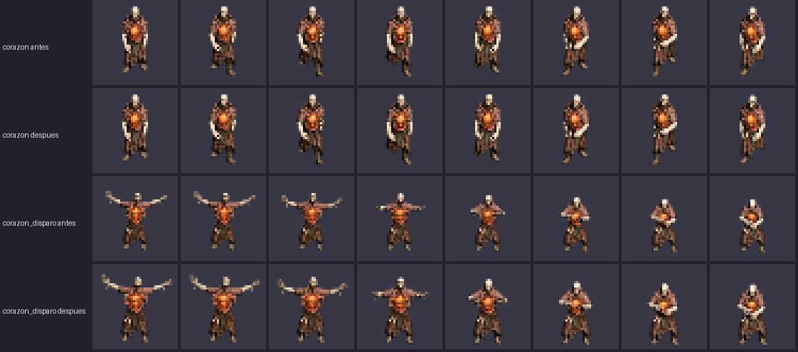
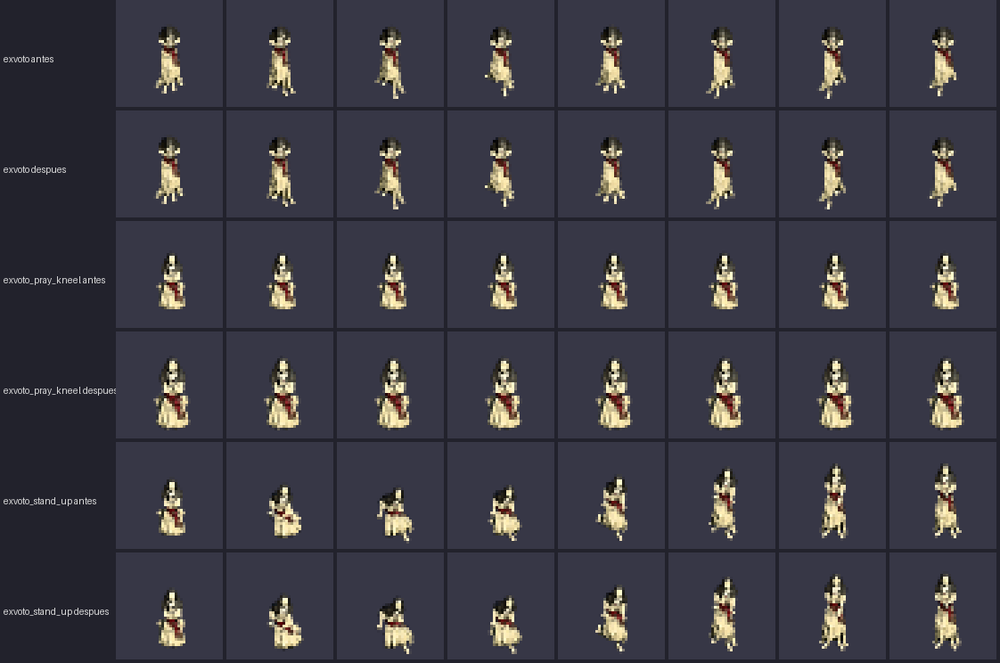
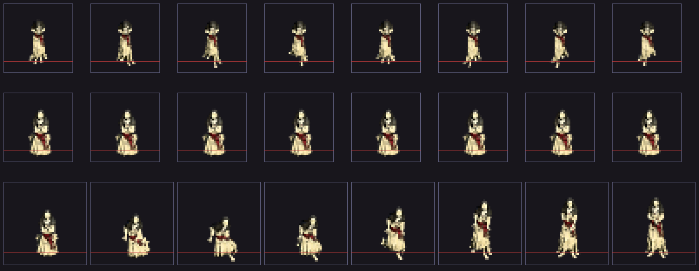

# Auditoría de assets 3D y manifiesto (2026-11-16)

Objetivo: saber qué hay, qué está versionado, qué sobra y poder regenerar todos los sprites desde los originales. Solo lectura sobre los assets; no se ha borrado nada. El registro vivo está en [`assets/MANIFEST.md`](../../assets/MANIFEST.md).

## Hallazgos

1. **Los originales de personajes están bien organizados**, cada uno en su `source*/`, y los scripts `build_*.py` saben cuál usar. Cireneo, Abanderado, Exvoto, Monaguillo y Corazón están en git. **Ojo y Campanero no** (unos 240 MB solo en este disco).
2. **Los zips de `inbox/processed` son casi todo copia.** Comparando contenido byte a byte, 25 de 43 zips (643 MB) están ya extraídos en `source*/` o en `floor_tiles`: se pueden borrar sin perder nada.
3. **Los props de la catedral sí están en riesgo.** Columna, banco, lápidas, santo, vela, sacos y arco solo existen como zips UUID (unos 326 MB): sus carpetas de trabajo se borraron y el `.gitignore` excluye sus `.fbx`. Hoy no se pueden regenerar sus renders si se pierde el disco.
4. **Los zips no dicen qué contienen** (nombre UUID). El manifiesto los identifica por el nombre de las texturas internas. El relicario y tres o cuatro zips más quedan por confirmar.
5. **Ya existe medio manifiesto**: `characters.json` enlaza modelo y sprite, pero cubre 14 entradas y no incluye Abanderado ni Monaguillo (usan sus `regen_*`). Entran necron y skeleton, sin uso.
6. **Legado sin uso o dudoso** (unos 560 MB): necron, spacemarine, monster, charger, custom, dreadhollow (316 MB de previews externas) y scifi_dungeon.
7. **Variantes sin decidir**: Campanero (con o sin barba), Ojo (capucha, delgado, dos cabezas y dos cuerpos).

## Qué se puede borrar, archivar o conservar

| Qué | Tamaño | Propuesta |
| :--- | :--- | :--- |
| 25 zips redundantes de `inbox/` (ya extraídos, comprobado por contenido) | 643 MB | borrar |
| 17 zips sin copia extraída (props, esqueleto zombi y 4 del legado marine/necron/charger) | 326 MB | extraer a carpeta con nombre, versionar y luego borrar el zip |
| Previews y GLB de dreadhollow | 316 MB | borrar (pack externo recuperable) |
| Necron, spacemarine, monster, custom | ~160 MB | preguntar: no se usan en el juego |
| Derivados `*_walk.fbx` etc. | ~480 MB | no versionar, se regeneran con los scripts |
| Variantes descartadas de Ojo y Cireneo v1 | ~60 MB | archivar o borrar tras decidir |

Estimación de lo que habría que versionar tras la limpieza: unos 400 a 500 MB de originales (personajes ~330 MB, props 326 MB, suelo y HUD ~60 MB, menos duplicados). Es el dato que decide el almacén (al final, Git LFS: ver la última sección).

## Pendiente

- Validar con el usuario qué legado se borra y qué variante de Ojo y Campanero es la vigente.
- Extraer los zips de props a `assets/models/environment/cathedral/props/<pieza>/` y completar el manifiesto.
- Probar la regeneración completa de un personaje desde su original (Ojo) como prueba de que el manifiesto basta.
- Decidir almacén con el tamaño real.

## Decisiones del usuario sobre el inventario de dudas (2026-11-16)

Detalle y imágenes en [`inventario.md`](inventario.md).

- Se aceptan las propuestas del Ojo, los sueltos y el Campanero (con barba).
- Cireneo: en lugar de conservar el v1 solo por sus animaciones, se extraen los clips de walk y charge a un FBX de solo animación (en curso).
- Props: una columna, un banco normal y el roto. Se descubre que el roto, el volcado y la columna rota eran modelos Tripo del 8-nov cuyo zip no existe: solo quedan sus renders. El volcado se hará por código.
- El arco gótico es el muro de la catedral (se conserva). Las lápidas y el suelo tienen su cadena documentada (`tools/catedral_editor/gen/README.md`, `tools/floor/rombos_tripo.py`): el suelo usa las cinco losas.

## Almacén: de DVC con Google Drive a Git LFS (2026-11-17)

- Se montó DVC con Google Drive (puntero en git y datos en Drive) y se llegó a subir todo (449 MB). Funcionaba, pero exigía un proyecto de Google Cloud con credenciales OAuth, usuarios de prueba y una autorización que caduca: el usuario no quería depender de algo que no entendía. Se quitó DVC entero.
- **Git LFS:** sigue siendo git (`add`, `commit`, `push`) y GitHub guarda los archivos grandes aparte. Cupo gratuito: 10 GiB de almacenamiento y 10 GiB de descarga al mes. En LFS van unos 1.050 MB en 232 archivos: todos los originales 3D con sus texturas, el archivo legado y los vídeos ya versionados.
- Los hooks de graphify impedían que `git lfs install` instalara los suyos; las llamadas de LFS se añadieron a mano (detalle en `TECHNICAL.md`, «Assets pesados: Git LFS»).
- **Catálogo:** `assets/MANIFEST.md` pasa de cubrir solo los 3D a cubrir todas las familias (sprites, entorno, HUD, audio, vídeos, cartas, intro), con su fuente, su script, lo que usa la ROM y el almacén. Lista también las anomalías abiertas.
- **Política:** `AGENTS.md`, «Ciclo de vida de los assets»: entrada en `inbox/`, evaluación, adopción, derivados, sustitución, retirada y limpieza del inbox.
- Queda por borrar la copia en Drive, el proyecto de Google Cloud y la caché `C:\codexlocal\dvc-cache`. Se hará cuando `git push` haya subido los datos a GitHub.

## Catálogo visual y reordenación (2026-11-17)

- [`catalogo.md`](catalogo.md): los 49 modelos 3D con render y propuesta. El usuario aprobó borrar los 12 propuestos: legado (necrón, marine, cargador antiguo, esqueleto, armas y animaciones del lab), blockout, ventanas ojivales, geometría de arenas (pasa a derivado ignorado) y el monstruo. Quedan sin decidir sus cuatro modelos de prueba personales, que no se versionan.
- **Personajes y animaciones separados:** `characters/
/source/` solo modelo con esqueleto; `animations/<grupo>/` solo clips sin malla.
  - Corazón: una malla y dos clips, más `build_corazon.py`.
  - Cireneo: `source_v2` pasa a `source`, sus clips a `animations/cireneo/` y su andar es el `walk_normal` compartido (era un duplicado byte a byte).
  - Campanero: el cuerpo con barba en `source/`.
  - Sin maniquí de Mixamo en `pray/*` y `sad_walk` (de ~2 MB a 0,6-1,3 MB).
- **Verificación:** poses de todos los huesos y frames antes y después con diferencias ≤ 5e-6 (umbral 1e-4) en Corazón, Cireneo, Exvoto y Abanderado. Sprites del Corazón con el lab:
  - andar, 182 píxeles distintos de 102.400;
  - disparo, 9.463 con un máximo de 27/255 por canal: los dos FBX originales traían normales distintas y ahora hay una sola malla. A la vista no se distingue ([comparación ×4, diferencia ×8](assets/corazon_disparo_ab.png)).
  - Los sprites del juego no se han regenerado.
- **Riesgo anotado:** `build_corazon.py` restituye el desfase de tiempo original de los clips reescribiendo los tiempos del FBX con módulos internos de Blender 5.2; puede romperse con otra versión de Blender.

## Escala fija por personaje y re-render completo (2026-11-17)

- **Problema:** el render encuadraba cada animación según su propia amplitud. Una pose más abierta alejaba la cámara y el personaje salía más pequeño. Corazón disparando salía al 87 % de su andar, el Exvoto arrodillado y levantándose al 80 %, y la carga del Cireneo al 94 %. El Exvoto lo compensaba con zooms ajustados a mano.
- **Arreglo:** cada personaje se renderiza a los píxeles por metro de su animación de andar. Las demás animaciones llevan `scaleRef` en `characters.json` y heredan esa escala, sin zooms por animación. Si una pose no cabe, esa animación lleva una celda mayor: el Exvoto levantándose pasa a 48 px, ocupa +32 KB de ROM y no necesita cambios en el código del juego. Regla y tabla sprite → modelo → animación: `assets/MANIFEST.md` §2.
- **Resultado:** todas las animaciones están a escala 1,000 de su referencia, todos los personajes están re-renderizados y la ROM compila sin avisos.

- **Pendiente:**
  - Medir en la DS.
  - Las variantes `cathedral-playground` no compilan, tampoco en `main`: falta declarar `g_hw_shadows_on` con `GODRAYS_PROTO`. Mientras siga así, no se puede capturar el levantarse en la ROM.
