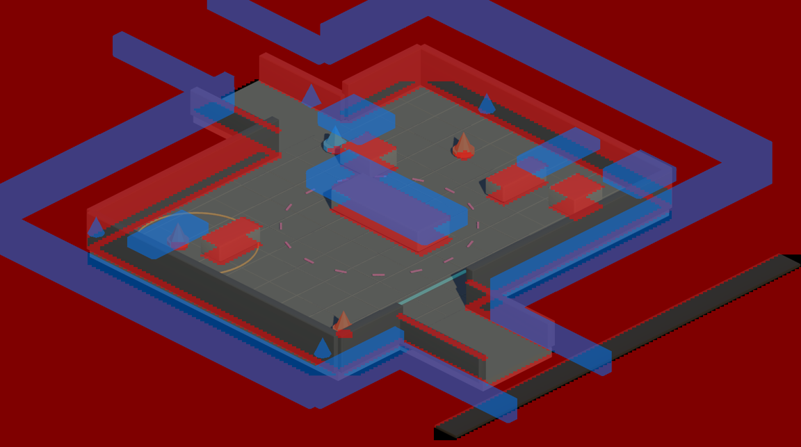
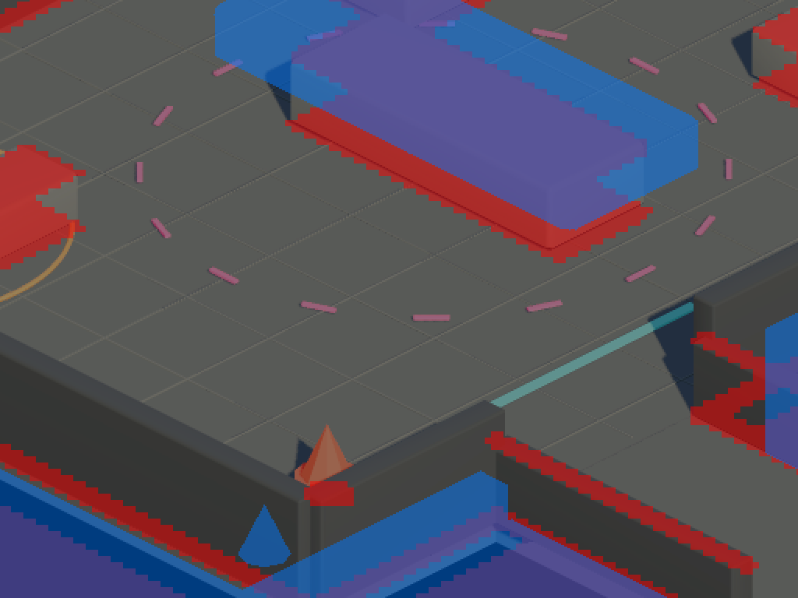
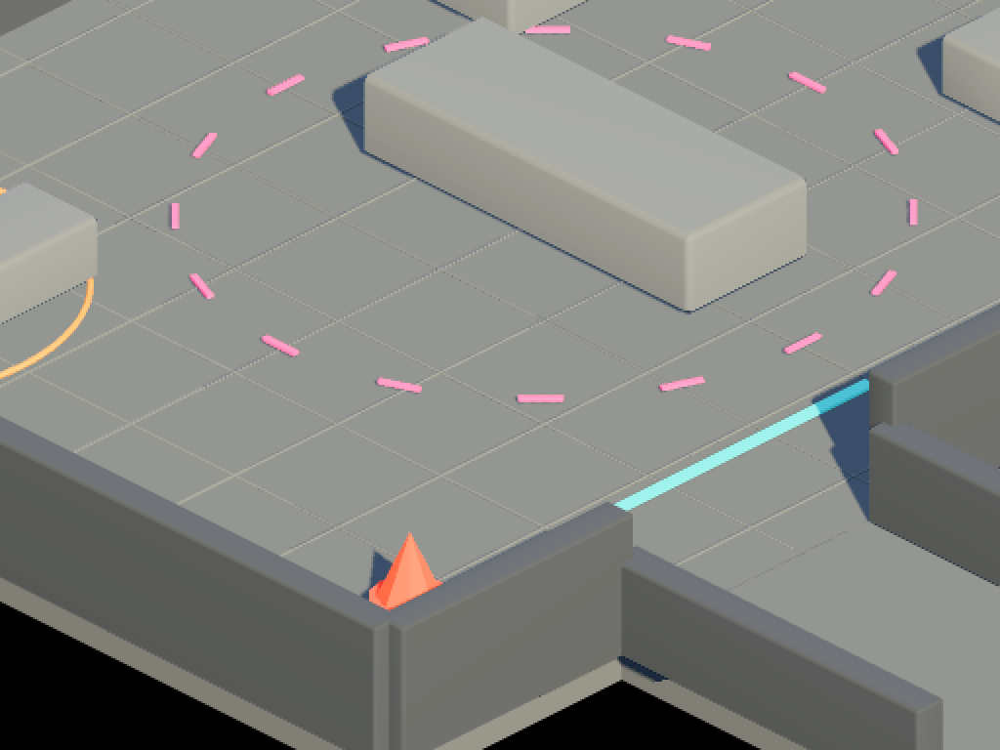

# Auditoría de saneamiento 2D/3D (2026-11-02)

Solo análisis; no se ha cambiado código. Fuentes: revisión directa de `source/main.c` y del exportador del lab, más tres subagentes (pipeline→runtime, gameplay, higiene/tests).

## 0. Diagnóstico en una frase

El juego guarda **todo en coordenadas de pantalla 2D** (posición del actor = píxel del `world.png`), pero colisión y oclusión salen de **dos máscaras PNG independientes** exportadas por el lab, generadas con reglas 3D distintas entre sí y distintas del render. El runtime las combina con heurísticas 2D (la "base" de una pared es el último píxel de la columna). Personajes y sombras van bien porque comparten ancla y cámara; el escenario no, porque sus tres representaciones (imagen, colisión, oclusión) no están garantizadas como la misma geometría.

## 1. Cadena real de datos

| Dato compilado | Generador | Origen |
| :--- | :--- | :--- |
| `dungeon_bg_tiles.c` | `tools/bake_isometric_shooter_bl.py` | `world.png` (render Three.js del lab) |
| `diablo_dungeon.c` (colisión) | idem | `collision.png` ← `buildMapCollisionGrid()` en `tools/lab/FBX-Web-Renderer-parity.js:2058` |
| `dungeon_occlusion.c` | idem | `occlusion.png` ← `generateMapOcclusionCanvas()` en `FBX-Web-Renderer-parity.js:2373` + heurística `foot_y` del baker |
| `player_sprite.c` | `tools/generate_player_sprites_c.py` | sprites 40×40 del lab (`render_all_40px_headless.cjs`, elev 30) |
| `dungeon_data.c` (4.3 MB fuente) | `convert_*_to_c.py` legacy | **muerto**: cripta 36×36 antigua |

TECHNICAL.md describe todavía el pipeline Blender/`ds_look.py`/cripta, que ya no produce nada de lo que se compila.

## 2. Problemas de escenario (causa de lo que ves)

Rojo = bloqueado (collision.png), azul = oclusor (occlusion.png), morado = ambos.

 

**Oclusión**
1. **El 65,3 % de los píxeles oclusores caen sobre vacío** (`world.png` negro). El exportador rasteriza *todas* las caras por encima de 0,65 m sin test de profundidad ni de orientación; el render sí descarta caras (backface culling / muros de corte). Resultado: muros invisibles (sobre todo el perímetro sur y los laterales) que tapan al personaje.
2. Además la silueta oclusora no coincide con la visible: en el bloque central la zona azul sobresale arriba-izquierda del bloque renderizado → la cabeza del personaje se tapa detrás de "aire".
3. Sólo cuenta lo que está **por encima de 0,65 m**: la parte inferior de cada pared nunca ocluye. En los muros bajos del sur la franja superior de la cara no es oclusora → el personaje parado justo detrás del muro se dibuja **encima** del muro.
4. Profundidad = último píxel contiguo de la columna (`bake_isometric_shooter_bl.py:206-222`). Dos objetos apilados en pantalla (pilar delante de pared) se fusionan y heredan la base del más cercano; dinteles/arcos toman su borde inferior como "suelo". Sólo 146 de 858 tramos muestreados terminan en suelo caminable.
5. Agrupación de runs con tolerancia 4 px y `max_d`; runs de 1 px descartados (`:225-243`).
6. Runtime a celdas de 4×4 px (`OCCLUSION_DEPTH_SHIFT 2`, `main.c:52`) con `max` → recortes escalonados, hasta 16 px de sprite cortados por 1 px de muro.
7. El jugador ocluido se dibuja en frames impares (`main.c:500`) → parpadeo a 30 Hz en vez de silueta/transparencia.
8. El mapa de oclusión sólo se reconstruye si la cámara se mueve ≥4 px (`main.c:369`), dejando una franja de borde sin oclusores.

**Colisión**
9. La regla del lab mezcla dos cosas: huella en el suelo (XZ) de paredes **y** la tapa de los obstáculos bajos proyectada **a su altura** (`FBX-Web-Renderer-parity.js:2108-2117`). Esa tapa cae en pantalla sobre el suelo que hay *detrás* del obstáculo → muro invisible al norte de cada caja/cobertura.
10. Las caras verticales proyectadas a XZ tienen área cero: los muros se convierten en líneas de 1–2 celdas, sensibles al redondeo (umbral >40 % blanco en el baker, `:159`).
11. Doble fuente de verdad del suelo: `position_is_free` exige también píxel no negro del render (`main.c:228`); el baker convierte a índice 0 cualquier color casi negro → 89 islas (12.563 px) de suelo caminable bloqueadas sin motivo visible (sombras oscuras).
12. **Colisión y movimiento isotrópicos en pantalla** (`main.c:219-250`, `1519-1530`): un círculo de 6 px de pantalla es una elipse 1:2 en el suelo, y moverse en vertical recorre el doble de suelo que en horizontal. Por eso los choques "se notan" a distinta distancia según el eje.
13. Melee del charger sin comprobación de muro; LOS bloquea con `flags == 3` mientras las balas con bit `0x02`.

**Escala**
14. Mapa a 40,42 px/m; sprites a ~40,8 px/m de zancada; ningún test enlaza ambos. `PLAYER_ANCHOR_Y` vale 35 en el header, 32/33 en los datos y 28 en el test.

## 3. Gameplay (subagente Sonnet)

- **Bugs**: lead del tirador anulado por un `>>8` de más (`enemy_ai.c:419`); fallback de spawn con coordenadas del mapa antiguo (380,227) sin validar (`encounters.c:117,165`); `invuln_timer` nunca se asigna; pool de 16 pickups sin expiración pierde drops en silencio.
- **Código muerto**: sistema de lanzas óseas en `main.c` (nunca se activa), kill/drop duplicado en 3 sitios, hitscan enemigo sin uso, `enemy_ai_init` sin llamar, `legacy_lance_contract_stub` con lectura no inicializada.
- **Rendimiento**: `sweep_position` con división int64 por paso (software en ARM9).
- **Diseño no implementado**: navegación BFS (los enemigos se atascan en esquinas), detección por ruido.

## 4. Higiene

- `dungeon_data.c` legacy enlazado sólo para `init_obj_sprite_bounds` (escanea 40×96×96 px al arrancar): ~737 KB de ROM sin uso.
- Tests host (`python tests/<f>.py -v`, sin pytest): **12 pasan, 4 no**. Fallan `occlusion_depth_contract` (32.962 runs, límite 5000), `occlusion_grid_contract` (exige `OCCLUSION_DEPTH_SHIFT 1`), `shadow_masks` (faltan `assets/dungeon_e30/`) y `scenario_state_assertions` (importa `runtime/run_scenario`, inexistente). `world_void_contract` pasa porque se salta entero (7/7 skip). `sprite_ground_anchor` pasa con ancla 28 que no es la real.
- 17 escenarios `wh40k_*` + `ruins_*` + `character_switch_test` (skeleton) sobre geometría/personajes que ya no existen (viola la regla 5 de nomenclatura verídica). `wh40k_charger_north_occlusion_probe.json` tiene BOM y no parsea con `json.load`.
- Clutter ignorado por git: `archive/` 93 MB, `scratch/` 83 MB, `artifacts/` 21 MB; `assets/inbox/` 64 MB sin trackear; ROMs viejas `dungeonds_e30.nds`/`_e60.nds` en raíz; ~49 scripts de `tools/` sin referencia.
- STATUS.md con mojibake (UTF-8 leído como Latin-1).
- HANDOFF/TECHNICAL mencionan `smooth_lightmap.c`, niebla, cripta y Blender, que ya no existen.

## 5. Plan de saneamiento propuesto

1. **Una sola geometría → tres máscaras coherentes (exportador del lab).** Generar colisión y oclusión desde el *mismo* pase que el render:
   - Oclusión = buffer de profundidad del render real (mismas caras visibles, mismo culling) → por píxel guardar la **Y de pantalla del punto de suelo bajo ese píxel** (proyectar el punto 3D visible a altura 0). Esto sustituye la heurística `foot_y` y resuelve apilados, arcos y muros invisibles.
   - Colisión = sólo huella en el suelo (corte horizontal 0,05–1,0 m) rasterizada con grosor; eliminar la "tapa a su altura".
   - Suelo caminable = máscara exportada, no "píxel no negro".
2. **Coordenadas de suelo en runtime.** Mover actores en (x, y) de suelo (ej. 8.8 en píxeles de suelo con y×2) y proyectar sólo al dibujar: velocidad, diagonales y radio de colisión pasan a ser isotrópicos en el mundo.
3. **Oclusión por píxel o a 2×2**, con silueta/dither estable en vez de parpadeo.
4. **Tests de coherencia**: % oclusor sobre vacío ≈ 0; todo píxel de base de muro visible tiene oclusor; ancla única desde un solo header; escala px/m mapa = sprites.
5. **Purga**: `dungeon_data.c`, lanzas legacy, `tile_center_*`, `CACHE_*`, segmentos de oclusión, generadores obsoletos, escenarios wh40k; actualizar TECHNICAL/HANDOFF.
6. Bugs de gameplay de la sección 3.
