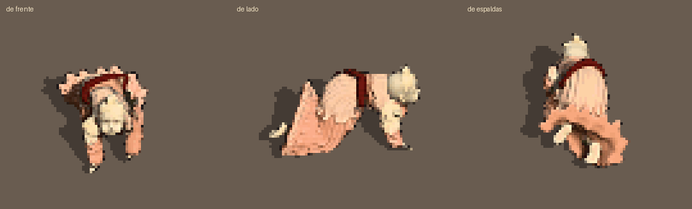

# Los Bebés gatean (clips para los vídeos de lore)

Estado: **aprobado** (2026-11-26). Es solo para vídeos: no va a la ROM.

Cuatro momentos del ciclo: [hoja de contacto](assets/bebe_gatear_contacto.png).

## Qué hay

- Clips nuevos del generador: `exvoto_bebe_gatear` (32 fotogramas), `exvoto_bebe_rezar` (16) y `exvoto_bebe_walk` (8), en `assets/sprites/bestiary/`, con las 8 direcciones y sombra.
- Gateo a partir de `assets/models/animations/crawl/crawling.fbx` (Mixamo), en el sitio.
- Ajustes sobre el clip: pecho más bajo para que las manos apoyen (el Bebé tiene los brazos muy cortos) y cabeza alzada para que la cámara le vea la cara.
- Se regenera con `build_exvoto_tier.py ... exvoto_bebe --crawl-only` y después `python tools/characters/build_exvoto_bebe_video.py`.

## Comprobado

- El generador de vídeos carga los tres clips en las 8 direcciones.
- Nada se corta; nada atraviesa el suelo (menos de 1 mm en el peor fotograma). Las manos apoyadas quedan a unos 3-4 cm sobre un cuerpo de 1 m: alrededor de un píxel.
- El ciclo enlaza.
- No se ha renderizado el vídeo 01 ni se ha tocado su guion.
