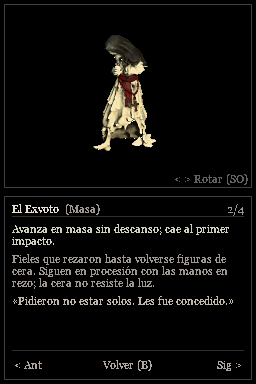
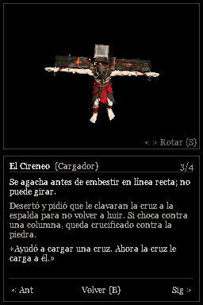
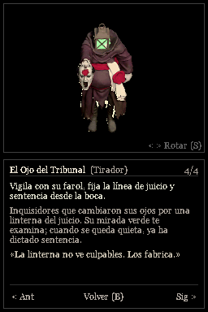

# Walkthrough: Bestiario de DungeonDS (`feat/bestiario`)

## Resumen

Implementado el bestiario jugable de DungeonDS siguiendo las decisiones fijadas en `DESIGN.md` §6.11:

- **Maquetación B minimalista con ilustraciones a resolución completa (160×160 px):** fondo negro puro y borde gris muy fino (`1 px`) en ambas pantallas.
  - **Pantalla superior:** ilustración animada a tamaño completo (160×160 nativos) cargada bajo demanda desde NitroFS (`nitrofiles/bestiary/*.bin`), centrada con el bounding box unido de la animación para estabilidad absoluta. Soporta rotación en **8 direcciones** con la cruceta (`LEFT` / `RIGHT`), con indicador discreto de orientación (`< > Rotar (S)`) en la esquina inferior.
  - **Pantalla inferior:** ficha de texto en español (nombre, rol, comportamiento en 1 línea, lore y cita) + navegación minimalista (`< Ant`, `Volver (B)`, `Sig >`) con soporte táctil, gatillos (`L`/`R`) y cruceta vertical (`UP`/`DOWN`), más botón `B` para salir.
- **Fuente bitmap en español (`include/bestiary_font.h`, `source/bestiary_font.c`):** fuente serif legible generada desde `tools/gen_bestiary_font.py` con soporte ASCII + tildes, `ñ/Ñ`, `ü/Ü`, `¡ ¿ « » — ·` (~2,4 KB en ROM).
- **Pipeline de retratos NitroFS (`tools/gen_bestiary_portraits.py`):**
  - Empaqueta 8 direcciones por personaje con paleta común BGR555 de 256 colores cuantizada con Pillow.
  - Carga en runtime con solo `fseek` + `fread` de 1 sola dirección a la vez a un buffer estático de 144 KB (máx 132 KB en Cireneo).
  - *Fallback* 2× de los sprites ROM si NitroFS no estuviera disponible.
- **Integración limpia (`source/bestiary.c`, `source/main.c`):** entrada y salida sin tirones sobre las páginas bitmap existentes; accesible mediante `bestiary_run(...)` para el futuro menú inicial, mediante `L + R + SELECT` en la ROM normal o directo al arranque con la variante `bestiary` (`BESTIARY_START=1`).

## Evidencia Visual

### Hoja de contacto 4× NEAREST (las 4 fichas en DeSmuME con retratos 160×160)

### Capturas individuales y retorno limpio al juego
- **1/4 — El Corazón Abierto:** 
- **2/4 — El Exvoto:** 
- **2/4 — El Exvoto rotado:** 
- **3/4 — El Cireneo:** 
- **4/4 — El Ojo del Tribunal:** 
- **Retorno al juego (`active == 0`):** 

## Verificación

- **Compilación BlocksDS:**
  - `default` (`dungeonds.nds`): `DS_BUILD=PASS warnings=0 new_warnings=0`
  - `bestiary` (`dungeonds-bestiary.nds`): `DS_BUILD=PASS warnings=0 new_warnings=0`
- **Tests de host (`run-host-tests.ps1`):** `DS_HOST_TESTS=PASS passed=18 failed=0` (incluyendo `tests/test_bestiary_assets_contract.py` y `tests/test_bestiary_contract.py`).
- **Escenario headless (`scenarios/bestiary_tour.json`):** `DSM_SCENARIO_RESULT=PASS name=bestiary_tour frames=90 wall_ms=1537` (recorre las 4 fichas con `R`, comprueba rotación con `RIGHT`, verifica `entry_index` 0..3 y confirma retorno limpio con `active == 0`).
- **Prueba física en DS:** pendiente de subir/probar por el usuario cuando confirme la subida por FTP.
