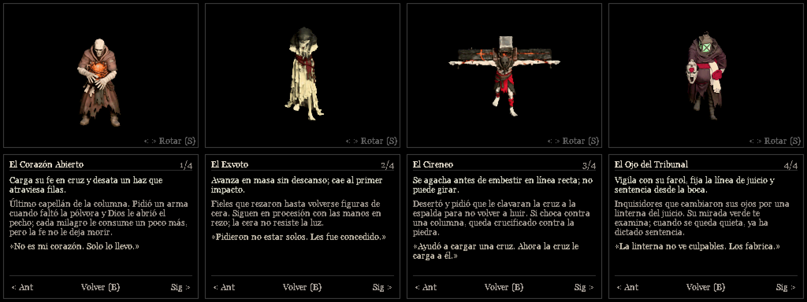
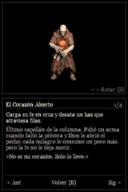
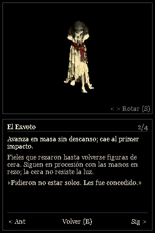
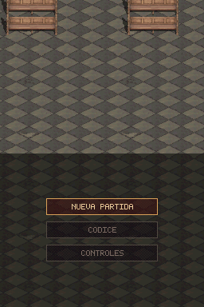

# Walkthrough: Códice / Bestiario de DungeonDS (`feat/bestiario`)

## Resumen

Implementado y validado en Nintendo DS física el códice jugable de DungeonDS siguiendo las decisiones fijadas en `DESIGN.md` §6.11:

- **Maquetación B minimalista con ilustraciones a resolución completa (160×160 px):** fondo negro puro y borde gris muy fino (`1 px`) en ambas pantallas.
  - **Pantalla superior:** ilustración animada a tamaño completo (160×160 nativos, preset C2) cargada bajo demanda desde NitroFS (`nitrofiles/bestiary/*.bin`), centrada con el bounding box unido de la animación para estabilidad absoluta. Soporta rotación en **8 direcciones** con la cruceta (`LEFT` / `RIGHT`), con indicador discreto de orientación (`< > Rotar (S)`) en la esquina inferior.
  - **Pantalla inferior:** ficha de texto en español (nombre limpio sin etiquetas de rol arquetípico, comportamiento en 1 línea, lore y cita) + navegación minimalista (`< Ant`, `Volver (B)`, `Sig >`) con soporte táctil, gatillos (`L`/`R`) y cruceta vertical (`UP`/`DOWN`), más botón `B` para salir.
- **Fuente bitmap en español (`include/bestiary_font.h`, `source/bestiary_font.c`):** fuente serif legible generada desde `tools/gen_bestiary_font.py` con soporte ASCII + tildes, `ñ/Ñ`, `ü/Ü`, `¡ ¿ « » — ·` (~2,4 KB en ROM).
- **Pipeline de retratos NitroFS y corrección de puntos blancos en hardware (`tools/gen_bestiary_portraits.py`):**
  - Empaqueta 8 direcciones por personaje con paleta común BGR555 de 256 colores cuantizada con Pillow (`MEDIANCUT` a 255 colores).
  - **Corrección del punteado blanco en DS física:** antes se anteponía `(0,0,0)` en el índice 0 de la paleta de cuantización, desplazando el blanco más brillante de `MEDIANCUT` al índice 1; al pre-multiplicar bordes semitransparentes sobre negro, los píxeles oscuros del borde caían en el índice 0 (`(0,0,0)`) y eran reasignados forzosamente al índice 1 (blanco puro `RGB15(31,31,28)`). Ahora se cuantiza directamente contra los 255 colores reales del personaje y se suma `+ 1` (`1..255`), reservando `0` exclusivamente para transparencia y garantizando con test de contrato (`test_no_dark_edge_pixels_mapped_to_bright_palette_entry`) que ningún píxel de borde oscuro apunte a una entrada clara.
  - Carga en runtime con solo `fseek` + `fread` de 1 sola dirección a la vez a un buffer estático de 144 KB (soporta 8 o 16 frames por dirección según `s_portrait_hdr.num_frames`).
- **Giro de linterna de El Ojo del Tribunal (`tools/characters/build_ojo.py`):**
  - Limpiados los pesos del auto-rig de Tripo en la jaula superior del farol (`z >= 0.775 m`), que antes quedaban anclados un ~34 % a los hombros/brazos, y reasignados a `Head`/`Neck`.
  - Añadido barrido de búsqueda (`±38°` en `Head` + `±8°` en `Neck`) al caminar, tanto en el sprite de juego (56×56 px) como en el códice, donde gira al **50 % de velocidad** respecto al paso (`ojo_walk_bestiary.fbx`, 16 frames por dirección = 2 ciclos de paso por cada barrido completo de linterna).
- **Integración limpia con el menú (`CODICE`) y hardware DS (`source/bestiary.c`, `source/menu.c`, `source/main.c`):**
  - El botón del menú inicial y del menú de pausa pasa a llamarse `CODICE` y abre directamente el visor.
  - Al entrar en `bestiary_run(...)` se ocultan las capas hardware de suelo y OAM (`top_hw_bg`, `bot_hw_bg`, `DISPCNT`, `BLDCNT`, `oamClear` + `oamUpdate`) y se restauran al salir con `swiWaitForVBlank()`.

## Evidencia Visual

### Hoja de contacto 4× NEAREST (las 4 fichas en DeSmuME con retratos 160×160)

### Capturas individuales y retorno limpio al juego
- **1/4 — El Corazón Abierto:** 
- **2/4 — El Exvoto:** 
- **2/4 — El Exvoto rotado:** 
- **3/4 — El Cireneo:** 
- **4/4 — El Ojo del Tribunal:** 
- **Retorno al juego (`active == 0`):** 

## Verificación

- **Compilación BlocksDS:**
  - `default` (`dungeonds.nds`): `DS_BUILD=PASS warnings=0 new_warnings=0`
  - `bestiary` (`dungeonds-bestiary.nds`): `DS_BUILD=PASS warnings=0 new_warnings=0`
- **Tests de host (`run-host-tests.ps1`):** `DS_HOST_TESTS=PASS passed=21 failed=0` (incluyendo `tests/test_bestiary_assets_contract.py`, `tests/test_bestiary_contract.py` y `tests/test_menu_contract.py`).
- **Escenario headless (`scenarios/bestiary_tour.json`):** `DSM_SCENARIO_RESULT=PASS name=bestiary_tour frames=90` (recorre las 4 fichas con `R`, comprueba rotación con `RIGHT`, verifica `entry_index` 0..3 y confirma retorno limpio con `active == 0`).
- **Prueba física en Nintendo DS:** validado por el usuario en consola real (sin puntos blancos, maquetación, textos y giro de linterna aprobados).
