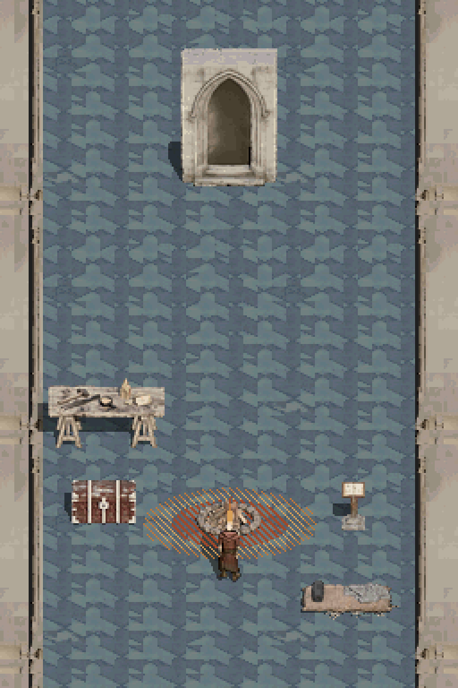
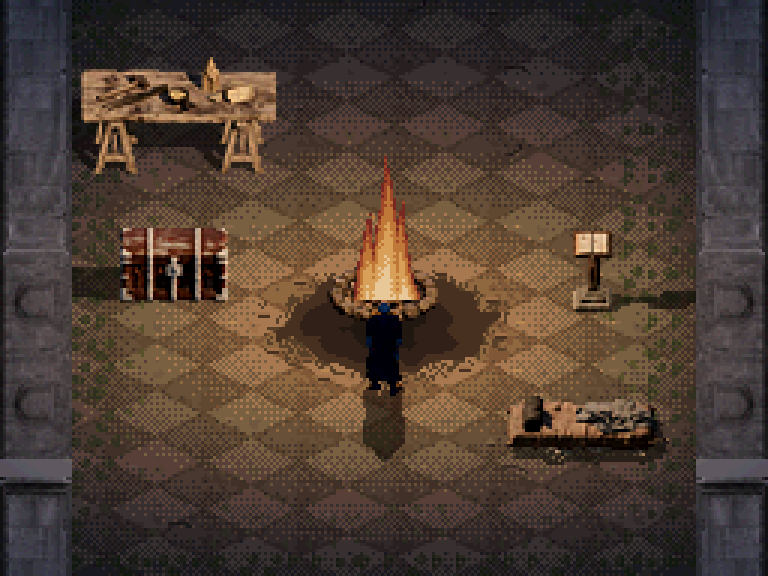

# Campamento nocturno (`proto/arpg`, 2026-11-21)

El campamento deja de parecerse a la catedral: patio exterior de noche, iluminado solo por la hoguera, con la luz horneada (sin sombras dinámicas). Decisión escrita en `DESIGN.md` §7.5.

| Antes | Ahora |
| :--- | :--- |
|  |  |

## Qué cambia
- **Suelo:** la losa de la catedral recoloreada a tierra y piedra apagada, musgo en los bordes, grietas y un círculo de tierra quemada bajo el fuego. La luz de la hoguera va horneada en 7 bandas de brillo con tramado, y su parpadeo se hace modulando entradas de paleta (`source/camp_floor_light.c`). [`suelo_parpadeo.png`](assets/suelo_parpadeo.png)
- **Fuego:** llama animada precalculada de 8 frames (~46 px) con paleta apagada; desaparece el aura de puntos. [`fuego_frames.png`](assets/fuego_frames.png)
- **Props:** mesa, arcón, atril, jergón y leña re-renderizados con luz cálida desde la dirección del fuego y relleno azul frío; sus sombras apuntan al lado contrario. [`props_hoja_contacto.png`](assets/props_hoja_contacto.png)
- **Héroe:** 8 variantes de luz y de sombra (hoguera en S, SW, W, NW, N, NE, E, SE) leídas de NitroFS; el juego elige según dónde esté respecto al fuego, con histéresis. [`heroe_8_luces.png`](assets/heroe_8_luces.png), [`rom_heroe_8_posiciones.png`](assets/rom_heroe_8_posiciones.png)
- **Marco de muros:** kit de 3 piezas (panel liso, panel con portón, contrafuerte) generado por el usuario como imágenes y compuesto como sprite a todo color: norte = contrafuerte, panel, portón, panel, contrafuerte; laterales = paneles con contrafuertes cada 5 paneles. La puerta es el panel central (sigue siendo interactuable). [`marco2_superior_3x.png`](assets/marco2_superior_3x.png), [`marco2_uniones_6x.png`](assets/marco2_uniones_6x.png)
- **Sin rótulos** sobre los props (diegético).
- **Arreglo:** las banderas de giro de los tiles del suelo se emitían en formato de kit y el motor las descartaba (bloques rectos junto al fuego). Antes/después: [`rom2_antes_despues_fuego.png`](assets/rom2_antes_despues_fuego.png)

Referencias: [`decisiones_campamento.html`](assets/decisiones_campamento.html) (ronda de decisión), prompts del kit en `assets/environment/camp/prompts_muros.md`.

## Pendiente
- **Revisar la perspectiva de los muros laterales** (decidido por el usuario): el frontal queda bien, pero los laterales son la textura frontal en escorzo afín (compuesta en Python) y parecen PNG pegados; la perspectiva no resulta convincente. Hay que reconstruirlos para que se lean como pared con volumen (p. ej. render 3D del kit con la cámara del juego, o rehacer el escorzo). Detalle en `TECHNICAL.md` §campamento y `STATUS.md`.
- **Rendimiento en la DS:** no medido. El marco son ~40.000 píxeles opacos por frame; el héroe lee un fotograma de NitroFS por cambio de (azimut, dirección, frame). Medir con `build-project.ps1 -Variant perf` en la catedral normal (regla 6).
- Mesa como Crisol de desguace (decidido, sin implementar); señal diegética de foco sin rótulos (sin decidir); atenuación por distancia en la luz del héroe y retoque del contraste del muro norte (opcionales).

## Verificación
Build 0 avisos; escenarios `campamento_captura` (incluye entrar a la catedral por la puerta), `campamento_8luces` y `campamento_fuego_solo` (solo evidencia, `suite:false`); tests de host: ver `STATUS.md`. Sin prueba en la DS.

## Documentos revisados
`DESIGN.md` §7.5 (nuevo), `TECHNICAL.md` (lab rápido y campamento), `STATUS.md`, `assets/MANIFEST.md`. `LORE.md` y `AGENTS.md` sin cambios.
