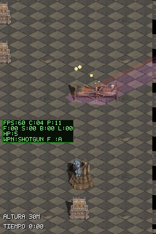
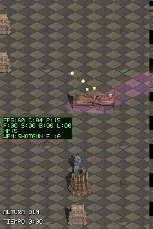

# Corrección de oclusión y colisión de props en la catedral

> **Revisión 2026-11-10:** el usuario comprobó la ROM en DS y confirma que colisiones y oclusiones de props siguen fallando. El PASS de contacto de esta entrega solo cubre la columna, semilla y ruta de ese escenario; no cierra los demás props ni las aproximaciones desde otros lados. Ver [cierre y diagnóstico](../catedral-cierre/walkthrough.md).

## Síntoma

El marine siempre se dibujaba por delante de los props, y la colisión se comportaba como una línea sin profundidad.

## Cambio

- El baker generaba profundidad solo para columnas y santos; ahora genera spans de oclusión para los seis props físicos.
- La huella ahora se hornea como runs 2D de celdas de 4×4 px. `foot_anchor_y_px` alinea esa huella con el origen de profundidad y evita que el padding de la sombra desplace la base.
- Las lápidas decorativas siguen sin colisión ni oclusión.
- La máscara de `banco_volcado` está vacía; como solución conservadora el baker usa su rectángulo de contenido completo. El prerender de esa pieza debe corregirse para recuperar una forma precisa.

## Evidencia

Capturas de la ROM en DeSmuME: el personaje se detiene en la huella y se separa al retroceder.

## Verificación

- `build-project.ps1 -Variant cathedral-playground`: PASS, cero warnings nuevos; kit dentro de presupuesto (1.024 tiles, ventana máxima 224, oclusión máxima 14.838/32.768 runs).
- Tests de host: 9 PASS.
- `cathedral_props_depth_collision`: PASS; contacto y retroceso sobre una columna del layout con semilla fija.
- `cathedral_playground_respawn`: PASS.
- `cathedral-playground-perf`: compilada sin warnings nuevos; chequeo `upload-rom.ps1 -DryRun` PASS (sin conexión FTP).
- Pendiente: probar esta build en la DS física y medir el coste de oclusión antes de fusionar. Esta ROM no se ha vuelto a subir.
