# Cepo legible (cepo-abc)

Rama `feat/cepo-abc`, base `arpg`, 2026-11-26.

## Problema

El cepo de las salas 4, 5 y 12 salía naranja y plano. El giro "de frente" de `props.json` nunca se aplicó (el lab rápido ignora `yaw`) y de frente no se leen los agujeros.

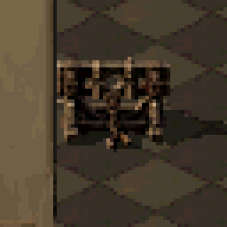

## Ronda 1: giro 3/4 y tamaño

`yaw_extra` -45 (vista 3/4) y `target_width` 40. Variantes A/B/C:

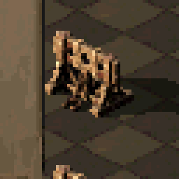 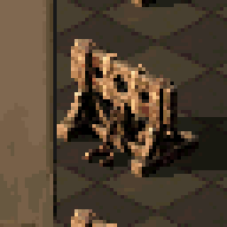 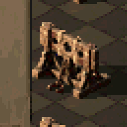

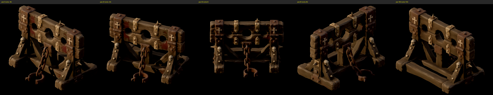
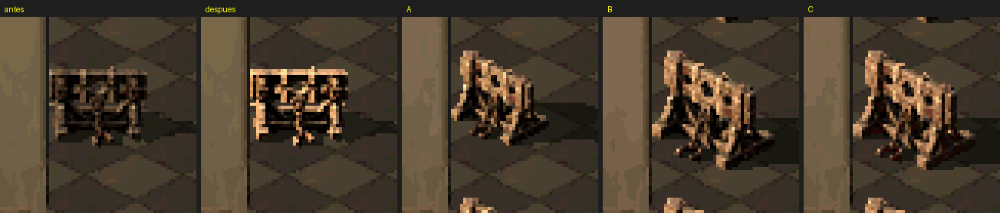
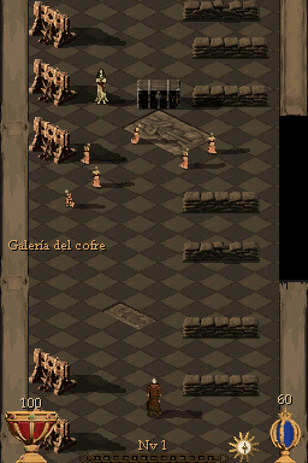

## Ronda 2: madera oscura por material

Nueva opción `material_grade` en `prerender_props.py`: madera, metal y sangre se clasifican sobre el render de alta resolución y cada uno recibe su ajuste.

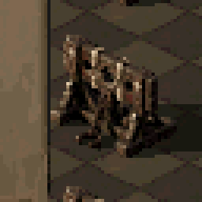 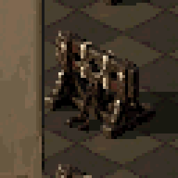 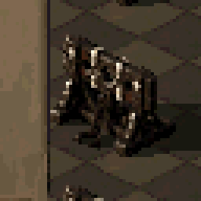
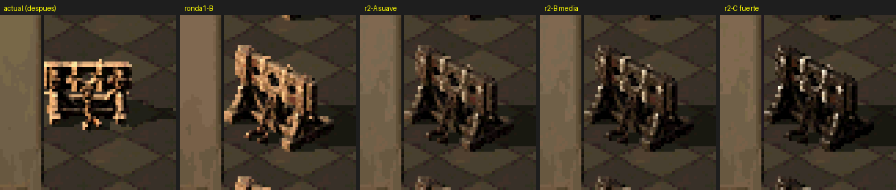

**Elegida: B media** (`material_grade` wood 0.6, metal 1.3, blood 0.75, metal_desat 0.6).

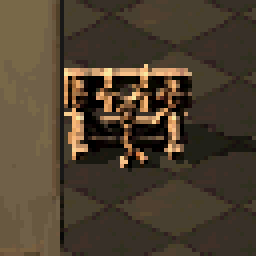
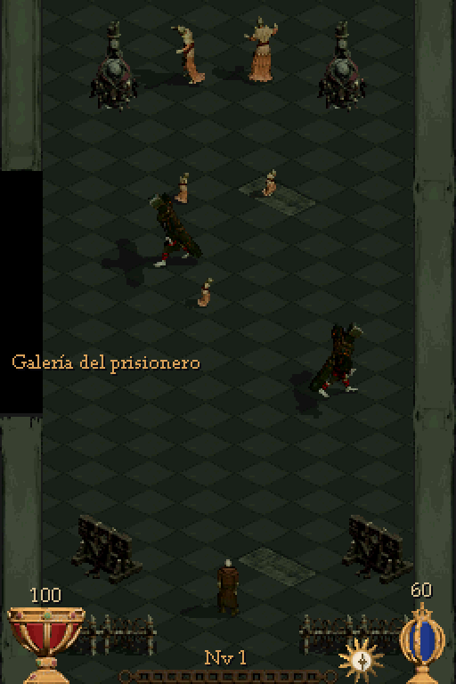

Página de la ronda: [`cepo_abc.html`](cepo_abc.html).

## Verificación

- Build `-Clean` PASS, sin avisos nuevos.
- Capturas de la ROM en las salas 4 y 12 (escenario `scenarios/cepo_abc.json`, `suite: false`, solo evidencia).
- Cepo: 23 tiles únicos (antes 16). `galerias` 743/1024 y `prisionero` 658/1024 tiles.
- No medido en la DS: prop fijo de decorado.

## Nota técnica

- Re-hornear un prop de sala: `arpg_light_props.py <grupo> --kit --only cepo`, luego sin `--kit`, `arpg_light_pack.py <grupo>` completo y build `-Clean`. Si no, la ROM descarta el `.rmk` o `nitrofiles` queda desfasado.
- El `yaw` de `props.json` no lo aplica el lab rápido; hace falta `yaw_extra` (anotado en `TECHNICAL.md` §3).

## MDs

`DESIGN-ARPG.md`, `TECHNICAL.md`, `STATUS-ARPG.md`, `STATUS-ARCHIVE.md` actualizados.
