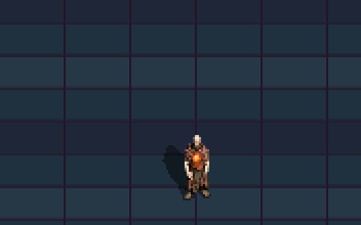
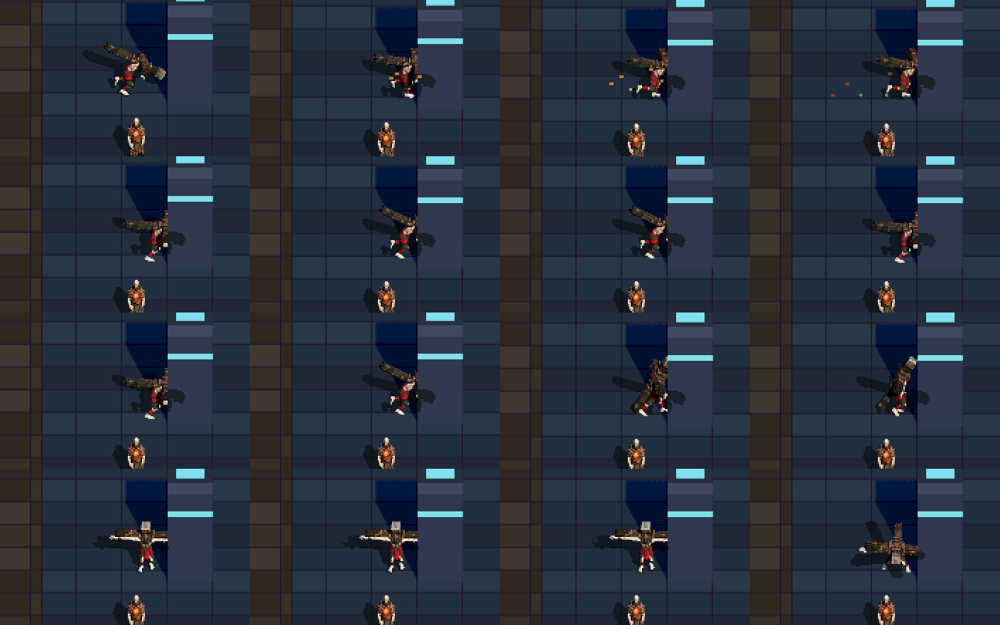

# Cireneo: atasco contra muros y columnas (`feat/cireneo-atasco`, 2026-11-24)

## Qué cambia para el jugador

Cuando el Cireneo choca contra un muro o columna en plena carga, ya no se queda congelado en la primera pose del andar. Hace un **atasco en tres tiempos** durante 90 frames:

1. **Impacto:** 6 astillas y polvo de colores apagados salen del punto de contacto.
2. **Forcejeo:** de cara al muro, alterna una pose de la carga y la de la telegrafía cada 8 frames (`CHARGER_JAM_STRUGGLE_TICKS`).
3. **Liberación:** un paso atrás de unos 6 px y vuelve a su comportamiento normal.

Reutiliza poses existentes: sin sprites nuevos ni memoria extra. El aturdimiento por disparo no cambia. La decisión está escrita en `DESIGN.md`.

## Evidencia

Ciclo completo a 4x (escenario `scenarios/cireneo_atasco_gif.json`, `suite: false`, solo evidencia):

Hoja de contacto a 2x:

## Verificación

- Build por defecto y sandbox: 0 avisos nuevos.
- Escenario de evidencia: PASS.
- **Pendiente:** no se ha medido en la DS (`perf`); el rendimiento no está certificado.

## MDs

Solo `DESIGN.md` (decisión del atasco) y `STATUS.md` (entrega; la más vieja pasa a `STATUS-ARCHIVE.md`). Sincronizados con `proto/arpg`.
