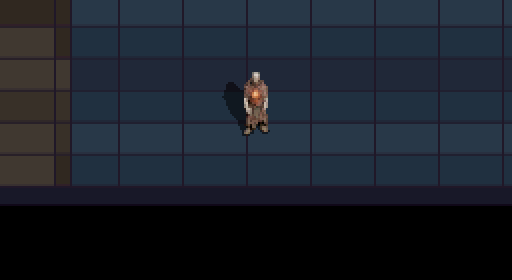
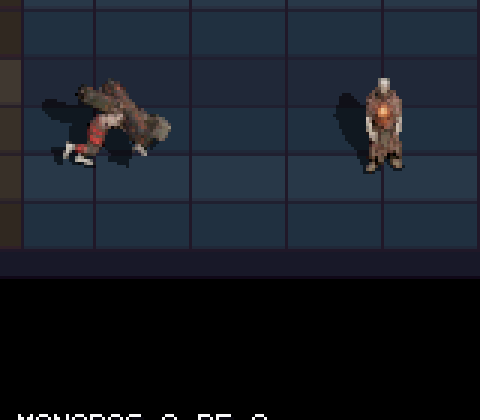
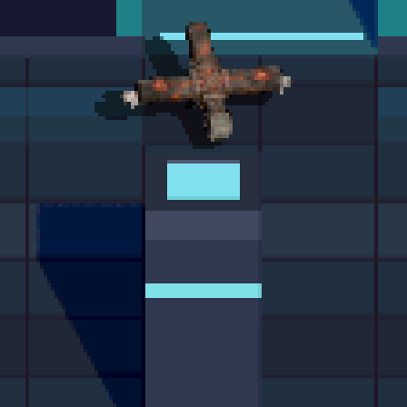
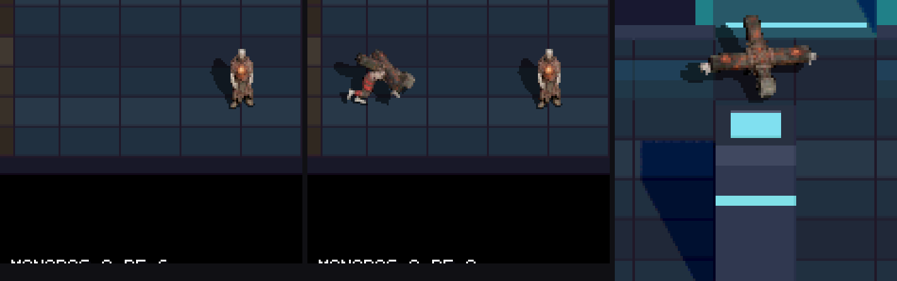

# Cireneo v2 en la ROM: tamaño 60×60, postura de carga casi paralela al suelo y ritmo de pasos (`feat/cireneo-rom`)

Integración del Cireneo de la cruz (`CHAR_CHARGER`) en la ROM con tamaño de sprite ampliado un 50 %, clip propio para telegrafía y carga, y ritmo de animación ajustado a la velocidad de desplazamiento.

## Resultado en la ROM (capturas y GIF de DeSmuME)

**Andar, telegrafía y carga en tiempo real (ROM real, ampliado 2×, 15 fps / 4 frames DS por fotograma)**:

**Carga lateral frente a Corazón Abierto** (`enemy_charger_lunge_hits_player`, 4×):

**Carga frontal hacia una columna** (`enemy_charger_charge_into_column_stuns`):

**Hoja de contacto (telegrafía | carga lateral | carga frontal)**:

## Cambios realizados

1. **Sprite un 50 % mayor (60×60 px)**:
   - Exportado `cireneo_walk.fbx` en el lab headless (`tools/lab/export_character_headless.cjs --resolution 60 --fitZoom 0.88`). La altura visible pasa de 28–32 px a **41–48 px** (claramente por encima de los 34–35 px de Corazón Abierto).
   - `CharacterConfig` (`include/player_sprite.h`, `source/player_sprite.c`, `source/main.c`) pasa a guardar `sprite_w`, `sprite_h`, `shadow_w`, `shadow_h` por personaje, manteniendo el resto de personajes en 40×40.
   - El volumen de impacto del francotirador (`include/hitvolume.h`, `source/weapons.c`) escala a 1,5× (`CHARGER_BODY_HIT_CY=21, RX=23, RY=27`) para cubrir al cargador de 60×60.

2. **Cruz más larga (`CRUZ_LOWER_K = 0.70`)**:
   - En `tools/characters/build_cireneo_v2.py`, subido `CRUZ_LOWER_K` de `0.40` a `0.70` para que el palo inferior de la cruz conserve su proporción de cruz latina sin atravesar el suelo al andar.
   - Comprobado sobre los spritesheets de 60×60 que toda la cruz entra con margen dentro de la celda (nada se recorta).

3. **Clip de carga inclinado casi paralelo al suelo**:
   - En `tools/characters/build_cireneo_v2.py`, `LEAN_CHARGE` pasa de `(10, 11, 11, 11, -16, -14)` a `(25, 22, 22, 18, -28, -20)` (`CHARGE torso angle f0 = 77,4°` respecto a la vertical).
   - Regenerado `cireneo_charge.fbx` en Blender y exportado a 60×60 (`assets/sprites/characters/cireneo_charge/`).
   - Integrados 4 frames (`0, 2, 4, 6`) en `g_charger_charge_frames` para `ENEMY_STATE_TELEGRAPH` (frame 0) y `ENEMY_STATE_CHARGE` (ciclo de 4 frames), desplazados +3 filas (`walk_anchor 50 - charge_anchor 47`) para mantener los pies en la misma línea de suelo.
   - Para respetar el límite de 3,5 MiB de EWRAM en la DS, `tools/generate_player_sprites_c.py` recorta las máscaras de sombra de 120×120 a 80×80 centradas en `(60, 60)` (toda la sombra del Cireneo cabe en `[-38..21] × [-37..5]`, ahorrando 250 KiB).

4. **Ritmo de pasos sin efecto «alfombra mágica»**:
   - **Andar (`CHASE`)**: `anim_period = 8` (8×8 = 64 frames de juego por zancada de ~37,86 px a velocidad 150 = 0,586 px/frame → 37,5 px por ciclo).
   - **Carga (`CHARGE`)**: ciclo de 4 frames a 4 ticks/frame (`16` frames de juego por zancada a velocidad 650 = 2,54 px/frame → 40,6 px por ciclo).

## Verificación

- Compilación limpia (`0 warnings`) en `default` (`dungeonds.nds`) y `sandbox` (`dungeonds-sandbox.nds`).
- Escenarios headless en `sandbox`:
  - `enemy_charger_charge_into_column_stuns`: `PASS` (160 frames)
  - `enemy_charger_lunge_hits_player`: `PASS` (129 frames)
  - `enemy_charger_shotgun_stuns_telegraph`: `PASS` (91 frames)
- Pendiente antes de mergear a `main`: prueba en la DS con la nueva animación de carga/pasos, restaurar el reparto `60/15/25` en `include/horde.h` (temporalmente en `30/50/20` para facilitar la prueba en DS) y añadir clip propio de `stuck` si hace falta.
