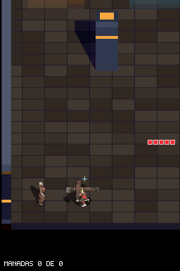
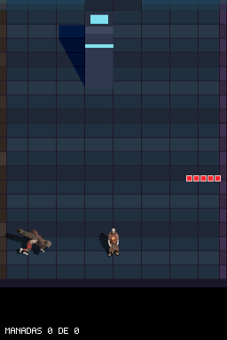

# Telegrafía sobria del Cireneo (`feat/cireneo-telegraph`)

Sustitución del parpadeo arcade en `ENEMY_STATE_TELEGRAPH` por una animación corporal progresiva en 3 fases (`walk[0] → cireneo_telegraph → charge[0]`), un pulso único de brasa tras la cruz al fijar la dirección y un temblor contenido de 1 px en los últimos 10 frames antes de embestir (`DESIGN.md` §6.9.1).

## Evidencia en la ROM (DeSmuME)

**Cireneo en pose de telegrafía agachada frente al Corazón Abierto** (`enemy_charger_shotgun_stuns_telegraph`):

**Inicio de la carga tras la telegrafía** (`enemy_charger_lunge_hits_player`):

## Cambios realizados

1. **Decisión de diseño (`DESIGN.md` §6.9.1):**
   - Retirado el parpadeo del sprite durante `ENEMY_STATE_TELEGRAPH`.
   - Definida la telegrafía como agachado progresivo + temblor de tensión de 1 px + pulso único de brasa tras la cruz.

2. **Keyframe `cireneo_telegraph` a 60×60 en EWRAM (`assets/sprites/characters/cireneo_telegraph/`, `tools/generate_player_sprites_c.py`, `include/player_sprite.h`):**
   - Exportado `cireneo_telegraph.fbx` en el lab headless (`60×60`, `fitZoom 0.88`).
   - Integrado el keyframe intermedio (frame 6, agachado con pies abiertos) como `g_charger_telegraph_frames` (`8 dirs × 1 frame = 56,25 KiB`) para respetar el límite de 3,5 MiB de EWRAM, reutilizando `g_charger_frames[d][0]` al inicio, `g_charger_charge_frames[d][0]` al final y `g_charger_charge_shadow_masks` para la sombra.

3. **FSM y render (`source/enemy_ai.c`, `source/main.c`):**
   - `update_charger`: avanza la fase de telegrafía en 3 tramos (`0..5 → 6..19 → 20..29`) sin divisiones.
   - `draw_enemy`: eliminada la línea de parpadeo; añadido `draw_telegraph_pulse` (8 trazos radiales en enteros con recorte por oclusión `occlusion_blocks_pixel`, tonos brasa apagados) y temblor de `1 px` en los últimos 10 frames.

## Verificación

- Tests de host: `python -m unittest tests/test_charger_contract.py` (`16` tests `OK`).
- Compilación limpia (`0 warnings`): `default` (`dungeonds.nds`) y `sandbox` (`dungeonds-sandbox.nds`).
- Escenarios headless en `sandbox`:
  - `enemy_charger_lunge_hits_player`: `PASS` (130 frames)
  - `enemy_charger_charge_into_column_stuns`: `PASS` (161 frames)
  - `enemy_charger_shotgun_stuns_telegraph`: `PASS` (93 frames)
