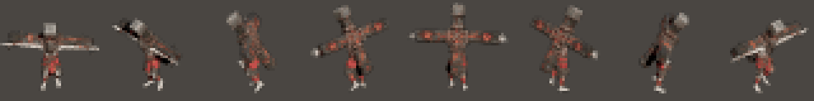
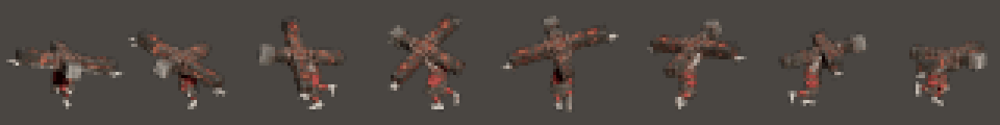
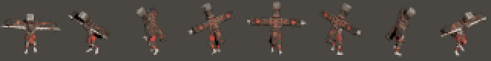
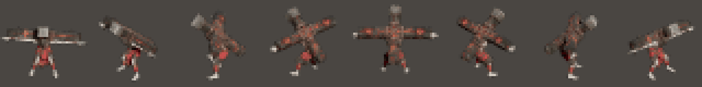

# Cireneo v2: modelo con acentos negro y rojo (2026-11-12, rama `feat/cireneo-v2`)

El usuario rehízo los personajes con acentos negros y rojos (`DESIGN.md` §6.10). Este walkthrough cubre el nuevo Cireneo y su cruz carbonizada, con las mismas cuatro animaciones que la primera versión (`walkthroughs/anim-cireneo/`).

## Resultado a escala de juego (lab, 40 px, 8 direcciones, ampliado 4x)

**Andar**

**Carga**

**Telegrafía**

**Atascado**

Hojas de contacto en Blender (vistas frontal, de perfil y cenital): `assets/sheet_<clip>.png`.

## Cómo se reutilizan las animaciones

- **Script:** `tools/characters/build_cireneo_v2.py`, copia de `build_cireneo.py` con un paso extra.
- **Andar y carga:** el modelo nuevo viene rigeado por Tripo pero sin animaciones, en T-pose. El antiguo estaba en pose A. Las rotaciones de Tripo son relativas a la pose de reposo, así que no se copian tal cual:
  - el armature antiguo se escala por la altura de `Hips` (k = 0,988);
  - cada hueso del cuerpo y de las piernas del nuevo copia la rotación en espacio de mundo del antiguo;
  - se hornea la animación.
  - Los ángulos de piernas y tronco coinciden con los del original.
- **Andar rehecho con Mixamo:** el andar de Tripo no movía los pies (1–2 mm en todo el ciclo; ya pasaba en la v1). Se sustituye por `source_v2/anim/Walking.fbx` (Mixamo), retargeteado a mano compensando las poses de reposo (COPY_ROTATION giraba el cuerpo 90°), sin desplazamiento horizontal, repartido en 40 frames y con +5° de cadera y +6° por vértebra para que vaya encorvado. Ahora los pies avanzan 31–33 cm y se levantan unos 10 cm.
- **Telegrafía, atascado, brazos fijos y cruz:** se generan igual que en la v1. La cruz solo cambia `CRUZ_BAR_Z` (de 58,07 a 57,62), porque mide lo mismo que la anterior.
- **Fuentes:** `assets/models/characters/cireneo/source_v2/`, con el personaje y la cruz en `cruz/`. Los FBX de salida no se versionan.

## Pendiente

- El andar de la v1, ya en `main`, sigue sin mover los pies; la v2 lo sustituye.

- Igual que en la v1: tamaño de 46 px e integración en la FSM del cargador.
- En la carga y la telegrafía, los brazos se inclinan junto con el travesaño. Es lo correcto, porque van clavados a él.
