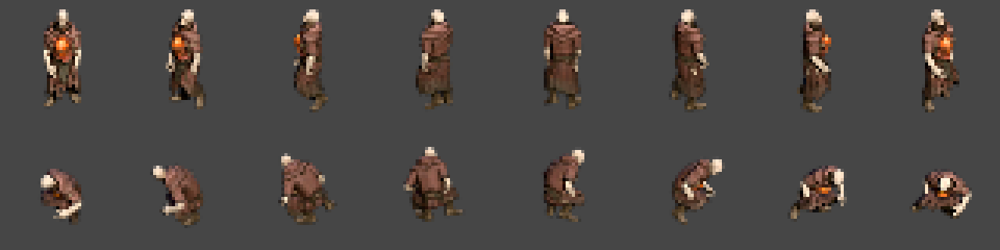
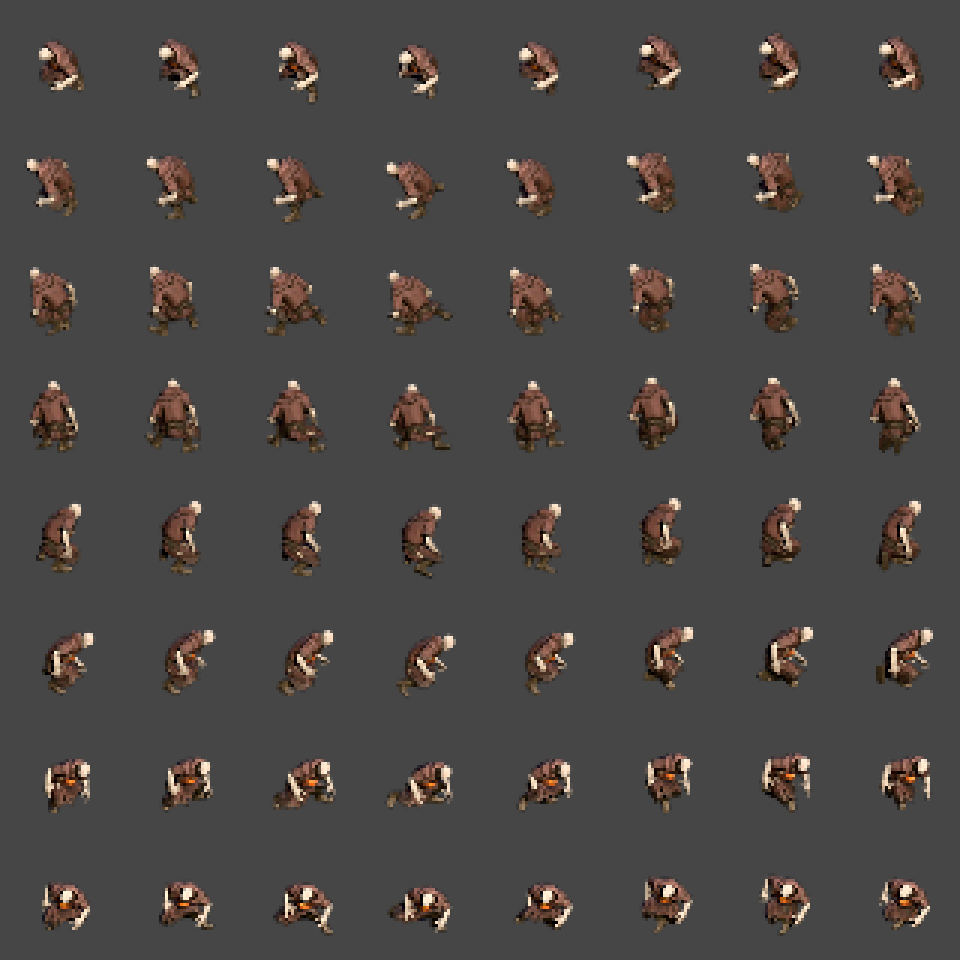
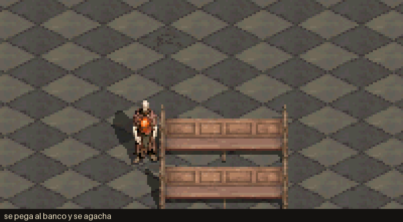
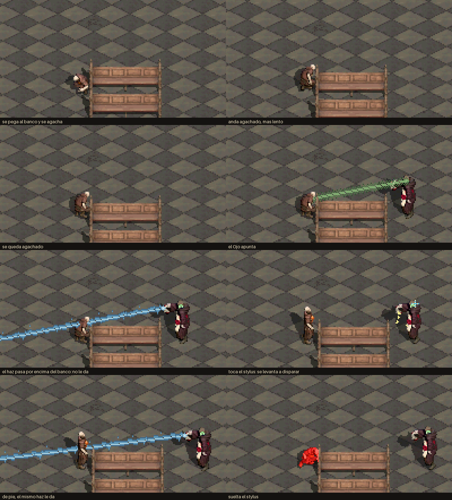

# Coberturas bajas: agacharse tras bancos y sacos

Rama `feat/coberturas-bajas`, 2026-11-18. Decisión de diseño: `DESIGN.md` §6.9, «Agacharse tras coberturas bajas».

## Qué hace
- Sin botón: el héroe se agacha solo al pegarse a un banco o a unos sacos, anda agachado a la mitad de velocidad y se levanta al separarse.
- No dispara agachado: al tocar el stylus se levanta al instante y dispara; al soltar, si sigue pegado, se vuelve a agachar.
- Protege por un solo lado: el haz del Ojo no le da si cruza la cobertura antes de llegar a él. Cuerpo a cuerpo, cargas y marea le dan igual.
- Colisión nueva «cobertura baja» (valor 2): bloquea cuerpos pero no balas. Bancos del kit y rects de sacos de los encuentros.

## Arte final: A2
El usuario eligió la variante A2 del andar agachado (cadera 15 u más baja, torso más inclinado que el clip de Mixamo, cabeza compensada). Altura media 20,8 px frente a 32,3 de pie (64 %). Variantes descartadas: A1, A3, la ronda previa `a` y el clip sin retocar (85 % de la altura de pie, no se leía agachado). El retoque es procedural y reproducible (`tools/characters/build_corazon.py`, `CROUCH_LEVELS`/`CROUCH_LEVEL`). El agachado quieto usa el fotograma 4 del andar (el más compacto en las 8 direcciones, pies juntos y cabeza baja).

## Escenario de la feature
`scenarios/cobertura_baja_agachado.json` (variante `cathedral-sandbox`): agachado el haz no le da (5 hp); de pie, el mismo haz sí (5 a 4).

La ronda en la que se eligió A2: [GIF](assets/abc_agachado_torso.gif), [8 direcciones](assets/abc_agachado_torso_8dir.png).

## Verificación
- Build 0 avisos nuevos; escenarios `-Tag coberturas` PASS; tests de host (kit, paridad de layout, boca del arma, ancla de suelo, contrato del blitter, guardarraíles) PASS. Se actualizaron `test_character_muzzle` y `test_sprite_ground_anchor` por el décimo personaje (`CHAR_HERO_CROUCH_WALK`).
- DS física (ROM `perf`, antes de A2): 60 FPS y coste de agacharse ~3 % del frame. A2 solo cambia el arte, no el render ni el presupuesto, así que no se midió de nuevo.
- Presupuestos: tiles del kit 948/1024; EWRAM 3,38 de 3,5 MiB.
- `main` se fusionó en la rama antes del cierre sin conflictos (remates, encuentros, piezas 3D, escala unificada).

## Deuda ajena anotada
- La plantilla `templates/blocksds-test/Makefile` decide `ENCOUNTERS_PROTO` mirando `DEFINES`, pero las variantes llegan por `CFLAGS`: todas las variantes sandbox llevan el prototipo de encuentros activo. Se parcheó temporalmente para compilar el sandbox del escenario. Arreglo pendiente en el repo de la skill.
- `fetch-device-log.ps1` corta a 60 s y el log pesa 3,7 MB.
- `scenarios/cathedral_bench_collision.json` está desfasado (los bancos con la semilla actual están en x=280).
