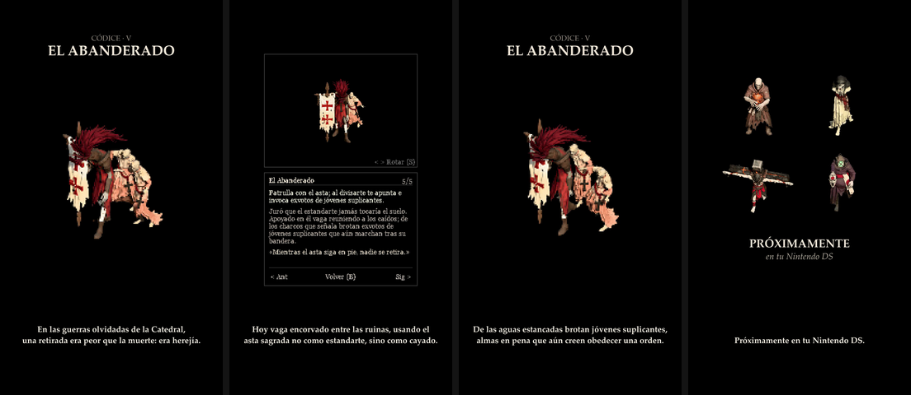
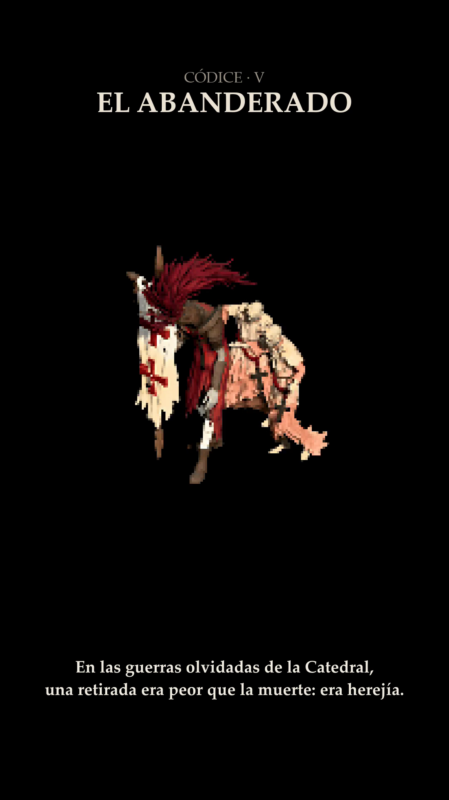
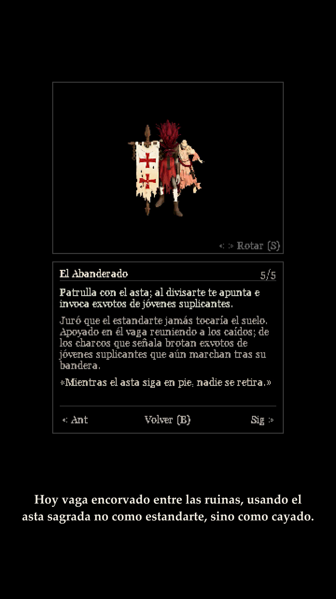
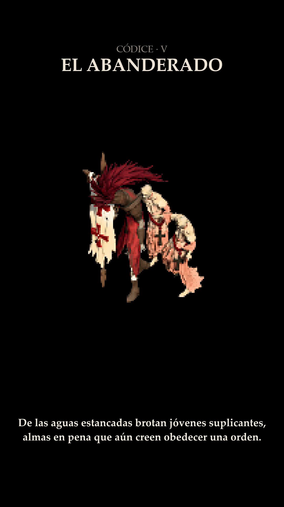
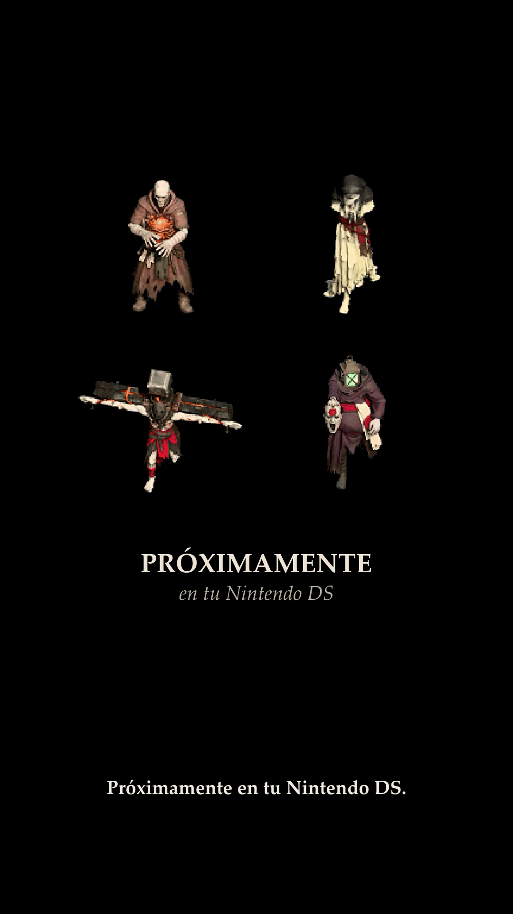

# Walkthrough: Vídeo de Lore de El Abanderado (`codice-abanderado`)

## Resumen

Generado el vídeo vertical de lore (9:16, 1080×1920) para redes sociales (TikTok, Reels, YouTube Shorts) correspondiente al quinto penitente del Códice, **El Abanderado** (`CÓDICE · V`), utilizando la skill estandarizada `codice-lore-video`.

### Claves de Dirección Artística y Montaje

1. **Sprite animado en diagonal izquierda (`1_SW.gif`, 160×160 px nativos):**
   - Ilustración en perspectiva isométrica diagonal hacia la izquierda (suroeste), mostrando al Abanderado caminando cabizbajo apoyado en el estandarte como bastón, dejando a su derecha y espalda en perfecta visibilidad la procesión de los dos exvotos de jóvenes suplicantes (monaguillos de cera) que avanzan con él.
   - Escalado píxel-perfecto con `flags=neighbor` sobre fondo negro puro (`#000000`), centrado con aire superior e inferior.
2. **Tarjeta de doble pantalla de Nintendo DS (`walkthroughs/abanderado-codice/assets/05_abanderado.png`):**
   - Transición central a la ficha auténtica capturada de la ROM, limpia y sin etiquetas de rol provisionales.
3. **Locución y música:**
   - Voz de Carmelo (`eleven_multilingual_v2`, `stability=0.28`, `similarity_boost=0.80`, `style=0.60`, `speed=1.0`) sintetizada frase a frase con pausas dramáticas de silencio (`0.50 s – 0.85 s`).
   - Guion con enfoque aspiracional y mitológico centrado en el pacto, el dogma inquebrantable de la no retirada y la invocación de almas en pena, sin descripciones literales ni evidentes de pantalla.
   - Música de fondo `cathedral_battle_loop.wav` atenuada al 9 % (`volume=0.09`) con fundidos suaves al inicio y al final.
4. **Subtitulado Palatino Linotype:**
   - Subtítulos `.ass` en color marfil (`#F2ECE0`) con fileteado negro, tipografía serif solemne (`Palatino Linotype`), `MarginV = 240` (respetando la zona inferior reservada para la interfaz de las plataformas) y sincronización milimétrica con cada frase.
5. **Cierre estándar del Códice:**
   - Pantalla final con mosaico 2×2 animado de penitentes sobre fondo negro puro y texto `PRÓXIMAMENTE / en tu Nintendo DS`.

---

## Evidencia Visual

### Tira de Control de Fotogramas (Cortejo diagonal izquierda SW)

### Fotogramas Individuales por Etapa

| 1. Apertura (`CÓDICE · V · EL ABANDERADO`) | 2. Ficha Nintendo DS | 3. Cortejo y Comportamiento | 4. Cierre Mosaico (`PRÓXIMAMENTE`) |
| :---: | :---: | :---: | :---: |
|  |  |  |  |

---

## Ficha Técnica del Vídeo Generado

- **Archivo:** `walkthroughs/codice-abanderado/assets/codice_05_abanderado.mp4` (centralizado en `assets/videos/codice_05_abanderado.mp4`)
- **Resolución:** 1080×1920 px (relación de aspecto vertical 9:16)
- **Duración:** 01:22.23 (~82,2 s)
- **Tasa de refresco:** 30 fps progresivo (H.264 / AAC)
- **Peso:** 14,4 MB (15.128.831 bytes)
- **Palabras de locución:** 126 palabras (10 frases, ritmo pausado con pausas dramáticas)
