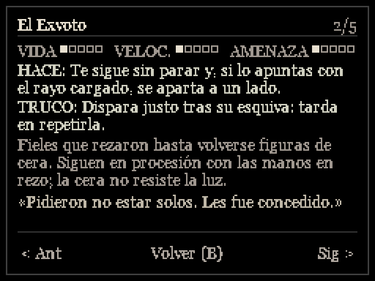
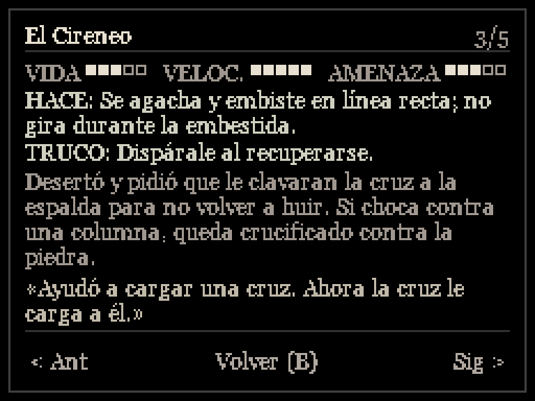
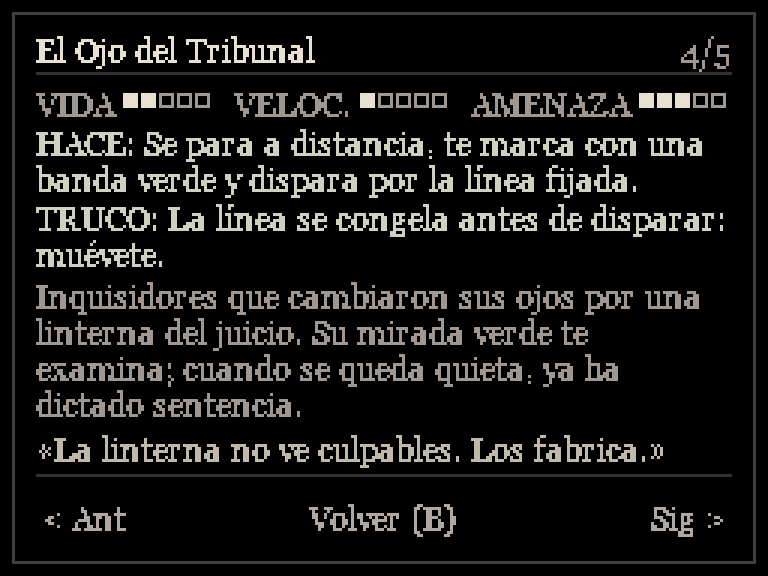
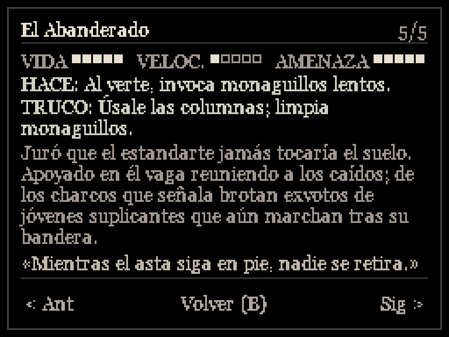
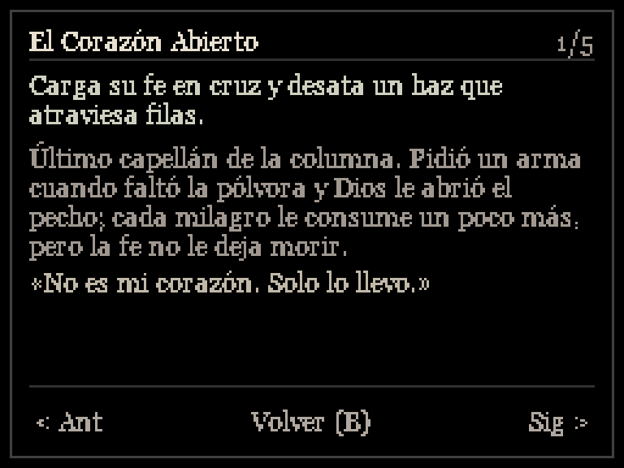

# Códice con datos de juego (`docs/codice-datos`, 2026-11-19)

Las fichas de los enemigos dejan de ser solo lore: cada una enseña cómo se comporta y cómo se le gana. Decisión escrita en `DESIGN.md` §6.11.1.

## Qué lleva cada ficha
Una fila `VIDA / VELOC. / AMENAZA` (1 a 5), una línea `HACE:` y una `TRUCO:`, y debajo el lore y la cita.

| Ficha | VIDA | VELOC. | AMENAZA |
| :--- | :--- | :--- | :--- |
| El Exvoto | 1 | 1 | 1 |
| El Cireneo | 3 | 5 (embestida) | 3 |
| El Ojo del Tribunal | 2 | 1 | 3 |
| El Abanderado (jefe) | 5 | 1 | 5 |

- El Exvoto es el mínimo de las tres escalas y los demás se miden contra él. Por debajo de él se queda en 1.
- `VIDA` y `VELOC.` salen de las tablas del acto I; `AMENAZA` es subjetiva, decidida con el usuario.
- El Corazón Abierto no lleva bloque (es el héroe). El Monaguillo no tiene ficha hasta que exista su lore.

## Evidencia (pantalla inferior de la ROM real, escenario `bestiary_tour`)
 
 

## Textos acortados para que cupieran
Cireneo `TRUCO` pierde lo de la columna (sigue en su lore); Abanderado `HACE` queda en una línea; el Ojo pierde pocas palabras. En el Ojo y el Abanderado la cita queda a ~2 px de la barra de navegación: no hay margen.

## Verificación
Compila sin warnings nuevos; escenario `bestiary_tour` PASS; subida a la DS verificada.
