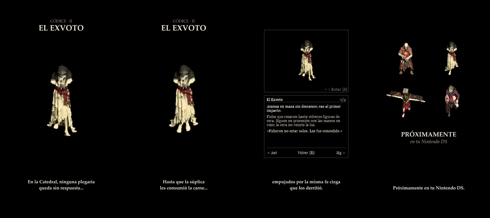
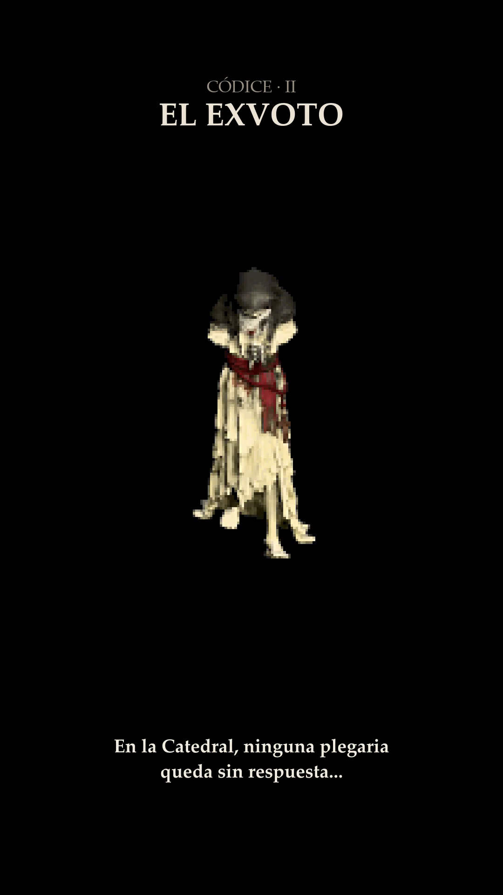
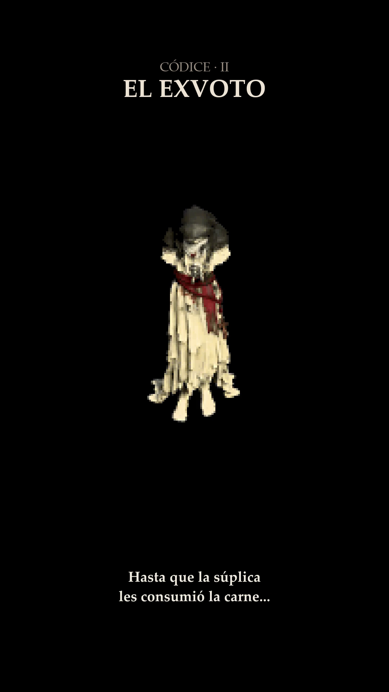
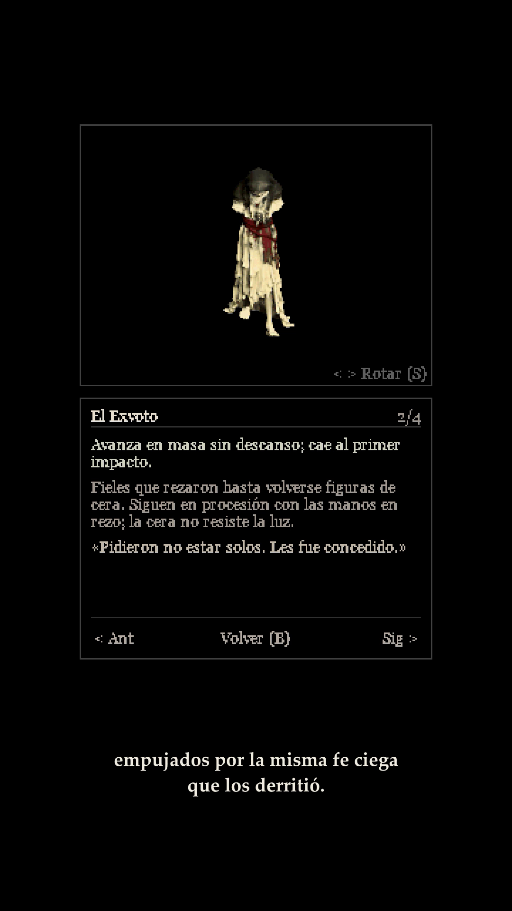
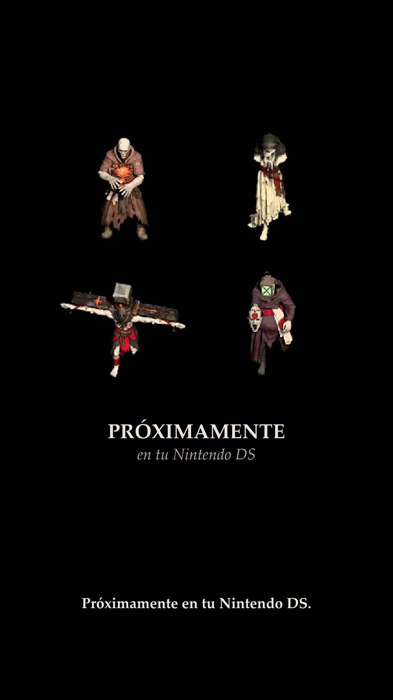

# Walkthrough: Vídeo de Lore de El Exvoto (`feat/video-lore-exvoto`)

## Resumen

Vídeo vertical de lore (9:16, 1080×1920) para redes sociales (TikTok, Reels, YouTube Shorts) correspondiente al segundo penitente del Códice, **El Exvoto** (`CÓDICE · II`), utilizando la skill estandarizada `codice-lore-video`.

### Claves de Dirección Artística y Montaje

1. **Ilustración frontal (`0_S.gif`, 160×160 px nativos):**
   - Animación de caminata en procesión con las manos juntas en oración perpétua sobre fondo negro puro (`#000000`).
   - Escalado píxel-perfecto con `flags=neighbor`.
2. **Tarjeta de doble pantalla de Nintendo DS (`walkthroughs/bestiario/assets/02_exvoto.png`):**
   - Transición central a la ficha auténtica capturada de la ROM, limpia y sin etiquetas de rol provisionales.
3. **Locución y música:**
   - Voz de Carmelo (`eleven_multilingual_v2`, `stability=0.28`, `similarity_boost=0.80`, `style=0.60`, `speed=1.0`) sintetizada frase a frase con pausas dramáticas de silencio (`0.40 s – 0.85 s`).
   - Música de fondo `cathedral_battle_loop.wav` atenuada al 9 % (`volume=0.09`) con fundidos suaves al inicio y al final.
4. **Subtitulado Palatino Linotype:**
   - Subtítulos `.ass` en color marfil (`#F2ECE0`) con fileteado negro, tipografía serif solemne (`Palatino Linotype`), `MarginV = 240` (respetando la zona inferior reservada para la interfaz de las plataformas) y sincronización milimétrica con cada frase.
5. **Cierre estándar del Códice:**
   - Pantalla final con mosaico 2×2 animado de los 4 penitentes sobre fondo negro puro y texto `PRÓXIMAMENTE / en tu Nintendo DS`.

---

## Evidencia Visual

### Tira de Control de Fotogramas (Secuencia completa)

### Fotogramas Individuales por Etapa

| 1. Apertura (`CÓDICE · II · EL EXVOTO`) | 2. Ficha Nintendo DS | 3. Lore y Procesión | 4. Cierre Mosaico (`PRÓXIMAMENTE`) |
| :---: | :---: | :---: | :---: |
|  |  |  |  |

---

## Ficha Técnica del Vídeo Generado

- **Archivo:** `walkthroughs/codice-exvoto/assets/codice_02_exvoto.mp4` (centralizado en `assets/videos/codice_02_exvoto.mp4`)
- **Resolución:** 1080×1920 px (relación de aspecto vertical 9:16)
- **Duración:** 01:06.40 (~66,4 s)
- **Tasa de refresco:** 30 fps progresivo (H.264 / AAC)
- **Peso:** 7,3 MB (7.626.374 bytes)
