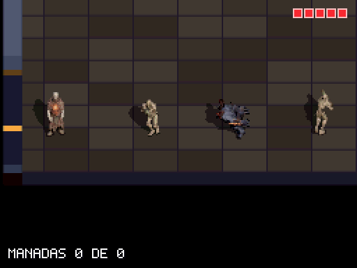
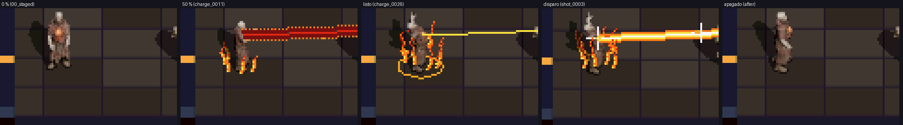
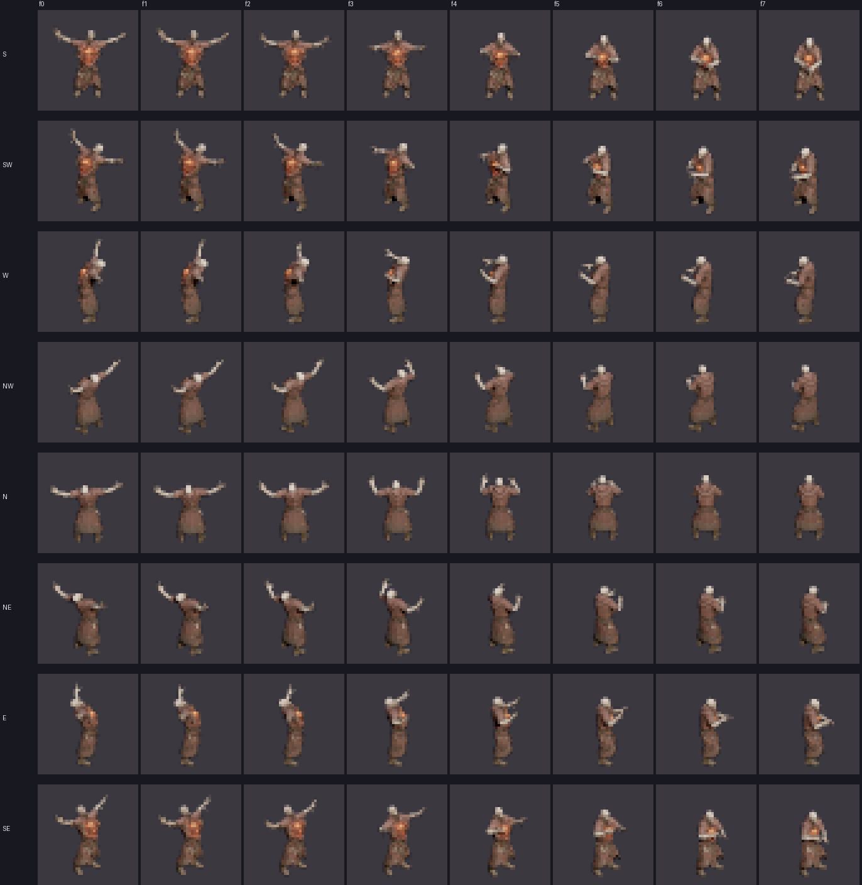
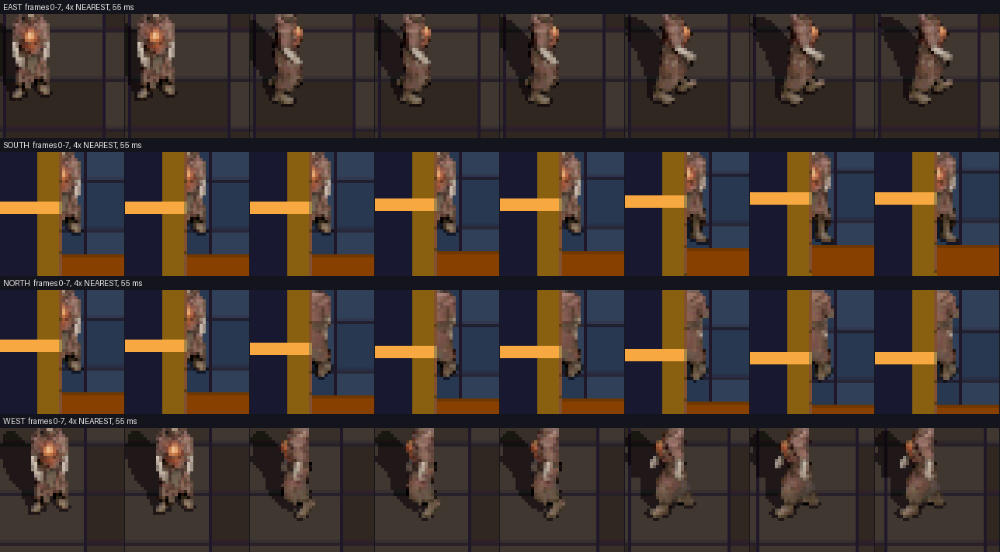
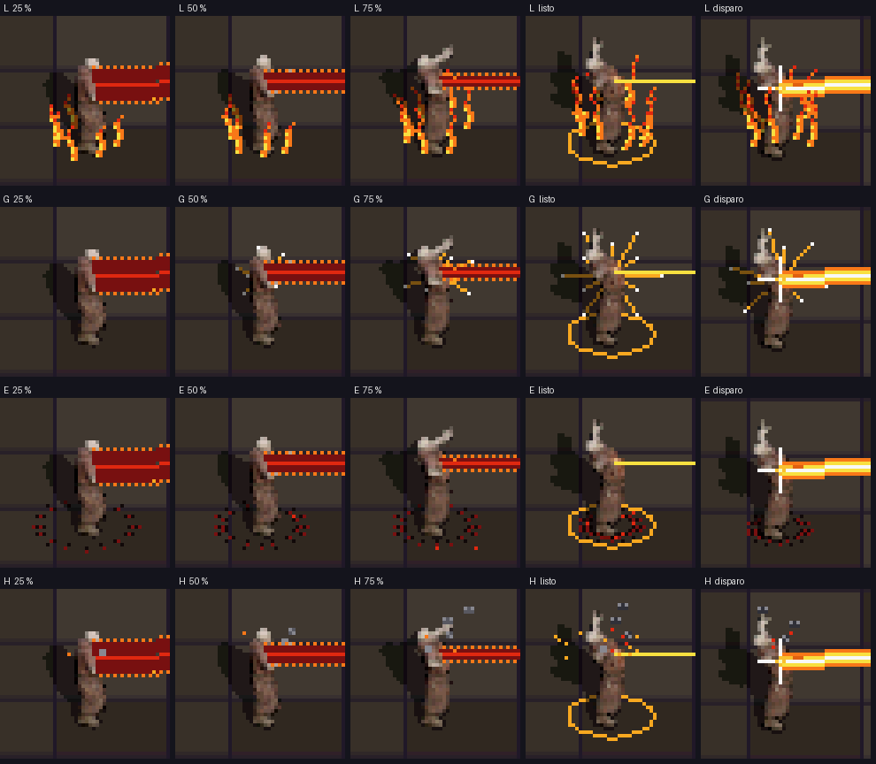

# El Corazón Abierto como héroe (2026-11-11/12)

Rama `feat/corazon-abierto`. Consolida el personaje elegido en `walkthroughs/concepto-demo-personajes/`: modelo, andar, carga y disparo, rayo desde el pecho y efectos en estilo «fuego sagrado». Decisiones en `DESIGN.md` §6.10 («Corazón Abierto en el juego»). Implementado por subagentes Haiku; coordinación, revisión de capturas y documentación en la sesión principal.

## Qué hay en la ROM

- **Héroe nuevo** (`CHAR_HERO`): modelo Tripo con rig Mixamo en `assets/models/characters/corazon/`, sprite en `assets/sprites/characters/corazon/` (8 direcciones × 8 frames, 31-33 px de alto, celda 40).
- **Andar:** el «Walking» genérico de Mixamo (`assets/models/animations/walk/walk_normal.fbx`) adaptado en Blender al esqueleto de Tripo. `ticksPerFrame` 4 y velocidad 326 (8.8), como el marine.
- **Carga y disparo:** el clip de disparo del zip (`assets/sprites/characters/corazon_disparo/`, 8 × 8 frames, ~410 KB más de ROM). La carga lo recorre al revés según el progreso (`7 - ((prog * 7) >> 8)`), se queda en cruz al estar listo y al soltar se reproduce al derecho a 3 frames de juego por frame.
- **Rayo desde el pecho:** el lab calcula el `muzzle` desde el hueso `mixamorig:Spine2` (`--muzzleBone`, `--muzzleForward 0.05`, `--fitZoom 0.86` en `tools/lab/export_character_headless.cjs`). En juego, `g_hero_shot_muzzle` da el pecho del frame del clip mostrado.
- **Haz «fuego»** del francotirador (único; `SELECT` ya solo cambia escopeta y granada).
- **Aura de carga:** cuatro opciones en comparación con `Y` (letra en el HUD de depuración): L llamas, G resplandor, E corona de espinas, H ceniza.

## Rondas de comparación

1. **Haz** (A referencia, B brasa, C fuego) y **aura** (K referencia, F1 brasas, F2 llamas, F3 rayos dorados). Elegidos C y F2. Registro: `assets/contacto_haz.png`, `assets/contacto_aura.png`.
2. **Más auras:** G resplandor, E corona y H ceniza junto a las llamas (`assets/contacto_aura2.png`, `assets/aura2_*.gif`). En capturas, L es la más legible; G se lee bien al estar listo; E (espinas negras sobre suelo oscuro) y H (humo como motas) no se leen todavía. Elección pendiente tras jugarla en la DS.

## Tropiezos y lecciones

- **El primer andar se veía mal.** Se copió la orientación absoluta de cada hueso del andar del nigromante, y la pose de reposo de Tripo no coincide con la de Mixamo: el torso se retorcía. Funcionó aplicar a cada hueso solo el giro respecto a su reposo (`P = Rb⁻¹ · Dp⁻¹ · Db · Rb`).
- **El sprite encogió un 30 % y el rayo salía 9 px por detrás.** El andar de Mixamo no era «in place» y el retarget restó la media de la cadera, no la tendencia: la cadera avanzaba 0,75 m y el lab encuadró todo el recorrido. Con la traslación horizontal de la cadera fija, el sprite volvió a 31-33 px y el `muzzle` al pecho. Un agente intentó compensarlo acelerando la animación; se deshizo.
- **El clip del zip es el disparo, no la carga.** Un agente se fió del nombre del clip (la descripción del prompt de carga) en vez de mirar los frames; el usuario lo corrigió tras verlo en el lab.
- Las capturas de andar al norte y al sur del sandbox pasan detrás de una columna y no valen como evidencia.

## Verificación

- Compilación normal y sandbox sin warnings; tests de contrato (`tests/test_hero_shot_clip_contract.py`, `test_weapons_contract.py`, `test_sandbox_contract.py`) y escenarios `sandbox_sniper_fire*`, `sniper_hit_sweep_*`, `sandbox_hero_walk_*` en PASS antes del merge con `main`.
- ROM subida a la DS el 2026-11-12 (sin `PERF_PROFILE`) para verla y jugarla.

## Pendiente

- **Medir 60 FPS en la DS con `PERF_PROFILE`** (regla 6) con el haz y cada aura, antes de mergear a `main`.
- Elegir aura y borrar las descartadas y el selector `Y`.
- Las cruces cian de impacto son la chispa genérica de `main.c` (compartida con escopeta y granada); decidir si el rayo lleva una propia.
- El ciclo de piernas va al doble de velocidad que el clip original y el paso del juego es un ~24 % más largo que el del lab: juzgar en la DS si resbala.
