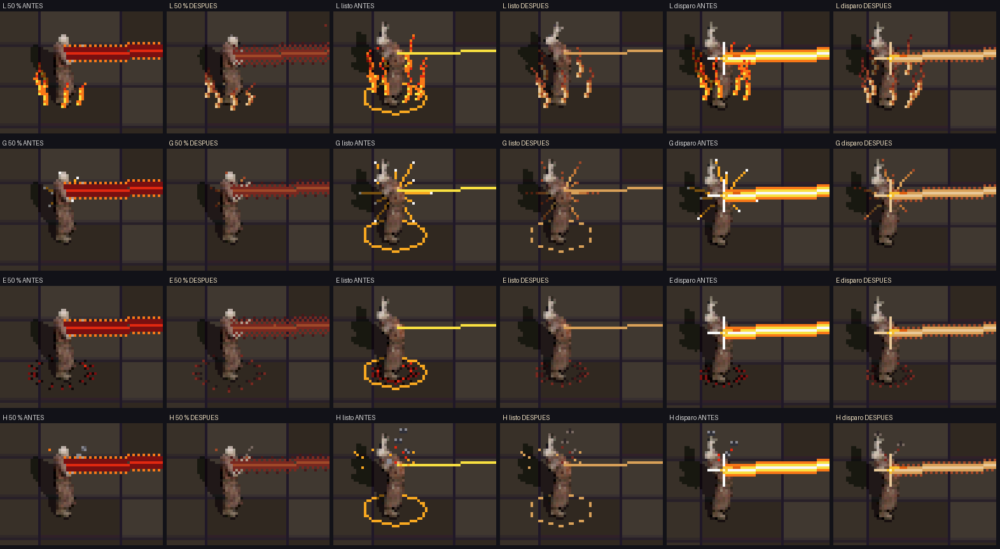
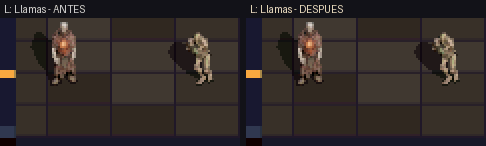
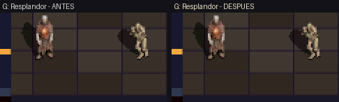
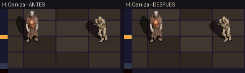

# Rediseño de paleta y suavizado de VFX del Corazón Abierto (2026-11-13)

Rama `feat/corazon-vfx-paleta`. Rediseña los efectos visuales del Corazón Abierto (láser de carga y disparo, chispas/cruz de impacto y las cuatro auras `L`, `G`, `E`, `H`) para eliminar el aspecto saturado y «dibujado» y alinearlos con la paleta cálida y el acabado prerenderizado del personaje y la catedral.

## Qué se ha cambiado en la ROM (`source/weapons.c`)

1. **Paleta dedicada `FX_SH_*` (desaturada y cálida):**
   - Sustituye los tonos neón (`RGB15(31,28,8)`, `RGB15(31,15,3)`, `RGB15(28,5,2)`, `RGB15(31,31,31)`) por una rampa cálida coherente con el corazón del pecho del personaje:
     - `FX_SH_IVORY` `RGB15(29, 25, 19)` (núcleo cálido de fulgor, sin blanco puro)
     - `FX_SH_GOLD` `RGB15(27, 20, 11)` (oro antiguo)
     - `FX_SH_AMBER` `RGB15(24, 15, 7)` (ámbar)
     - `FX_SH_EMBER` `RGB15(20, 9, 5)` (brasa terracota)
     - `FX_SH_CRIMSON` `RGB15(15, 5, 4)` (carmesí / óxido sagrado)
     - `FX_SH_DEEP` `RGB15(9, 3, 3)` (sangre seca)
     - `FX_SH_ASH_A/B/C` `RGB15(15, 13, 12)` / `(10, 9, 8)` / `(6, 5, 5)` (ceniza cálida en lugar de gris azulado)
     - `FX_BLACK` `RGB15(4, 3, 3)` (hierro cálido para las espinas)
2. **Suavizado y fulgor (menos «dibujado»):**
   - **Banda de colimación (`aim_band`):** perfil degradado con borde exterior tramado orgánico (hash espacial+temporal) en lugar de banda sólida con damero rígido. En `AIM_READY`, filamento de 1 px `FX_SH_IVORY` / `FX_SH_GOLD`.
   - **Estela de disparo (`render_trail`):** núcleo `FX_SH_IVORY`, brillo interior `FX_SH_GOLD`/`FX_SH_AMBER` y halo exterior tramado (`draw_line_dither`) en `FX_SH_EMBER` para difuminar los bordes.
   - **Anillos de suelo (`READY` y aura `E`):** trazo discontinuo (`dash = 2`) en lugar de elipse sólida de 1 px.
   - **Aura `L` (llamas):** núcleo marfil/oro antiguo en la base, brasa en el cuerpo y carmesí/sangre seca en las puntas.
   - **Aura `G` (resplandor):** rayos cónicos por tramos (`glow_ray`) que se atenúan de marfil/oro a ámbar y brasa tramada en el tercio exterior, sin punto blanco duro en la punta.
   - **Aura `E` (espinas):** hierro cálido y sangre seca con destello carmesí en la punta y anillo discontinuo.
   - **Aura `H` (ceniza):** volutas de ceniza cálida con bordes redondeados/tramados (sin bloques rectangulares) y brasas cálidas.

## Comparativa A/B (Antes vs Después, capturas reales de la ROM)

### Hoja de contacto (4x NEAREST: 50 %, listo, disparo)

### L — Llamas + Láser

### G — Resplandor + Láser

### E — Corona de espinas + Láser

### H — Ceniza + Láser

## Verificación

- Compilación `default` (`dungeonds.nds`) y `sandbox` (`dungeonds-sandbox.nds`) con **0 warnings**.
- `tests/test_weapons_contract.py` (58 tests) y suite completa de `hostTests` en PASS.
- Escenarios `sandbox_sniper_fire_aura_L`, `G`, `E`, `H` en **PASS** (base de las capturas A/B).
- Pendiente: revisión visual del usuario para elegir aura definitiva (y decidir si se ajusta algún matiz antes de medir `PERF_PROFILE` en la DS y mergear a `main`).
