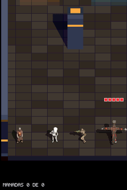
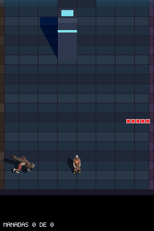

# Recorte de Sprites y Máscaras de Sombra en ROM

**Fecha:** 2026-11-13  
**Rama:** `perf/crop-sprites-shadows`

## Qué se ha hecho

El análisis de `dungeonds.nds` (2.871.808 B / 2,74 MiB) mostró que el 91,9 % de la ROM estaba en `source/player_sprite.c` (2,52 MiB), con las máscaras de sombra guardadas a `80×80` completo (1,07 MiB) y los sprites BGR555 sin recortar (1,44 MiB, >81 % píxeles `0x0000`).

1. **`tools/generate_player_sprites_c.py`**: recorta cada frame de sprite y cada máscara de sombra 4 bpp a su caja mínima `[x, y, w, h]`, generando tablas planas con índices (`*_frame_offsets`, `*_frame_bounds`, `*_shadow_offsets`, `*_shadow_bounds`).
2. **`include/player_sprite.h` y `source/player_sprite.c`**: adaptados al formato recortado (`player_sprite.c` pasa de 14,69 MB a 3,64 MB).
3. **`source/main.c`**: `draw_shadow_mask`, `draw_player`, `draw_enemy` y `death_chunks_spawn` leen los datos recortados directamente; se eliminan `measure_frame_bounds()` y los arrays de bounds en RAM al arranque.
4. **Tests de contrato**: actualizados `tests/test_sprite_ground_anchor.py`, `tests/test_hero_shot_clip_contract.py` y `tests/test_sniper_hit_volume.py`.

## Resultado

- **ROM (`dungeonds.nds`):** **2.871.808 B (2,74 MiB) → 1.048.064 B (1,00 MiB)** (**-63,5 %**, ~1,74 MiB menos, incluyendo `sfx_bank.c` y `g_charger_telegraph_frames`).
- **Compilación:** `default` y `sandbox` limpias (`warnings=0`).
- **Tests de host:** `test_sprite_ground_anchor`, `test_hero_shot_clip_contract`, `test_sniper_hit_volume`, `test_character_muzzle` y `test_charger_contract` — **41/41 OK**.
- **DeSmuME headless:** `enemy_sniper_row_skeleton_dies_in_one_shot` (145 frames) y `enemy_charger_lunge_hits_player` (130 frames) — **PASS**.
- **Nintendo DS física:** subida por FTP (`1.048.064 B`) y validada visualmente por el usuario.

## Evidencia

