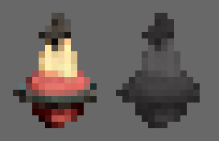
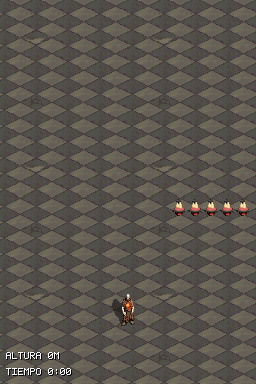
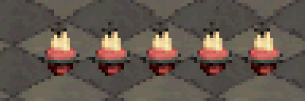

# Walkthrough: Demo para un colega (`feat/demo-colega`)

**Fecha:** 2026-11-14  
**Diseño:** `DESIGN.md` §6.9.1c

## Qué se ha hecho

1. **Vida en el HUD con Sagrados Corazones (`14×18` px, sin outline):**
   - Modelo 3D del Sagrado Corazón (`assets/models/hud/sacred_heart/tripo_convert_d96dac8c-dc43-495d-9495-f318e45fae13.fbx`) pre-renderizado con el lab (`tools/lab/export_map_package_headless.cjs --legibility c2`, iluminación `neutral`, elevación `0°`) mediante `tools/hud/prerender_hud_heart.py`.
   - Reducción y post-proceso C2 (`tools/hud/bake_hud_heart.py`: LANCZOS premultiplicado, umbral alfa `0.30`, `soft_contrast(1.45)`, `sharpen_rgba(0.5)`) y conversión a BGR555 redondeado (`tools/generate_hud_icons_c.py`) en `source/hud_icons_gfx.c` e `include/hud_icons_gfx.h`.
   - Pintado en `draw_run_hud` (`source/main.c`) arriba a la derecha de la pantalla inferior cuando el jugador está vivo (lleno = vida actual, apagado = vida perdida).

2. **Arma única en la ROM principal:**
   - El héroe arranca con el láser (`WEAPON_SNIPER`) y `L` deja de ciclar armas cuando `TEST_WEAPON_CYCLE == 0` (`include/gameplay.h`, `source/gameplay.c`, `source/main.c`).
   - Las variantes de prueba (`sandbox`, `playground`, `stress`, `godrays`) conservan `TEST_WEAPON_CYCLE == 1` (escopeta inicial y cambio con `L`).
   - `SELECT` (estilo de efectos) e `Y` (aura de carga) siguen activos en la ROM principal para comparar gráficos.

3. **Contratos y escenarios actualizados:**
   - Nuevo contrato `tests/test_demo_contract.py` registrado en `.ds-game-dev/project.json`.
   - Nuevo escenario `scenarios/demo_hud_hearts.json` y actualización de `scenarios/weapons_switching_and_touch.json` y `scenarios/sniper_aims_upper_screen.json` para el inicio directo con el láser.
   - Prompts preparados para las siguientes sesiones (`walkthroughs/demo-colega/prompts-siguientes-sesiones.md`: menú inicial/pausa y bestiario).

## Evidencia visual

- Iconos `14×18` px (8x NEAREST):

- Pantalla inferior en ROM real (DeSmuME) y recorte 4x NEAREST del HUD:

## Verificación

- **Compilación ROM principal (`default`):** `DS_BUILD=PASS`, `0` warnings.
- **Compilación variante `playground`:** `DS_BUILD=PASS`, `0` warnings.
- **Tests de host:** 16/16 suites en verde (incluyendo `tests/test_demo_contract.py`).
- **Escenarios headless (DeSmuME):**
  - `demo_hud_hearts`: PASS (210 frames).
  - `weapons_switching_and_touch`: PASS (143 frames).
  - `sniper_aims_upper_screen`: PASS (113 frames).
- **Pendiente antes de mergear:** probar en la DS física (`upload-rom.ps1` + verificación de 60 FPS).
