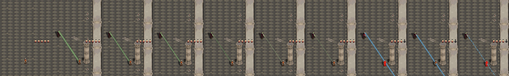
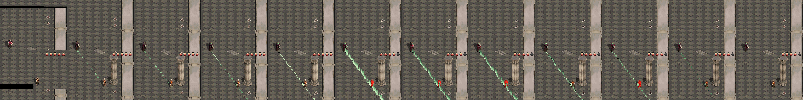
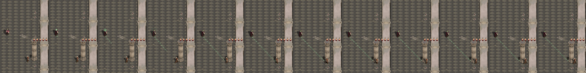
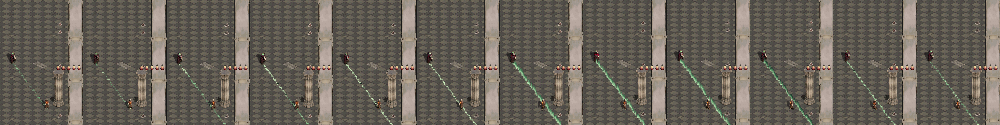
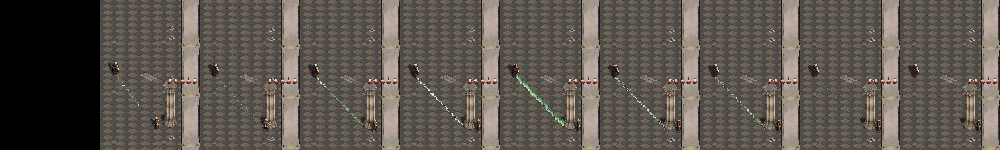
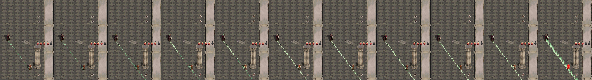
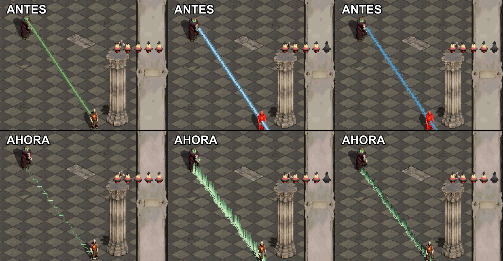
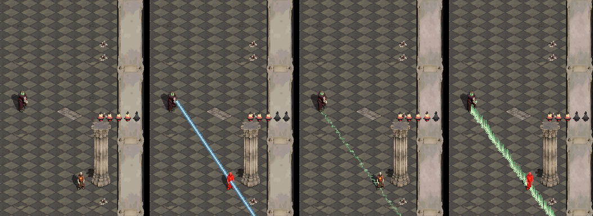
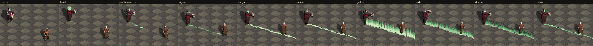

# Devlog 2: antes y después del Ojo del Tribunal

Entrega de vídeo para redes; no hay cambios en el juego de `main`.

## Qué se hizo

Vídeo vertical de 36 s (1080x1920) con formato antes/después: el Ojo del Tribunal disparaba un láser de aspecto ciencia ficción y ahora escribe la sentencia en el suelo (grieta con ojos, variante C1 «Fiel»), te sigue, se fija y arde. Planos didácticos: te pilla, esquivas saliendo de la línea, te escondes tras una columna; pantalla partida antes/ahora; gancho y cierre grabados con el móvil sobre la DS real.

- Planos de la ROM grabados en una sala de rodaje ad hoc (variante `rodaje-ojo`): rama `feat/rodaje-ojo` (95e31620, versión nueva) y `feat/rodaje-ojo-antes` (a695a533, versión del láser). Son variantes solo para rodar; no se mergean.
- Montaje en Remotion fuera del repo (`C:\codexlocal\devlog`, composición `Devlog2`, episodio `ep02`), voz y subtítulos palabra a palabra, rótulos ANTES/AHORA con la caja dorada del juego. Final: `C:\codexlocal\devlog\out\ep02_final.mp4`.
- La ROM de rodaje se subió a la DS sustituyendo a `dungeonds.nds`; hay que volver a subir la normal para jugar.

## Evidencia

Guion: [`guion.html`](guion.html). Los GIF y MP4 de revisión (`review/`, ~12 MB) no se versionan.

| Plano | Hoja de contacto |
| :--- | :--- |
| Antes (láser) |  |
| Te pilla |  |
| Te sigue |  |
| Esquiva |  |
| Columna |  |
| Ojos |  |
| Pantalla partida |  |
| Sala de rodaje |  |
| Variante C1 |  |

Láser anterior en movimiento: [`assets/antes_ojo.gif`](assets/antes_ojo.gif).

## MDs

Sin cambios en los documentos del juego.
